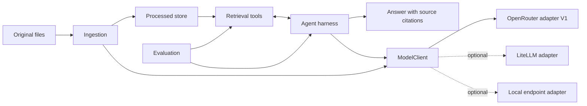

# Personal Knowledge Agent: Foundation

This document defines the system's purpose, boundaries, and order of work. It is the reference for focused implementation plans, not an implementation plan itself. `knowledge-agent-architecture.md` records the original design brief; the current user requirements take precedence where they differ.

## Outcome

The agent should answer exploratory questions across a mixed personal knowledge base even when the question's wording does not appear in a source. It should find related concepts, inspect the strongest original passages, reason across sources, and cite the passages that support its answer.

The first proof is a question about getting early B2B customers without paid ads. A good answer should discover relevant ideas such as direct outreach, founder-led sales, manual onboarding, networks, and early distribution, and distinguish source evidence from the agent's synthesis.

## System principles

1. **Original files are the authority.** Keep source files unchanged. Generated summaries, context, topics, and evidence cards help discovery but never replace source passages as evidence.
2. **Provenance is continuous.** Every processed artifact must resolve to a document ID, the source hash captured by its ingestion run, and an exact source span. One complete run is active for answers; experimental and historical runs remain available for comparison. Reuploading a transcript replaces the active derived view after ingestion succeeds.
3. **Retrieval uses several signals.** Combine embeddings, lexical search, and structured extracted knowledge. Evaluate each signal and their combination against known relevant sources.
4. **The agent can investigate.** It may reformulate a question, search again, inspect neighboring material, and compare sources. The application owns the loop and its limits.
5. **Models are replaceable.** Agent, extraction, embedding, and optional reranking roles are separately configured. The application's thin `ModelClient` owns the stable interface. A direct OpenRouter adapter is the V1 implementation; LiteLLM and local endpoint adapters can be added without changing ingestion, retrieval, or the agent harness. V1 must be capable of running entirely on open-weight models; OpenRouter is an inference gateway, not a requirement to use a proprietary model. Selected agent models must be checked for reliable tool use or structured actions rather than assumed compatible because they share an endpoint.
6. **Behavior is inspectable.** Prompts, chunk boundaries, extraction output, retrieval ranks, tool calls, and citation decisions should be available for debugging and evaluation.
7. **V1 stays small.** Use Python, FastAPI, Supabase Postgres with pgvector and full-text search, and a minimal interface. Add infrastructure only when evaluation shows a need.

## Component boundaries

| Component | Owns | Does not own |
|---|---|---|
| Source library and catalog | Original files, stable document identity, source metadata | Generated knowledge or search ranking |
| Ingestion | Parsing, normalization, structural chunking, enrichment, embeddings, source mapping | Answer generation |
| Processed store | One active run per document, retained experimental runs, extracted knowledge, versioned embedding indexes, artifact relationships | Source-of-truth files |
| Retrieval layer | A small set of semantic, keyword, evidence, document, and source-reading operations | The agent's reasoning policy |
| Agent harness | Tool loop, search policy, evidence sufficiency, answer synthesis, citation requirements | Provider-specific agent runtime |
| `ModelClient` and adapters | Stable model operations and normalized responses; provider-specific calls stay inside adapters | Search, orchestration, or source permissions |
| Evaluation | Labeled questions, retrieval and answer checks, cost/search traces | Production answers |
| Interface | Asking questions and viewing answers, citations, and excerpts | Direct access to the knowledge store |



## Original file location

The recommended starting point is a normal local folder synced with a cloud drive the user already uses. For example, a `Knowledge Sources/podcast-transcripts/` folder can hold the original text or Markdown files. The files stay readable in a file manager and through that drive's own interface. A configurable source root lets ingestion read the local synced copy. That folder remains the authoritative file library; the processed store may retain source snapshots associated with ingestion runs so old experiments remain reproducible.

This is a proposed storage choice until the user's existing sync provider is known. The first implementation plan should define how source links open the original transcript from the interface. A separate backup may be useful later; sync alone should not be treated as version history.

## Repository shape

The repository should keep original files, application code, database changes, prompts, evaluations, and focused plans visibly separate:

```text
sources/                 Shareable samples and source-catalog files; private originals may live outside the repo
app/                     Ingestion, retrieval, agent, model adapter, and API code
prompts/                 Versioned extraction and agent instructions
supabase/migrations/     Processed-store schema changes
evals/                   Questions, expected sources, and run results
tests/                   Code and integration checks
docs/plans/              Focused ce:plan outputs for individual work packages
README.md                Setup and operating instructions
.env.example             Configuration names without secrets
```

The first source plan will decide which transcript metadata belongs in the repository and how the configured external source root is addressed. Podcast transcripts are the first real source type. Notes, books, and summaries follow after the transcript path works.

## Data relationships to preserve

At the conceptual level, a stable **document** points to the current original transcript. An **ingestion run** records the source hash, parser, prompts, models, and enough captured source text to reproduce its evaluation. Its **chunks** retain exact source locations. **Context, topics, evidence cards, and summaries** identify the run and source material from which they were derived. A successful reupload activates a complete new run for that document; a failed run does not leave a partial searchable document. Prior runs may remain for experiments and comparison, but only the active run is served for normal questions. Their retention and cleanup rules belong to the storage plan.

**Embedding indexes have a different lifecycle.** Each index has an `embedding_spec`: provider, model, model version, dimensions, distance metric, input recipe version, context prompt version, chunking version, and creation time. A changed model, dimension, or recipe requires a new complete embedding index. The old index remains available until the new one is evaluated and selected. The exact schema and cutover mechanics belong to the storage plan.

The Supabase schema plan will settle tables, keys, indexes, and access rules. The initial candidate concepts are documents, ingestion runs, chunks, evidence cards, summaries, topics, embedding specs, and embeddings. Entities should be added only if their retrieval value and identity rules are clear.

## Retrieval and answer path

For each question, the agent forms a few plausible search angles. pgvector search and Postgres full-text search ranked with `ts_rank` run independently; reciprocal rank fusion (RRF) merges their positions into a candidate list. **Evidence-card search is a separate V1 retrieval tool** that the agent chooses when it needs structured examples, tactics, or claims. Cards do not automatically join the RRF pool. The agent reads the most relevant original chunks, searches again when a material angle is missing, and writes an answer grounded in inspected excerpts. Evaluation will test whether the card tool improves answers or merely adds searches.

Postgres's built-in full-text ranking is **not BM25**. It is the agreed V1 lexical baseline. If evaluation shows weak lexical retrieval, a focused plan can test true BM25. Supabase documents a ParadeDB integration in which a logical replica provides BM25 search; that would be an additional service, justified only by measured need. Reranking is also gated by evaluation. Citation validation checks that each cited span supports the nearby claim, not merely that its ID exists.

| Stage | Search stack | Decision gate |
|---|---|---|
| V1 | pgvector + Postgres FTS/`ts_rank` + RRF | Establish retrieval and answer baselines. |
| V2 candidate | pgvector + BM25 + RRF, potentially through ParadeDB | Add only if lexical retrieval is weak enough to justify another service. |
| V3 candidate | Add a reranker | Adopt only if it improves the evals enough to justify latency and cost. |

The retrieval plan will define the exact tool contracts, ranking method, filters, and result budgets. The agent plan will define loop states, stopping rules, tool limits, and citation behavior. Neither belongs in this foundation document.

## Work map

Each row is a separate candidate for a focused `ce:plan` run. Plans should name their own acceptance checks and be small enough to implement and evaluate without claiming the whole system is complete.

| Order | Focused work | Proof it should produce |
|---|---|---|
| 1 | Podcast transcript source handling and ingestion contracts | Real transcript files have stable IDs, metadata, exact location mapping, and validated intermediate records. The eval directory begins with representative questions tied to these transcripts. |
| 2 | Mixed Markdown ingestion | Transcripts, notes, articles, highlights, and book exports produce source-linked fixed and structural chunks. Optional context, evidence cards, summaries, and embeddings retain their source and version relationships. Retrieval comparisons begin after step 3 supplies search. |
| 3 | Supabase storage and search | Processed artifacts are written and retrieved by semantic and lexical search without losing provenance. |
| 4 | Retrieval API and agent loop | The agent can search more than once, inspect sources, and answer with validated citations. |
| 5 | Evaluation and tuning | A gold set targeting 30-50 real questions reveals retrieval misses, unsupported claims, citation errors, incomplete synthesis, and unnecessary searches. |
| 6 | Minimal interface and corpus expansion | A user can ask, see cited excerpts, and add notes, books, and summaries after the transcript path works. |

The early work should use a small, known corpus. Evaluation starts in row 1 and accompanies each later package. The first end-to-end checkpoint spans rows 1-4: source file → ingestion → Supabase → hybrid retrieval → multi-step agent → cited answer. Later work improves measured quality and usability.

## Decisions for focused plans to carry forward

- **First source:** Podcast transcripts. Preserve speaker exchanges, Q&A pairs, complete stories, and topic changes. Later note/book plans should preserve headings and paragraphs.
- **Replacement and experiments:** Reuploading a transcript runs ordinary ingestion and switches its active chunks, cards, summaries, and other derived artifacts only when the new run succeeds. Keep experimental and historical runs long enough to compare chunking, prompts, and embeddings; they are not served in ordinary answers. Long-term source-file version management is outside the first work package.
- **Chunking:** Start with structural chunks around 600-1,000 tokens and roughly 10% overlap. The deliberately simple baseline is fixed 800-token chunks, 10% overlap, and no enrichment. Overlapping source spans need deduplication in retrieval and evaluation.
- **Evidence cards:** Start with `type`, `statement`, nullable `situation`, `action`, and `result`, `principle`, `evidence_span`, `chunk_id`, and `document_id`. Mark `principle` as derived interpretation. `evidence_span` must occur in `chunk.raw_text`; cards that fail deterministic validation never enter search. Missing facts remain null rather than being inferred.
- **Embedding versions:** Record the full `embedding_spec` above and build a complete parallel index when it changes. Compare the new and old indexes on the same evaluation set before switching the active one.
- **Search:** V1 retrieves vector and Postgres FTS/`ts_rank` top-K lists independently and combines ranks with RRF. Evidence cards remain a separate agent-selected tool. BM25 through a separately evaluated search layer and reranking are later candidates, not V1 dependencies.
- **Access:** V1 contains personal transcripts, notes, and books only. Customer-specific data and its authorization model come later.

## Evaluation contract

Build a gold set of roughly 30-50 real questions with manually labeled relevant chunks. Mark the evidence that **must** be found separately from useful additional evidence. Include single-source, multi-source synthesis, recurring-pattern or “find all,” and negative questions with no supporting evidence.

Retrieval evaluation reports Recall@5, Recall@10, and especially Recall@20. Answer evaluation is separate: check whether citations point to exact supporting spans and whether the answer is **supported, complete, balanced, and calibrated**. A topically related span is not a correct citation. Claims about repeated patterns require multiple independent supporting passages. Record searches and token use so improvements can be weighed against cost.

The chunking and context tests isolate one change at a time:

| Experiment | Control | Treatment | Question |
|---|---|---|---|
| A: chunking | Fixed 800-token chunks, 10% overlap, raw text | Structural 600-1,000-token chunks, roughly 10% overlap, raw text | Does chunking improve Recall@20? |
| B: context | Structural chunks, raw text | The same structural chunks with chunk-specific context | Does context improve Recall@20 beyond chunking? |

Fixed 800-token raw chunks remain the overall baseline. Keep the embedding model and retrieval policy fixed within A and B. Separate search comparisons then measure semantic, Postgres FTS, and RRF; a later reranker test holds the winning candidate generation fixed. A focused plan will specify the comparison order, evidence-card on/off test, and exact gold-set labeling rules.

## Choices still open

- Which existing cloud drive, if any, should sync the original transcript folder?
- What format and metadata do the first real transcript files contain, including speakers and timestamps?
- How should the first UI open an original file: local path, cloud-drive link, or both?

## Boundaries for V1

The intended V1 stack is Python, FastAPI, Supabase Postgres, pgvector, Postgres full-text search, an explicit in-code agent loop, the application's `ModelClient` with a direct OpenRouter adapter, and a simple UI. Every model role can be filled with an open-weight model. LiteLLM is an optional later adapter when multiple gateways or local hosting justify it. A model router, knowledge graph, Neo4j, Kafka, OpenSearch, Kubernetes, and multiple specialized agents require evidence from V1 before they enter the work map.

The first focused `ce:plan` run should cover **podcast transcript source handling and ingestion contracts** only. Once that contract is agreed, later plans can specify chunking and enrichment, the Supabase schema, retrieval, and the agent loop against stable inputs.

## Research informing the experiments

- [New Relic's AWS case study](https://aws.amazon.com/blogs/machine-learning/new-relic-transforms-productivity-with-generative-ai-on-aws/) reports that hierarchical chunking worked best in its own tests. That motivates an experiment here rather than prescribing a winner.
- [PDI's AWS case study](https://aws.amazon.com/blogs/machine-learning/how-pdi-built-an-enterprise-grade-rag-system-for-ai-applications-with-aws/) used a 70% chunk-content, 10% overlap, 20% **document-summary** allocation and reported answer approval rising from 60% to 79%. Its reused document summary is distinct from chunk-specific context.
- [Anthropic's contextual retrieval study](https://www.anthropic.com/engineering/contextual-retrieval) evaluated top-20 retrieval failures and reported improvements from context and reranking. Its results motivate Recall@20 and separate context/reranker tests.
- [Qdrant's embedding migration guide](https://qdrant.tech/documentation/tutorials-operations/embedding-model-migration/) shows a parallel-index cutover pattern. [OpenSearch's RRF guide](https://docs.opensearch.org/latest/vector-search/ai-search/hybrid-search/rrf/) explains why rank fusion works when lexical and vector scores cannot be compared directly.
- [OpenRouter's API documentation](https://openrouter.ai/docs/quickstart) describes its common model endpoint, [Responses endpoint](https://openrouter.ai/docs/api/api-reference/responses/create-responses), and [tool-calling interface](https://openrouter.ai/docs/guides/features/tool-calling). [Supabase's ParadeDB integration](https://supabase.com/partners/paradedb) documents the possible BM25 path, which requires a separate replicated search service.
- [Pinecone's agent knowledge work](https://www.pinecone.io/blog/introducing-nexus-knowledge-engine/) emphasizes source-level provenance for derived artifacts; its [benchmark account](https://www.pinecone.io/blog/nexus-ea-benchmarks/) uses questions and expected answers drawn from the corpus. These are external examples, not quality guarantees for this project.
