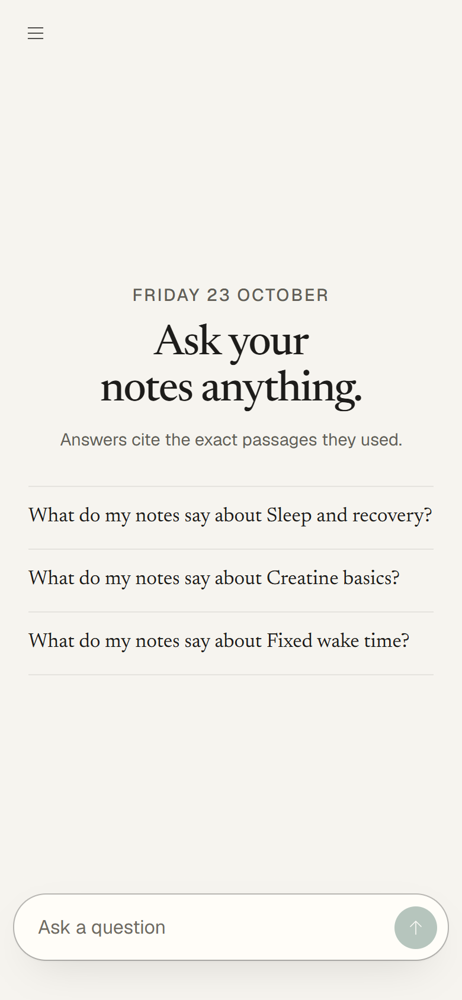
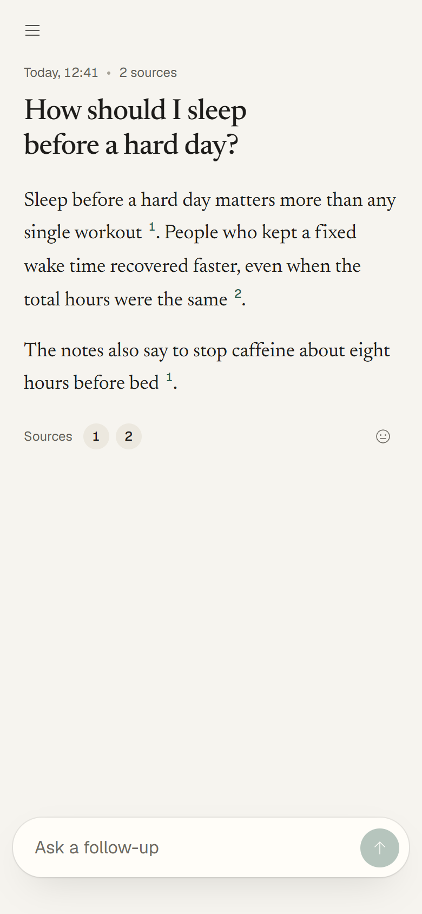
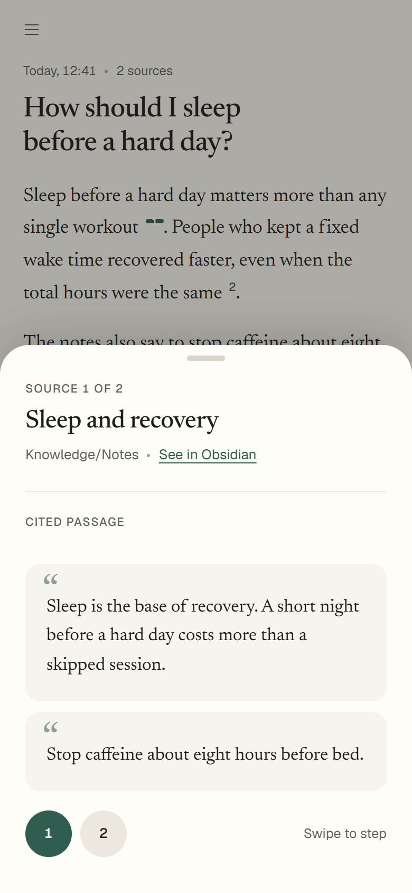
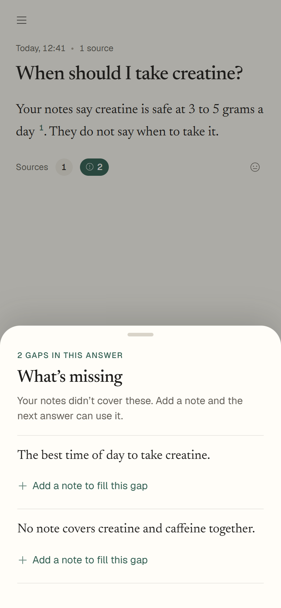
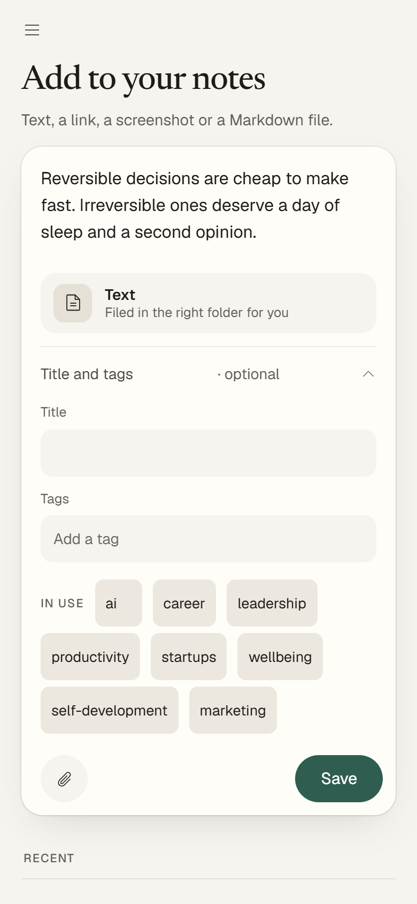
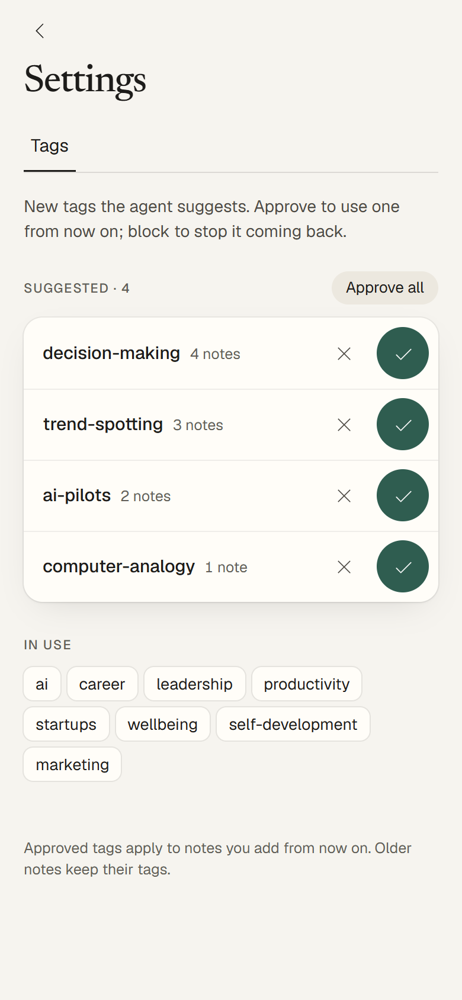
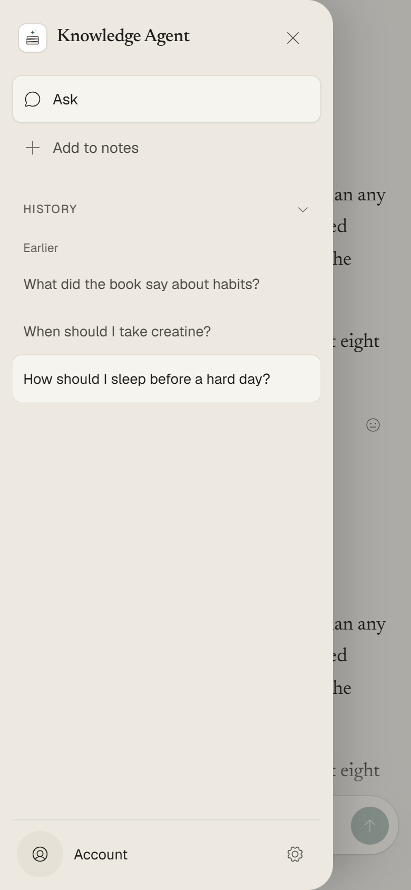
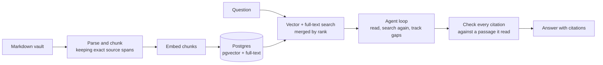

# Knowledge Agent

**Save anything from any device. Ask questions across all of it and get answers that quote the passages they came from.**

A personal knowledge agent that grows with you. Add any source in seconds from your phone or desktop (text, a link, a screenshot, a Markdown file or a YouTube video). It becomes a note in your own knowledge folder, which syncs across all your devices and is searchable within minutes. Then ask questions across everything you have saved and get answers that quote the exact passages they came from. It runs as a private web app you can install on a phone, and every answer shows what your notes did not cover, so you know what to add next.

| Ask | Answer with citations | The cited passage | What is missing |
| --- | --- | --- | --- |
|  |  |  |  |

| Add a note | Tags | History |
| --- | --- | --- |
|  |  |  |

*These screenshots are mock data. They come from a demo server with made-up notes and canned answers, not from a real vault or real model output.*

## Why I built it

Notes are easy to collect and hard to use. Keyword search finds the exact words you remember, not the idea you half remember. Asking a chat model about your notes risks an answer that sounds right but is not in them.

This project tries to do three things that a simple "chat with your documents" setup does not:

- **Find ideas, not only words.** It combines meaning-based search with keyword search, so a question can reach a passage that never uses the question's words.
- **Show its evidence.** Every claim in an answer points at a passage the agent actually read, and the app checks that the passage exists. It also says what it could not find.
- **Be measured.** Choices such as how to split notes into chunks, and whether extra model-written summaries help, were decided with a labelled test set rather than by feel. The results are in [docs/evaluation.md](docs/evaluation.md).

## What it does

- Answers a question from your notes, with footnote-style citations that open the source passage and link to the original note in Obsidian.
- Reads whole passages, searches again when something is missing, and reports the gaps instead of guessing.
- Handles follow-up questions that build on the earlier turns and passages.
- Captures new notes from pasted text, `.md` files, screenshots and YouTube links (new files only; it never edits an existing note).
- Keeps the index in step with the vault: new, edited and deleted notes are picked up every few minutes.
- Tags each note by type and topic with a classifier, and lets you approve or block the tags it proposes.
- Caps spending: every live model call has a dollar limit, and there is a daily cap.

## It gets more useful the more you add

A knowledge base only pays off if adding to it is quick enough to do every day. That is the other half of this project: a capture path that works from a phone or a desktop in a few seconds.

- **Add anything from any device.** Paste text or a link, drop a Markdown file, share a screenshot, or share a YouTube link. On Android, the installed app is a share target, so "Share to Knowledge Agent" works from any app. On desktop you can paste, drag and drop.
- **It becomes a proper note.** A screenshot is read into text. A YouTube video becomes a transcript with the speakers named. Each note is filed in the right folder (transcripts, articles, highlights, notes) and tagged from your own tag list.
- **It reaches all your devices.** Captures are written as new files in your Obsidian vault, and Obsidian Sync carries them to your phone and computers like any other note. The server never edits or overwrites an existing note.
- **It is searchable within minutes.** The server watches the vault and indexes new, edited and deleted notes every few minutes, so tomorrow's question can use what you saved today.
- **It tells you what is missing.** When an answer has a gap, the app says what the notes did not cover and offers "Add a note to fill this gap", which opens the capture sheet with the gap shown above the box, so you know what to write or paste. Questions point at what to collect next, so the collection grows where it is thin.

Over weeks, the loop is: ask, see the gaps, add a source in seconds, and ask again with a better answer.

## How it works



**How an answer is made.**
1. The server runs a first search with the question: meaning-based (vector) search and Postgres full-text search, merged with reciprocal rank fusion.
2. A language model, limited to four actions (`search`, `find`, `read`, `finish`), reads whole chunks and searches again for anything still missing. The code, not the model, owns the budgets for calls, bytes and time.
3. The agent keeps a list of what the question needs and marks each need resolved by the passages that cover it.
4. Before an answer is returned, the host checks that each citation points to a passage the agent read. A claim without a read passage is rejected.

More detail: [docs/architecture.md](docs/architecture.md). Why each choice was made: [docs/decisions.md](docs/decisions.md).

## Stack

- **Python 3.11+**, FastAPI, plain JavaScript front end (no build step), installable as a web app (service worker, share target).
- **Postgres with pgvector and full-text search**, hosted on Supabase; the schema is private and deployed from versioned SQL migrations.
- **Models through OpenRouter**, behind a thin `ModelClient` interface, pinned to providers that retain no data. GPT-5 mini answers; a small embedding model (Perplexity 0.6B) makes the vectors.
- **Hosting**: one Docker container on Railway, with the vault synced through Obsidian Sync ([docs/deploy.md](docs/deploy.md)).
- **CI**: GitHub Actions runs all seven test suites on every pull request. `constraints.txt` pins every dependency version, and CI and the Docker image both install with it.

## Results

On a labelled set of 37 questions over six real files:

- Search finds **44 of 51** required passages in the top 10 (47 in the top 20).
- The accepted answer prompt passes **78.8%** of the scored checks on a frozen 85-check checklist (bar: 70%).
- A typical answer takes about 100 seconds and about $0.04.

The test set is small and the ratings come from one person; [docs/evaluation.md](docs/evaluation.md) says what the numbers do and do not show. Things that were tried and removed because they did not help (chunk summaries, model-written chunk context, evidence cards) are in [docs/decisions.md](docs/decisions.md).

## Quick start

You can run the tests and preview how a note is parsed and chunked without a database, a vault or any API key.

```bash
git clone https://github.com/matteop92/knowledge-base-agent.git
cd knowledge-base-agent
python -m venv .venv && source .venv/bin/activate    # Windows: .venv\Scripts\activate
python -m pip install -c constraints.txt -e ".[server,test]"

# Parse and chunk one of the bundled sample notes (no model calls, nothing leaves your machine)
KNOWLEDGE_SOURCE_ROOT=sources python -m app.ingestion.preview --relative-path fixtures/sample_article.md
```

The preview prints the chosen parser, the blocks and the chunk boundaries, and writes the run under `.local/ingestion-runs/`.

To run the whole system you need your own Markdown vault, a Postgres database with pgvector (a local Supabase works: `npx supabase start`) and an [OpenRouter](https://openrouter.ai) key. Copy `.env.example` to `.env`, then:

```bash
python -m app.storage.cli --help        # load a run, create a profile, publish, search
python -m app.agent.cli --help          # ask a question from the command line (--dry-run first)
uvicorn app.api.main:build --factory    # the web app and API
```

Run the agent command with `--dry-run` first: it checks the configuration and prices without spending anything. A live run needs `--live` and an explicit spending ceiling (`--max-usd`).

## Tests

```bash
for s in ingestion models storage agent api capture evals; do
  python -m unittest discover -s tests/$s -p 'test_*.py'
done
```

The tests use short synthetic fixtures and fake model clients, so they cost nothing. Tests that need a database are skipped unless `KNOWLEDGE_TEST_DATABASE_URL` points at a fresh, disposable Postgres with pgvector (use a separate database for each suite; never a real one). CI runs all seven suites against a throwaway Postgres.

## Repository map

| Folder | What is in it |
| --- | --- |
| `app/ingestion/` | Capture, parsing, chunking, embeddings, vault sync and the tag classifier. |
| `app/storage/` | Postgres loading, publication, search and the spend ledger. |
| `app/agent/` | The answer loop, its command line and the follow-up memory. |
| `app/api/`, `app/web/` | The FastAPI server and the installable web app. |
| `app/capture/` | Turns text, files, screenshots and YouTube links into new notes. |
| `app/models/` | The model interface, the OpenRouter adapter and pinned routes and prices. |
| `prompts/` | The prompts in use, with a changelog ([prompts/README.md](prompts/README.md)). |
| `evals/` | Labelled questions, the answer checklist and trial scripts ([evals/README.md](evals/README.md)). |
| `supabase/migrations/` | The database schema. |
| `docs/` | Architecture, decisions, evaluation and deployment. |

## Known limits

- **One user, one vault.** Sign-in is for a single allowed account; there is no sharing.
- **Small evidence base.** The tuning and the quality numbers come from six files and eight benchmark questions. Behaviour on hundreds of files, or on whole-vault questions ("find every note about X"), has not been measured.
- **Slow answers.** The agent loop takes around 100 seconds for a full answer. Ideas for speeding it up are listed in [docs/decisions.md](docs/decisions.md).
- **Connections across notes are not surfaced.** Search finds what matches the question; it does not point out a related idea in another note.
- **No reranking and no approximate vector index** yet; both wait for a corpus large enough to need them.
- **The sample vault is private.** The labelled evaluation runs on real notes that are not in this repository, so those trials can be read but not rerun. The synthetic fixtures in `sources/fixtures/` and the unit tests run anywhere.

## How it was built

I built this with [Claude Code](https://claude.com/claude-code) as my coding partner, and I treated it as a team member I had to manage, not a code generator.

- **I owned the decisions.** I chose the goals, the architecture and what counts as a good answer. Each piece of work started as a written plan with requirements and test scenarios, and I approved it before any code was written.
- **Evidence over opinion.** Chunking, embedding model and answer prompt were chosen by running trials against a labelled question set. Several ideas that looked good (summaries, evidence cards, model-written chunk context) were measured, found not to help, and removed. [docs/decisions.md](docs/decisions.md) lists them.
- **I rated the answers myself.** The 85-check answer checklist was reviewed and frozen by me. A model grader exists but missed its accuracy bar, so it only pre-rates and I confirm.
- **Every change was reviewed.** Code went through tests and a multi-reviewer code review before merging, and spending on live model calls was capped at every step.

## Licence

All rights reserved. The code is public so you can read and evaluate it; see [LICENSE](LICENSE). Please ask before reusing any of it.

## Credits

Icons are [Phosphor Icons](https://phosphoricons.com) (MIT). The web app uses the Geist and Newsreader typefaces, bundled under the SIL Open Font License (`app/web/fonts/`).
