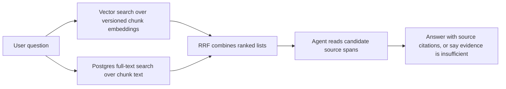

# Retrieval

`app/storage/search.py` runs independent exact pgvector and Postgres full-text candidate searches against the selected private local index. `app/storage/retrieval.py` adds deterministic rank fusion and bounded reads of stored original passages. Hits preserve document/run/hash/chunk identity and exact source locations. The answer loop and CLI pass local tests and a disposable database proof with synthetic provider responses. A live pilot and human review exposed answer quality failures; an externally exposed API remains unbuilt.

Vector search uses the selected embedding specification, whose payload must match its content-derived ID, dimensions, metric, and chunking version. Before private query embedding, the current endpoint must qualify for ZDR, denied data collection, a pinned provider without fallback, and the price ceiling, including any model-specific route override. Queries use the spec's `search_query` input type where specified.

Full-text search uses `simple` lexemes, `websearch_to_tsquery`, a GIN index, and `ts_rank`; whole-question searches with no all-term hits retry as an OR query over their words. Both channels filter through the selected active profile and run before limiting, with stable chunk-ID ties. RRF sums `1/(60+rank)` over at most 20 hits per channel and returns at most 20 candidates, deduplicating identical source-span sets. Raw channel scores are not combined. The shared hybrid search also checks each published run's title (falling back to its file name), authors, guests, and tags. A nontrivial two-word phrase or an exact surname or tag can name up to three sources. It runs both channels within each named file before limiting and reserves up to five chunks per file in the 20 returned candidates. Queries with no named source keep the ordinary fused ranking. Explicit historical selection remains available only through the underlying evaluation search functions.

Document-scoped find searches original indexed chunks in the exact active document revision of a discovered reference. Stored-source reads validate document/run/hash/chunk identity and allow at most 2,400 characters at a validated offset within one selected chunk span. A continuation reports its next offset and gets a distinct citation ID; reads cannot cross non-whitespace excluded source gaps or stale revisions. The caller owns a read-only repeatable-read transaction.

The selected six-file profile uses structural/raw chunks, `perplexity/pplx-embed-v1-0.6b`, 1,024 dimensions, cosine distance, and `raw-v1`, with 83 vectors. The selected profile is `stage5-card-free-20261002` and requires no enrichment artifacts. The active-profile trial scores all 37 checked questions; 31 supported questions require 51 spans. Negative questions have no recall score and remain visible in the report.

| Required spans found | K=5 | K=10 | K=20 |
| --- | --- | --- | --- |
| Exact vector | 41/51 | 44/51 | 47/51 |
| Full text | 28/51 | 40/51 | 44/51 |
| RRF | 39/51 | 44/51 | 47/51 |

RRF does not improve these aggregate results; it has lower coverage at K=5. At K=20 its four missing spans belong to `tim_conversion_recommendations` and `tim_message_testing`. These are candidate-recall diagnostics, not answer-quality scores. The earlier live answer pilot found that the agent often stopped after inspecting too few relevant passages; the current harness reads whole chunks and checks a finish against unread chunks of sources already used. Exact vector ordering remains the correctness baseline; HNSW waits for representative recall and query-plan checks.

`python -m evals.retrieval_trial --provider-tag perplexity/int8 --max-usd 0.01 --report .local/retrieval-dry-run.json` checks labels against stored source revisions without vault access or model calls. Set `KNOWLEDGE_DATABASE_URL`; add `--live` with `OPENROUTER_API_KEY` for one route-gated query-embedding batch. Reports must be new files under ignored `.local/`. The U3 repeat report `.local/stage5-u3-retrieval-live.json` retained vector coverage 41/44/47 of 51; query embedding cost was bounded at $0.000002128. Q8's first live hybrid search returned both the Bending Spoons interview and Sivers book, with at least five chunks each; `.local/stage5-u3-q8-live.json` records that check and its $0.000000156 cost bound. Both requests are accounted for in `.local/stage5-budget.json`. Stage 5's reservation ceilings are $12 and $14 cumulative, raised for the authorized U4 baseline; operator runs must account for previous reports before using the remaining allowance.

See [INGESTION.md](INGESTION.md) for how candidates are made, [DATA.md](DATA.md) for their identities, and [SYSTEM.md](SYSTEM.md) for the full map.

## Local answer core

`app/agent/harness.py` controls strictly parsed version-3 `search`, `find`, `read`, and `finish` JSON actions through `ModelClient`. Each invocation owns its limits, candidates, inspected evidence, and question-derived investigation needs; source content cannot modify host tool budgets. Before the first model turn the host runs one hybrid search with the question and records it as `host_search`. Candidates are one per chunk, keep their best rank across searches, and are shown unread-first by rank (20, plus the two best of any source those leave out) with a 200-character preview. One `read` inspects every span of the chunk, including continuations past 2,400 characters; each passage keeps its own citation ID such as `E3.1` or `E3.1@2400`, so citations stay span-level.

The host ignores fields that do not belong to the chosen action, accepts a passage ID such as `E6.5` as chunk `E6`, and returns the specific validation rule on a rejection. It retains a valid search or read if the model also emits draft-answer fields, requires a read after two discovery actions while unread candidates remain, and rejects a repeated query with the leads that query already produced. A voluntary finish with an open material need gets one correction opportunity. A voluntary finish is also checked, at most twice and only after new reading, against unread chunks from sources already used; a repeat finish without new reading is accepted. A version-3 finish marked complete with declared or unresolved gaps is recorded as partial rather than rejected for the gaps. Receipts count refused actions, including invalid JSON actions. Complete answers require inspected inline citations; fabricated, unread, or mismatched citation lists are rejected. This verifies provenance, not whether every claim is semantically supported. One malformed JSON response, including on the first model turn, receives a single format-correction turn using the existing candidates and inspected evidence. A second malformed response, truncation, route failure, or exhausted allowance remains an explicit failure. Malformed output is retained only when a private report was explicitly requested.

Prompt version `answer_agent_v13` (v12 plus a relevance test in the question's own words; on one run per question it cut points outside the question's scope from 9 to 3 against v12, with a similar overall checklist score) describes these tools, asks for short queries, requires speaker-aware attribution (an interviewer's question and a reader's "My note" are not the author's statement), asks for every distinct relevant point in inspected passages on broad questions, and requires the answer to end after its explanation or material limitation without a closing offer or question. Request/input budget, deadline, and model-mismatch failures have safe categorical stop reasons. With remaining allowances close to exhaustion, the host hides candidates and restricts the schema to `finish`, keeping inspected originals available for synthesis and recording the finalization trigger. The time reserve accounts for recent request latency. The default serialized-input allowance is 800,000 bytes; the finite `broad` CLI profile (20 model calls, ten chunk reads, 420 seconds, 1,600,000 bytes) permits more investigation and synthesis with a separately checked worst-case spending bound.

The result includes cited passages, the full inspected ledger, retrieval ranks and provenance, gap/sufficiency decisions, stop reason, and elapsed time. Failed tools and exhausted budgets preserve the prior evidence. The model adapter accepts optional OpenAI reasoning effort without changing ingestion defaults and rejects truncated structured responses. Answer HTTP calls share a deadline and use a conservative serialized-input allowance for their spending bound.

In the web app a follow-up passes `memory` and `search_query` to the same core (`app/agent/memory.py`). GPT-6 Luna rewrites the follow-up into a standalone query for the host's first search; if its route check fails, the follow-up itself is searched. The last three turns are resent as text, and passages read in the last six turns are carried forward as `earlier_evidence`, capped at 24 passages and 24 KB, renumbered E1, E2 and so on, and citable without a new read. Passages whose document has a different active run are dropped and named in `changed_sources`. New candidates are numbered after the carried chunks, and a carried chunk found again is not listed as new. Follow-ups use prompt `answer_agent_v14` (v13 plus one paragraph on these inputs); first questions use v13 unchanged. The receipt records the search query, the counts carried and dropped, and the prompt version.

`python -m app.agent.cli` calls the same stateless core inside a read-only repeatable-read transaction. It preflights pinned embedding and structured generation endpoints, reports usage/cost, and writes private traces only to explicitly requested new `.local/` files. Consecutive CLI requests start with fresh clients and ledgers. Candidates show source title and people alongside rank and preview. See [README.md](README.md#ask-a-question) for commands. Historical prompts v1–v11 and their private receipts remain intact. The scoring rules under review are a three-dimension checklist (coverage, grounding, example) in `evals/answer_questions_v4_restructured.yaml`: `evals/answer_rubric.py` loads and scores it, `evals/answer_grader.py` can grade it once frozen, and `python -m evals.answer_review` builds a local page for judging saved receipts against it. It is a draft with open decisions, and the grader remains uncalibrated. The card-free selected profile passed a live retrieval proof at 41/44/47 required spans for exact vector K=5/10/20. The bounded correction repaired a malformed action in a fresh five-run Q8 batch: all five completed and cited both named sources. Agent review against frozen rubric v3 found mean essential coverage of 1.3/3, below the earlier with-card 2.33/3. Ferrari’s caution against filling an urgent seat was often implicit or absent, and question-led coaching from a reader note was attributed to Sivers instead of labeled as an adaptation. The quality stop condition halted U4 after Q1 round one; Q2 has an interrupted $1 reservation and no receipt. The private assessment and receipts are under .local/stage5-u4-q8-corrected-review.json and .local/stage5-u4-q8-corrected-r*/. No repeated-query refusal fired in the completed Q8 runs, but the forty-run condition for removing that refusal has not been met. The baseline awaits user review under the [current plan](docs/plans/2026-10-02-001-refactor-remove-cards-finish-answer-gate-plan.md).
