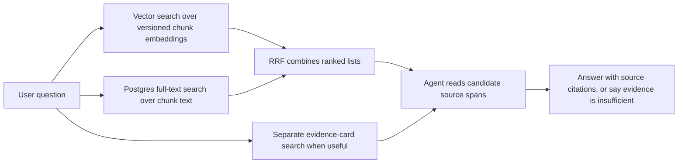

# Retrieval

`app/storage/search.py` runs independent exact pgvector and Postgres full-text candidate searches against the selected private local index. `app/storage/retrieval.py` adds deterministic rank fusion, separate published-card search, and bounded reads of stored original passages. Hits preserve document/run/hash/chunk identity and exact source locations. The answer loop and CLI pass local tests and a disposable database proof with synthetic provider responses. A live pilot and human review exposed answer quality failures; an externally exposed API remains unbuilt.

Vector search uses the selected embedding specification, whose payload must match its content-derived ID, dimensions, metric, and chunking version. Before private query embedding, the current endpoint must qualify for ZDR, denied data collection, a pinned provider without fallback, and the price ceiling, including any model-specific route override. Queries use the spec's `search_query` input type where specified.

Full-text search uses `simple` lexemes, `websearch_to_tsquery`, a GIN index, and `ts_rank`; whole-question searches with no all-term hits retry as an OR query over their words. Both channels filter through the selected active profile and run before limiting, with stable chunk-ID ties. RRF sums `1/(60+rank)` over at most 20 hits per channel and returns at most 20 candidates, deduplicating identical source-span sets. Raw channel scores are not combined. Explicit historical selection remains available only through the underlying evaluation search functions.

Card search uses FTS over statement, situation, action, result, and principle, separately from RRF. Only ready card artifacts named in the active publication are eligible. Repeated exact evidence spans are deduplicated. Stored-source reads validate document/run/hash/chunk identity and allow at most 2,400 characters within a chunk span or a published card's validated evidence span, including cards spanning adjacent paragraphs. Reads reject stale revisions and out-of-scope ranges. The caller owns a read-only repeatable-read transaction. Three local card probes verified 30 original reads; measured SQL execution took about 14–16 ms, so no new card index or migration was added.

The selected six-file profile uses structural/raw chunks, `perplexity/pplx-embed-v1-0.6b`, 1,024 dimensions, cosine distance, and `raw-v1`, with 83 vectors and 510 validated cards. The active-profile trial scores all 37 checked questions; 31 supported questions require 51 spans. Negative questions have no recall score and remain visible in the report.

| Required spans found | K=5 | K=10 | K=20 |
| --- | --- | --- | --- |
| Exact vector | 41/51 | 44/51 | 47/51 |
| Full text | 28/51 | 40/51 | 44/51 |
| RRF | 39/51 | 44/51 | 47/51 |

RRF does not improve these aggregate results; it has lower coverage at K=5. At K=20 its four missing spans belong to `tim_conversion_recommendations` and `tim_message_testing`. These are candidate-recall diagnostics, not answer-quality scores. The live answer pilot found that the agent often stopped after inspecting too few relevant passages. Exact vector ordering remains the correctness baseline; HNSW waits for representative recall and query-plan checks.

`python -m evals.retrieval_trial --provider-tag perplexity/int8 --max-usd 0.01 --report .local/retrieval-dry-run.json` checks labels against stored source revisions without vault access or model calls. Set `KNOWLEDGE_DATABASE_URL`; add `--live` with `OPENROUTER_API_KEY` for one route-gated query-embedding batch. Reports must be new files under ignored `.local/`. The completed local report is `.local/stage5-retrieval-recall.json`; query embedding cost was bounded at $0.000002128. Stage 5's approved ceilings are $8 and $10 cumulative; operator runs must account for previous reports before using the remaining allowance.

See [INGESTION.md](INGESTION.md) for how candidates are made, [DATA.md](DATA.md) for their identities, and [SYSTEM.md](SYSTEM.md) for the full map.

## Local answer core

`app/agent/harness.py` controls strictly parsed `search`, `search_cards`, `read`, and `finish` JSON actions through `ModelClient`. Each invocation owns its limits, candidates, and inspected evidence; source content cannot modify host tool budgets. The prompt requires simple explanations, concrete examples, honest attribution, and an explicit sufficiency decision. Complete answers require inspected inline citations; fabricated, unread, or mismatched citation lists are rejected. This verifies provenance, not whether every claim is semantically supported. A later malformed JSON response receives bounded correction feedback using the existing inspected evidence; an invalid first response, truncation, route failure, or exhausted allowance remains an explicit failure. Malformed output is retained only when a private report was explicitly requested.

Candidate context uses compact span-index/preview pairs without repeating raw chunk snippets; full revision provenance stays in the host trace. Prompt version `answer_agent_v6` explains this discovery format. Request/input budget, deadline, and model-mismatch failures have safe categorical stop reasons. With remaining allowances close to exhaustion, the host hides discovery previews and restricts the schema to `finish`, keeping inspected originals available for synthesis. The time reserve accounts for recent request latency. The default serialized-input allowance is 400,000 bytes; each invocation still checks a conservative spending cap.

The result includes cited passages, the full inspected ledger, retrieval ranks and provenance, gap/sufficiency decisions, stop reason, and elapsed time. Failed tools and exhausted budgets preserve the prior evidence. The model adapter accepts optional OpenAI reasoning effort without changing ingestion defaults and rejects truncated structured responses. Answer HTTP calls share a deadline and use a conservative serialized-input allowance for their spending bound.

`python -m app.agent.cli` calls the same stateless core inside a read-only repeatable-read transaction. It preflights pinned embedding and structured generation endpoints, reports usage/cost, and writes private traces only to explicitly requested new `.local/` files. Consecutive CLI requests start with fresh clients and ledgers. See [README.md](README.md#ask-a-question) for commands. The frozen rubric and human review separate facet coverage, semantic citation support, examples, qualifications, unsupported inference, attribution, and usefulness; the comparable eight-question mini/minimal and GPT-5.4/medium runs returned 7/8 and 8/8 runtime answers, respectively. Valid references coexist with missing facets and source examples. Human review also found invented examples, shallow synthesis, and irrelevant gap notes. No semantic quality baseline has passed; the [answer quality plan](docs/plans/2026-09-29-1832-fix-retrieval-answer-quality-plan.md) orders prompt and investigation repairs before rubric and grader work.
