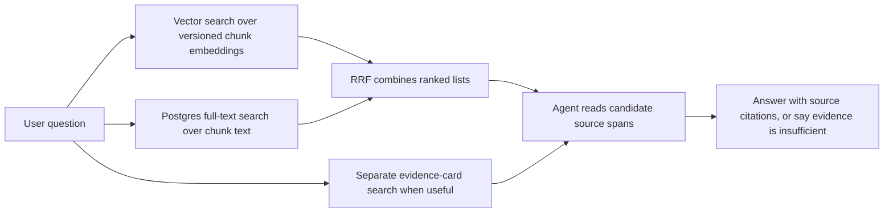

# Retrieval

`app/storage/search.py` runs independent exact pgvector and Postgres full-text candidate searches against a selected private local index. Each hit includes rank, raw distance or score, document/run/source IDs, chunk ID, exact source spans, locator, and raw text for trusted callers. The production retrieval API, rank fusion, evidence-card query path, and answer agent remain planned. The flow below shows how those pieces will use the candidate lists.

Vector search finds semantically related chunks with one profile-compatible embedding specification. Full-text search uses `simple` lexemes, `websearch_to_tsquery`, a GIN index, and `ts_rank`; whole-question searches with no all-term hits retry as an OR query over their words. Both filter through the selected active profile and run before limiting, with stable chunk-ID ties. Explicit profile and historical-run parameters allow evaluation of old or staged data. Reciprocal rank fusion (RRF) will combine the independent ranks without treating raw scores as comparable. The agent will inspect source spans and cite original passages. Evidence-card search remains a separate, agent-selected path.

The first measured raw-chunk profile uses fixed 800-token chunks with 80-token overlap, `perplexity/pplx-embed-v1-0.6b`, 1,024 dimensions, cosine distance, and `raw-v1`. In the checked six-file trial, 31 supported questions required 51 source spans: exact vector Recall@10 covered 42 spans, while independent FTS covered 29. This small trial selects an initial index, not a final retrieval or answer-quality setting. The hard questions and later fusion need Stage 6 evaluation. Exact vector ordering remains the correctness baseline; a profile-specific HNSW index waits for representative recall and query-plan checks.

See [INGESTION.md](INGESTION.md) for how candidates are made, [DATA.md](DATA.md) for their identities, and [SYSTEM.md](SYSTEM.md) for the full map.
