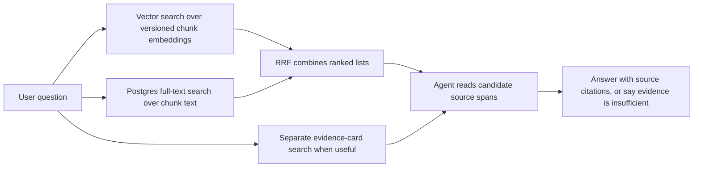

# Retrieval

Retrieval is a design target, not running code. There is no Supabase index, query endpoint, ranking result, or answer agent in this repository yet. The planned flow below is the current design to implement and measure.

Vector search should find semantically related chunks; PostgreSQL full-text search should recover exact terms. Reciprocal rank fusion (RRF) combines their positions into one candidate list without treating raw scores as comparable. The agent should inspect the original source spans behind candidates and cite those passages in its answer. Evidence-card search is a separate, agent-selected path for claims and examples; it must still lead back to exact source text.

The code already produces fixed and structural chunk variants and defines raw and contextual embedding inputs. Model, dimensions, input recipe, and chunking version are part of each embedding specification; the search index must use a compatible specification and a deliberate active run. Neither chunking variant, embedding model, nor ranking settings have been chosen by measured retrieval results. The 37 checked questions in `evals/questions_*.yaml` currently test source-span mapping; later they can support recall and answer-quality evaluation after search exists.

See [INGESTION.md](INGESTION.md) for how candidates are made, [DATA.md](DATA.md) for their identities, and [SYSTEM.md](SYSTEM.md) for the full map.
