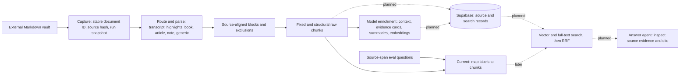

# System

The original Markdown vault is the authority. Each derived item must point back to the source file and exact source revision; search and answers are still planned.

**Working now:** capture, routing, parsing, two raw chunk variants, local preview, source-span eval mapping, and versioned enrichment code and prompts. Enrichment has been exercised with fake model responses in tests, but no production model or live vault run has been selected. **Still to build:** database loading, search, ranking evaluation, and the answer agent.

The local preview writes a source snapshot, parsed document, chunk sets, and run manifest under ignored `.local/ingestion-runs/<run_id>/`. It makes no model calls. Model enrichment is required for the intended product, but is not part of that preview command.

Follow one detail link for the task: [INGESTION.md](INGESTION.md) for input and enrichment, [RETRIEVAL.md](RETRIEVAL.md) for search and answers, or [DATA.md](DATA.md) for records and provenance. [README.md](README.md) has commands; [docs/plans/](docs/plans/) holds plans rather than current-state documentation.
