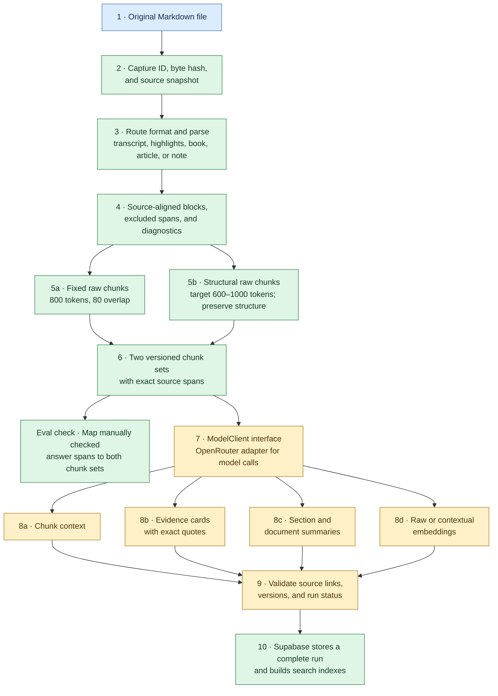
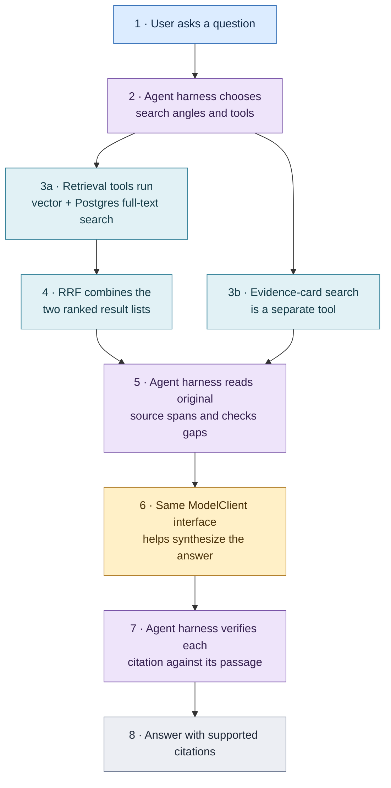

# System

The original Markdown vault is the authority. A file is processed into an index once, then many questions can use that index; these are two different sequences. Every derived item must point back to the exact source revision. For stage-by-stage completion and the next checkpoint, read [FOUNDATION.md#current-progress](FOUNDATION.md#current-progress).

## A. Build the index from a file

This runs when a Markdown file is ingested. The two chunking paths produce separate versions of the same source; the eval check is a parallel check, not a required step for every file.

**Green** runs locally, including both chunk variants, label mapping, and the private storage/search path. **Amber** has code and prompts tested with fake model responses; raw-chunk embeddings have also been compared live on six checked vault files, while extraction, contexts, cards, and summaries have no live-vault trial. `ModelClient` sends generation and embedding requests; it does not choose what to search.

## B. Answer a question from the index

This starts later, when a user asks a question against the active run stored in A. The agent harness controls the investigation; retrieval tools only return evidence candidates.

The question-answer path as a whole is **planned**. Independent vector and full-text candidate queries work locally; rank fusion, the agent harness, and answer citations have not been built. Purple boxes are the agent harness, teal boxes are retrieval tools, and amber is the shared ModelClient. If inspected passages leave a gap, the harness repeats step 2 before answering. The checked questions now measure first-pass candidate recall; answer quality remains unevaluated.

The local preview writes a source snapshot, parsed document, chunk sets, and run manifest under ignored `.local/ingestion-runs/<run_id>/`. It makes no model calls. Model enrichment is required for the intended product, but is not part of that preview command.

Follow one detail link for the task: [INGESTION.md](INGESTION.md) for input and enrichment, [RETRIEVAL.md](RETRIEVAL.md) for search and answers, or [DATA.md](DATA.md) for records and provenance. [README.md](README.md) has commands; [docs/plans/](docs/plans/) holds plans rather than current-state documentation.
