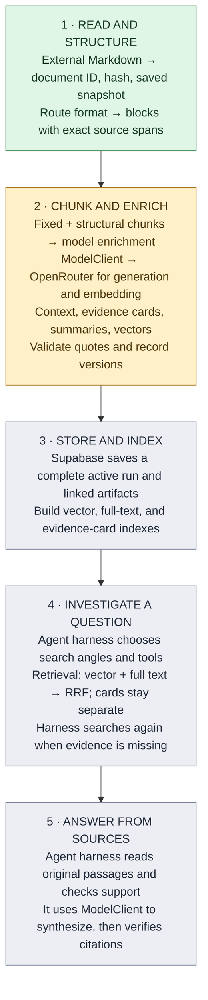

# System

The original Markdown vault is the authority. Each derived item must point back to the source file and exact source revision; search and answers are still planned. For stage-by-stage completion and the next checkpoint, read [FOUNDATION.md#current-progress](FOUNDATION.md#current-progress).

**Green:** working locally. **Amber:** raw chunks work locally; enrichment code and prompts pass fake-model tests, but no model has run on the vault. **Gray:** planned. A user asks the question after an index has been built.

**ModelClient** handles model calls in stages 2 and 5; the OpenRouter adapter exists, but no live model has been selected. The **agent harness** controls stages 4 and 5: it chooses searches, decides whether the evidence is enough, and checks citations. The retrieval tools in stage 4 fetch and rank candidates; they do not decide what the answer should say. Today's checked questions map to source spans and chunks; retrieval and answer scoring come later.

The local preview writes a source snapshot, parsed document, chunk sets, and run manifest under ignored `.local/ingestion-runs/<run_id>/`. It makes no model calls. Model enrichment is required for the intended product, but is not part of that preview command.

Follow one detail link for the task: [INGESTION.md](INGESTION.md) for input and enrichment, [RETRIEVAL.md](RETRIEVAL.md) for search and answers, or [DATA.md](DATA.md) for records and provenance. [README.md](README.md) has commands; [docs/plans/](docs/plans/) holds plans rather than current-state documentation.
