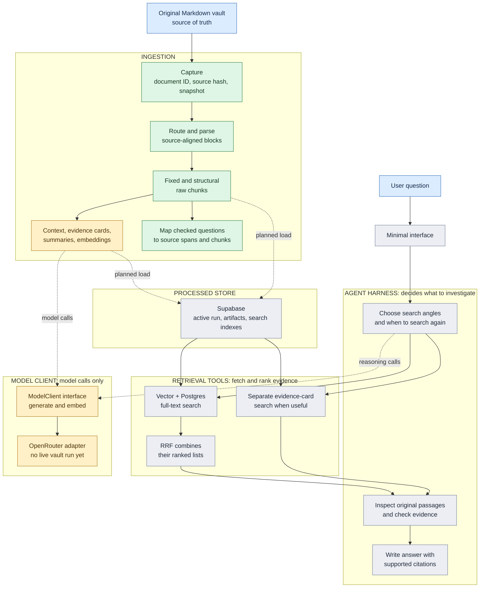

# System

The original Markdown vault is the authority. Each derived item must point back to the source file and exact source revision; search and answers are still planned. For stage-by-stage completion and the next checkpoint, read [FOUNDATION.md#current-progress](FOUNDATION.md#current-progress).

**Green:** working locally. **Amber:** code and prompts tested with fake model responses; no live vault model run. **Gray:** planned. The main path runs from the vault at the top through ingestion and storage, then from a question through the agent harness and retrieval tools to a cited answer.

The **agent harness** owns the decisions: what to search, whether to search again, which passages support an answer, and when to stop. **Retrieval tools** fetch and rank candidates. **ModelClient** only sends generation or embedding requests to a provider; it does not choose search steps or inspect the database.

The local preview writes a source snapshot, parsed document, chunk sets, and run manifest under ignored `.local/ingestion-runs/<run_id>/`. It makes no model calls. Model enrichment is required for the intended product, but is not part of that preview command.

Follow one detail link for the task: [INGESTION.md](INGESTION.md) for input and enrichment, [RETRIEVAL.md](RETRIEVAL.md) for search and answers, or [DATA.md](DATA.md) for records and provenance. [README.md](README.md) has commands; [docs/plans/](docs/plans/) holds plans rather than current-state documentation.
