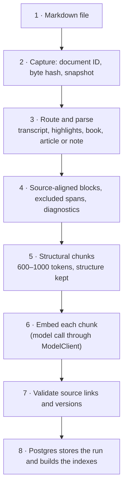
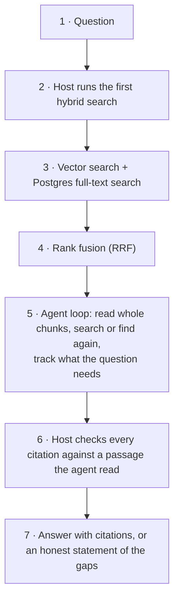

# Architecture

The Markdown vault is the authority. A file is processed into an index once, and many questions then use that index. These are two separate flows. Every derived item points back to the exact source revision it came from.

Contents: [Building the index](#building-the-index) · [Answering a question](#answering-a-question) · [Data and provenance](#data-and-provenance) · [Search](#search) · [The answer loop](#the-answer-loop) · [The web app](#the-web-app) · [Status](#status)

## Building the index

| Stage | What it does | Code |
| --- | --- | --- |
| Capture | Reads the file as UTF-8, gives its path a stable `document_id`, hashes the original bytes and starts a new `run_id`. | `app/ingestion/source_reader.py` |
| Route and parse | Chooses a parser for bold or bracket transcripts, Kindle highlights, books, articles, notes or generic Markdown. Parsers keep headings, speaker turns, highlights, personal notes, exact source spans, excluded spans and diagnostics. | `router.py` and the parsers in `app/ingestion/` |
| Chunk | Builds chunks of whole structural units (target 600 to 1,000 tokens). Each chunk keeps its exact source spans. A fixed 800-token variant (80 overlap) exists as the baseline the structural variant was compared with. | `chunking.py` |
| Embed | Turns each chunk into a vector. The selected model is `perplexity/pplx-embed-v1-0.6b` (1,024 dimensions, cosine distance). | `embeddings.py`, `app/models/` |
| Check and store | Validates that every record resolves to a source revision, then loads one complete run into Postgres in a transaction. A failed or partial run is never searchable. | `run_manifest.py`, `app/storage/` |

Text offsets are Unicode character offsets in the decoded snapshot. Editing a file changes its hash and gives it a new run; the document ID stays the same. The tool that reads the vault never edits it.

After the first load, `app/ingestion/vault_sync.py` keeps the index current. It indexes the vault's `Knowledge` folder incrementally by content hash, retires deleted files behind a guard (it refuses to retire more than 10% or 20 files at once), and classifies each note's type, tags, people, date and description (`properties.py`, using the live tag list: the approved rows of the `knowledge.tags` table plus every topic tag written in a note, minus blocked and merged ones; a proposal may not name a source type, a platform or a person). `config/tag_aliases.yaml` maps merged tags to their new name at read time, so cards, filters and counts show one name per tag.

**Not used in the live profile.** Chunk contexts, section and document summaries and evidence cards were all tried (see [decisions.md](decisions.md)). The selected profile needs none of them. Chunk-context code remains in `app/ingestion/enrichment.py`; the summary generators and evidence cards were removed, and only the stored `Summary` record stays so earlier runs still load.

## Answering a question

The application owns the loop and its limits; the model only chooses the next action. Retrieval tools return candidates, never answers.

## Data and provenance

Local JSON artifacts under ignored `.local/ingestion-runs/<run_id>/` are validated before loading into the private `knowledge` Postgres schema (`supabase/migrations/`). The schema is not exposed through Supabase's API; a separate login that inherits the narrow `knowledge_runtime` grants is used by the trusted Python code.

| Object | What it is |
| --- | --- |
| Document | A Markdown path under a stable root alias. The ID stays the same when the contents change. |
| Run | One read of the original bytes with its own `run_id` and `source_sha256`. It keeps the exact bytes, the decoded text and the parsed JSON. |
| Chunk set and chunk | A view of the eligible blocks with a variant and version. Each chunk has exact source spans. |
| Embedding spec and vector | Provider, model, dimensions, metric, input recipe and chunking version, with one vector per chunk. Changing any of these means a new complete index. |
| Profile | Chooses one chunk variant, embedding spec and full-text configuration. |
| Active run | The validated run for each document under a profile. Only active runs serve normal questions. |
| Document properties | Generated type, tags, people, date and description beside the unchanged source. |

Publication checks that all vectors are complete in one transaction before a run becomes active. Older and staged runs need an explicit scope to be queried.

## Search

`app/storage/search.py` runs two independent searches over the active profile:

- **Vector search**: exact pgvector search with the selected embedding spec. Before a private query is embedded, the endpoint must qualify for zero data retention, no data collection, a pinned provider and the price ceiling.
- **Full-text search**: Postgres `simple` lexemes with `websearch_to_tsquery` and `ts_rank` (not BM25). A whole-question search with no all-term hits retries as an OR query.

`app/storage/retrieval.py` combines them with reciprocal rank fusion (the sum of `1/(60+rank)` over at most 20 hits per channel, at most 20 candidates, duplicates removed). Search also reads each document's title, authors, guests and tags, so a question that names a source ("what does the Bending Spoons interview say") reaches it even if those words are not in the chunk text. Up to five chunks per named source are reserved.

Reading a passage re-checks document, run, hash and chunk identity and returns at most 2,400 characters at a time; longer chunks continue with a new citation ID. Results (measured recall) are in [evaluation.md](evaluation.md).

## The answer loop

`app/agent/harness.py` runs strictly parsed JSON actions (`search`, `find`, `read`, `finish`) through `ModelClient`. Each call has its own budgets for model calls, searches, finds, reads, bytes and time. Source text cannot change those limits.

- In the web app every question, first or follow-up (a follow-up is routed on its rewritten query; with no rewrite it goes plain without a call), gets one TypeSafe Jev call through OpenRouter's zero-retention `/api/v1/systemone` endpoint (about 0.3 s; wording in `prompts/question_router_v1.json`, code in `app/agent/router.py`). It picks one of three routes. "Plain" is listed first because Jev favours the first option, and an unsure or failed call goes plain:
  - **Catalog**: a count or list about the collection itself ("how many articles", "the latest note I uploaded"). Jev fills a typed query plan that code validates against the vault's real values and applies in Python to the list from `load_sources` (`app/agent/catalog.py`); no model writes SQL. The answer opens with how the question was read ("Sorted by when it was added, newest first; showing 1.") and cites each listed source's opening passage. Code reads dates and counts (`app/agent/periods.py`). A source's added date is the earliest time it entered the index (or its capture job); notes from the first bulk load take their own date.
  - **Narrowed**: a question about what the sources say that explicitly limits them by type, folder, period or "my latest note". The same search and answer loop runs over only those sources (a document filter inside the search SQL) and the answer opens with the scope ("Searched 12 notes from September 2026."). If nothing matches, it says so and searches everything. A person or a tag never narrows.
  - **Plain**: today's path, unchanged.
- The host runs one hybrid search before the first model turn. Candidates show source title, people, rank and a short preview, and are listed unread-first. The web app then reads the six best chunks itself (`host_reads`), so the first model turn already has passages to work with.
- A `read` returns every passage of a chunk. Each passage has its own citation ID (`E3.1`).
- The agent tracks the material parts of the question as needs, and marks each one resolved with inspected passage IDs, or excluded with a reason.
- A finish with an open need gets one correction. A finish can also be sent back for unread chunks of sources already used (`coverage_checks`, up to two). The web app turns this off: in the speed trials it cost 40% of answer time for about one point of graded accuracy.
- Complete answers need inline citations that point at passages actually read. This proves provenance, not that a claim is semantically supported; that is checked by people (see [evaluation.md](evaluation.md)).
- One malformed or cut-off reply gets one retry. A second one is an explicit failure.
- The result carries the cited passages, the full ledger of what was inspected, retrieval ranks, the gaps, the stop reason and the cost.

Follow-ups (`app/agent/memory.py`) rewrite the question into a stand-alone search query, resend the last three turns, and carry forward up to 24 passages from the last six turns (24 KB), dropping any whose source has changed. They use prompt `answer_agent_v14`; first questions use v13. Prompts v15 and v16 add a speaker rule and can be selected with `prompt_version`, but are not the default yet. See [prompts/README.md](../prompts/README.md).

Every transcript passage carries its speaker, read from the run's parsed blocks at read time (a passage that continues a turn, or an `@offset` read, keeps the speaker), and the model sees it both as a labelled field and as the first words of the passage text. After each answer `app/agent/attribution.py` flags a sentence that names a speaker of a cited transcript when none of the named speakers spoke a passage it cites. The flag is shown as a gap and stored in the receipt; the answer is not rewritten.

`python -m app.agent.cli` runs the same core from the command line inside a read-only transaction and writes private reports only to new files under `.local/`.

## The web app

`app/api/` is a FastAPI server and `app/web/` a plain JavaScript installable web app (no build step).

- **Sign-in**: an email code for one allowed user.
- **Answers**: run as background jobs the page polls, with cited excerpts that link back to the original note (with its author), a thumbs-down note and a daily spend cap. The page draws lists, bold and italic from the answer text as elements, never as HTML; a source cited from several passages numbers them 1.1, 1.2 and so on.
- **Capture**: pasted text, `.md` files, screenshots and YouTube links become new notes in the `Knowledge` folders (`app/capture/`). New files only; nothing is ever edited or overwritten.
- **Sync**: the server keeps a copy of the `Knowledge` folder through Obsidian Sync and indexes new, edited and deleted notes every five minutes (`app/api/scheduler.py`, `deploy/`).
- **Sources**: browse every indexed source (`GET /api/sources`, light rows built from the stored run metadata by `app/ingestion/card_facts.py`; nothing is written back to the vault). One search bar holds the filters as tokens (type, tag, person, source, date added, title; the source is the note's `publication` property, or its show, channel or site) and the page filters and counts in the browser (`app/web/source-filter.js`); the list shows the first 60 cards. On a phone the filters sit behind one button: a summary sheet (date and type inline) with a searchable page each for People and Tags, so hundreds of names stay findable. A card opens a reading page (`GET /api/sources/{id}`, the stored blocks of the active run, with Markdown markers and images taken out at read time); the page draws web links, bold, italic and inline code as elements, never as HTML, and shows the tags on the author's line. The reader also cuts fenced code and Markdown tables out of the stored blocks at read time (the parser reads them line by line; the stored text locates the fences, so nothing is re-indexed): tables draw as tables, code as code blocks, and a `mermaid` fence as a diagram drawn by the vendored `app/web/vendor/mermaid.min.js` (MIT, loaded only when a source has a diagram; a failed diagram shows its source). The retrieval chunks still hold the raw lines of code and diagrams. A book opens in Obsidian instead. Every link to the vault reads "Open in Obsidian" with the same gem mark. "Ask about this" starts a new question limited to that source: the request carries `source_id`, the router is skipped, and the search never widens past that source.
- **Settings**: one "In use" tag list (approved tags plus every tag written in a note, with note counts) and the tags the classifier proposes, which wait for approve or block. The classifier may use any tag in use and can only suggest new ones.

Hosting is described in [deploy.md](deploy.md).

## Status

| Area | State |
| --- | --- |
| Ingestion and chunking | Working for transcripts, notes, articles, highlights and book exports. |
| Storage and search | Working locally and on the hosted database (48 notes in the `Knowledge` folder). |
| Answer agent | Prompt v13 is the accepted baseline (78.8% of scored checks on the frozen checklist). Answers take about 37 s at the median and 92 s at p95; catalog questions about 8 s. Prompts v15 and v16 (speaker rule) stay opt-in: on the 85-check list v15 scored 88.7% against 94.0% for v13, mostly on coverage. |
| Question routing | Live: every question is routed catalog, narrowed or plain. The router set scores 65 of 67 (one plain question about a named article goes narrowed) and the 26 approved catalog questions pass 3 of 3. |
| Feedback evals | `evals/export_feedback.py` and `evals/feedback_eval.py` turn thumbs-down turns into checked evals. The two seed evals fail on the saved answers. Live, the latest-note eval passes every run and the Tim Ferriss eval passes 3 of 5 on v13 with the speaker written in the passage (2 of them cite a guest passage); the retry that lifts it to 4 of 5 is off because it adds about 40 s. |
| Web app and capture | Live, with follow-up memory and capture from the phone. |
| Sources page | Built: list with token search and filters (type, tag, person, source, date, title), reading page (draws tables, code blocks and mermaid diagrams), scoped "Ask about this". A note with `type: quote` shows as a Quote card. Settings holds one "In use" tag list; merged tags are mapped in `config/tag_aliases.yaml`. |
| Vault sync | Live; the server's sync is two-way so captured notes reach the owner's devices. |
| Later ideas | Cross-source connections and questions about the whole vault; neither has been built. See [decisions.md](decisions.md). |
