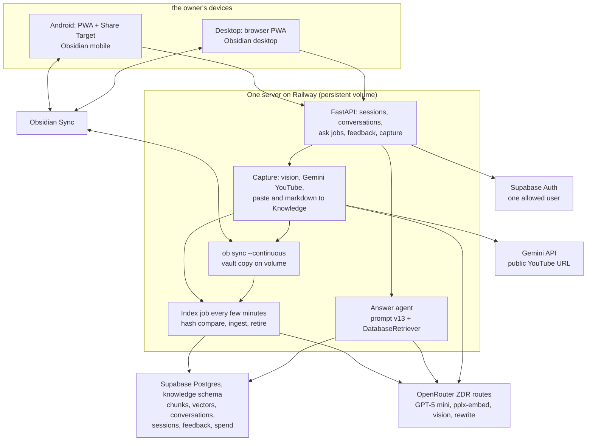
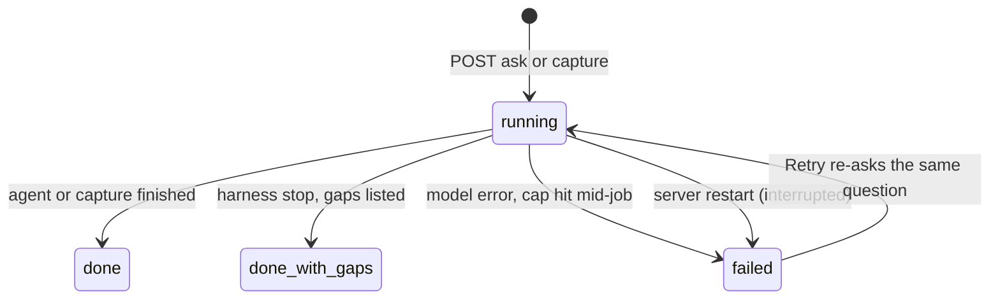

> **Archived example plan.** Kept to show how this project was scoped and built. The names of the owner and of private folders are removed, and links to files that were later merged or deleted (for example `FOUNDATION.md`, `SYSTEM.md`) no longer resolve. Current docs: [architecture](../../architecture.md), [decisions](../../decisions.md).

# Knowledge Agent Go-Live - Plan

## Goal Capsule

- **Objective:** Put a usable, private knowledge agent on the internet as soon as possible. The owner asks questions from his Android phone or desktop against his whole Obsidian vault and gets cited answers; later he also sends screenshots, YouTube links, pasted text and markdown files that become vault notes.
- **Authority:** KTD1-KTD8 are the owner's settled decisions of 2026-10-16 and are not reopened by executors. KTD9 onward are planning decisions an executor may revisit only with evidence and a note in this plan. The vault on Obsidian Sync is the home of every file; Supabase holds only the search copy, conversation history and spend records. Existing contracts in `SYSTEM.md`, `FOUNDATION.md` and `DATA.md` (source hashes, active runs, span provenance) still hold.
- **Execution profile:** Four phases. Phase 0 clears blockers. Phase 1 has two milestones: first the owner can ask a question on the hosted web app over the bulk-loaded vault (U8), then the vault keeps itself up to date (U16). Phase 2 adds follow-up memory and capture. Phase 3 is quality work driven by real use.
- **Stop conditions:** Stop and ask the owner when Obsidian Headless cannot hold a stable sync on the server (switch to the GitHub fallback only with his OK); when the bulk-load dry run's worst case exceeds the `--max-usd` he approved in U5; when full-vault retrieval recall in U5 falls more than 10 required spans below the six-file baseline at K=20; when the `rls_auto_enable()` review finds private tables reachable from the Data API; or when a hosted answer takes more than twice the local CLI's time or cost for the same question.
- **Status (2026-10-19):** Phase 0, Phase 1a (U8) and Phase 1b (U16) are built, reviewed, merged and live. Phase 2 and Phase 3 remain. The owner's decisions of 2026-10-17/18 override the original text below wherever they differ: there is no `Inbox/` folder (captures go straight into a `Knowledge` subfolder chosen by capture type), only the `Knowledge` folder is synced and indexed, and the server's sync starts download-only and is switched to two-way for Phase 2. Capture design, settled by the owner on 2026-10-19 (option A): the server processes each capture and writes the finished note itself into a `Knowledge` capture subfolder over two-way sync; it only creates new files there, never edits or deletes notes, treats captured text as content and never as instructions, and keeps the source link but never saves images (extracted text only).
- **Deploy note (2026-10-23):** Docs-only commit to start a fresh Railway deploy of `main`, since the merges of PR #25 and #26 did not get one.
- **Tail ownership:** Each phase ends with `$finish-task`, which updates `FOUNDATION.md#current-progress` and the one relevant system doc.

---

## Product Contract

### Summary

Build one small always-on Python server that serves a private installable web app, answers questions over the existing Supabase search store, keeps a synced copy of the owner's Obsidian vault, and indexes new and changed files every few minutes. In the web app the owner asks a question, gets an answer with citations and expandable source excerpts, and replies with follow-ups in the same conversation. Later the same app accepts shared screenshots, YouTube links, pasted text and markdown files, turns each into a markdown note with properties in a `Knowledge` subfolder chosen by capture type, and indexes it.

### Problem Frame

The agent works today only as a local command-line tool over six checked files (`app/agent/cli.py`). Its answer quality passed the owner's gate (prompt v13, 78.8% of scored checks), so the main gap is reach: no hosted index of the whole vault, no interface, no way to add material from a phone, and no memory across follow-up questions. Quality was measured on six files only, so U5 re-measures retrieval on the full vault before launch.

### Requirements

**Ask and answer**

- R1. The owner signs in once per device; nobody else can sign in or reach any data.
- R2. The owner starts a new conversation with "New question"; the composer in an open conversation continues it; a sidebar lists past conversations.
- R3. Each answer shows inline citations, and each citation expands to the exact source excerpt the agent read, with the source title and a link that opens the note in Obsidian.
- R4. The owner can mark an answer thumbs-down; the question, answer receipt and an optional note are saved as an eval candidate.
- R5. A follow-up in the same conversation builds on the earlier turns and on the sources already read. (Phase 2; in Phase 1 a follow-up is answered on its own and the screen says so.)

**Vault index**

- R6. Files in the vault folders the owner selects (the `Knowledge` folder, decided 2026-10-18) are searchable after a one-time bulk load whose cost was checked by a dry run first. Other folders are never synced to the server, read or indexed.
- R6b. Every indexed file has a consistent set of properties (type, tags from an approved list, people, date, one-line description). Properties the owner already set are never overwritten. New captures get the same properties from the same step.
- R7. A file the owner adds or edits in Obsidian becomes searchable within a few minutes; a file he deletes or empties stops appearing in answers.
- R8. Files stay in the Obsidian vault on Obsidian Sync; Supabase stores only text, chunks, embeddings, conversation history and spend records.

**Capture (Phase 2)**

- R9. From Android, the owner shares a screenshot, a link or a file to the installed app; on desktop he drags, drops or pastes.
- R10. A screenshot (including tweets and LinkedIn posts) becomes a markdown note with the extracted text and properties.
- R11. A YouTube link becomes a markdown note with a transcript and properties.
- R12. Pasted text and markdown files become notes with properties.
- R13. Every capture lands in a `Knowledge` subfolder chosen by capture type (no Inbox), syncs to the owner's devices, and is normally searchable within a minute, without waiting for the next scheduled index job.

**Operation**

- R14. Running cost stays near $5/month hosting plus model usage. A daily cap on all model spend (answers, indexing, rewrites, vision, transcripts) is enforced by the server; the one-time bulk load runs under its own approved limit.
- R15. No private vault data is loaded to the hosted database until the security review in U2 passes.

### Scope Boundaries

**Deferred for later**

- Long-term memory across conversations.
- Renaming or deleting conversations in the app (the owner can delete rows directly if needed).
- Cross-source themes and the compiled knowledge layer (`FOUNDATION.md` Stage 7).
- BM25/ParadeDB, reranking, HNSW indexes, unless U5's latency check shows a need; each gets its own focused plan driven by U14 evidence.
- Summaries and contextual embeddings; the selected structural/raw profile stays.
- Offline use beyond opening the app shell; dark mode is a styling choice at build time.
- Multiple users or sharing.

**Outside this product's identity**

- Editing or reorganising the owner's existing notes. The agent only adds new files, in a `Knowledge` subfolder by capture type.
- A native Android app. The installable web app with Share Target is the phone client.

### Open Questions

None block Phase 0 or the start of Phase 1. Each has a default the executor uses unless the owner says otherwise.

- Q1. Sign-in method: settled by the owner on 2026-10-16 as Supabase Auth with a six-digit email code typed into the app (see KTD10).
- Q2. Host: settled by the owner on 2026-10-16 as Railway (Hobby plan, about $5-8/month with a persistent volume). Fly only if Railway cannot give a persistent volume, a shell and Supabase access.
- Q3. Daily spend cap (needed by U6). Default: $2 for all model spend, adjustable by environment variable.
- Q4. Which vault folders to index (needed by U4b and U5). The owner names them before the dry run. Settled 2026-10-18: the `Knowledge` folder only (22 notes then, 23 now); there is no Inbox.
- Q5. The tag list (needed by U4b). Default: the classifier proposes a list from a sample of about 50 selected files plus the tags already in use; the owner edits and approves it before the full run.
- Q6. Writing properties back into existing vault files. Default: no. Properties for existing files live in Supabase only (see the non-goal on editing existing notes); new captures carry them in the file. A later opt-in command can write them into files after the owner reviews a sample.

---

## Planning Contract

### Key Technical Decisions

- KTD1. Interface is a small private installable web app (PWA) with Android Web Share Target and desktop drag-and-drop/paste, a conversation sidebar, and citations with expandable excerpts. (session-settled: user-directed — chosen over a chat-bot or native app: one client covers Android and desktop with share support.)
- KTD2. Hosting is one always-on Python server on Railway (~$5-8/month) running FastAPI, the sync job, ingestion and the answer agent. (session-settled: user-directed — chosen over Vercel functions: serverless functions cannot hold a synced vault copy.)
- KTD3. The vault stays on Obsidian Sync. The server runs Obsidian Headless as a one-shot `ob sync` every minute (so its settings are re-read each cycle), download-only and notes only at first; Phase 2 switches it to two-way so captures written into a `Knowledge` subfolder reach the owner's devices; the fallback is a private GitHub copy of the vault with the Obsidian Git plugin. The Supabase project keeps the search copy and conversation history only. (session-settled: user-directed — chosen over moving files into Supabase storage: the vault remains the owner's home for files.)
- KTD4. A job every few minutes indexes new or changed vault files by comparing the source byte hash with the active run, and retires deleted files. A one-time bulk load runs after a cost dry run. (session-settled: user-directed — chosen over manual uploads: edits made in Obsidian must reach the index on their own.)
- KTD5. Capture inputs v1 are markdown, pasted text, screenshots through a cheap vision model, and YouTube through the Gemini API with the public URL as input; a paid transcript API is the backup. (session-settled: user-directed — chosen over self-hosted transcription: no audio pipeline to run.) Revised 2026-10-20 with the user: Gemini's free tier returned "busy" (HTTP 503) on long videos, so YouTube now uses the video's own English auto captions first, with a zero-retention text model (DeepSeek, then Luna) naming each turn's speaker; in a 46-minute test this took about 20 seconds for under a cent and agreed with Gemini's speakers on 66 of 70 turns. Gemini's free tier is the fallback and there is no paid backup. A long video whose captions have no speaker marks goes to Gemini first; if Gemini fails, its captions are saved under one speaker name with a note saying the speakers were not separated.
- KTD6. Memory is per conversation only: resend recent turns, rewrite a follow-up into a standalone search query, and carry the evidence ledger forward; summarise only when a conversation gets long; use provider prompt caching where it applies. (session-settled: user-directed — chosen over long-term memory: smallest change that makes follow-ups work.)
- KTD7. Answer and embedding models stay as accepted: GPT-5 mini at medium reasoning, prompt v13, `perplexity/pplx-embed-v1-0.6b`, zero-retention OpenRouter routes. New model roles are a cheap vision model for screenshots, a cheap follow-up rewrite model (both on zero-retention routes), and the Gemini API for YouTube (KTD5). (session-settled: user-directed — chosen over re-tuning before launch: v13 passed the gate.)
- KTD8. Go live on current quality; thumbs-down feeds the eval set; review the `rls_auto_enable()` advisor warning before private data loads. (session-settled: user-directed — chosen over more eval work first: real questions are the better test.)
- KTD9. The server reaches Supabase only through Postgres as a `knowledge_runtime` login over TLS (`sslmode=verify-full`), never through the Data API. New tables live in the private `knowledge` schema, so no RLS policies for browser access are needed.
- KTD10. The server owns sessions. After sign-in with a six-digit email code from Supabase Auth (session-settled: user-directed — chosen over a magic link or a passphrase: a link opens in the browser rather than the installed Android app) it creates a random session id stored in `knowledge.sessions` with a 30-day expiry renewed on use, and sets it as an HTTP-only, Secure, SameSite=Lax cookie. Sign-out deletes the row; "sign out everywhere" deletes all rows. When Supabase Auth is used, the server checks the token's signature, issuer, audience, expiry and an allowlist of one user id; sign-ups are disabled in the project. A cookie, not a header token, lets page loads and service-worker uploads carry auth without storing a token in page JavaScript.
- KTD11. Answers and captures run as background jobs: `POST` creates a row marked `running` and returns its id, the client polls it. On startup the server marks every `running` row `failed` with reason `interrupted`, and the one-job-per-conversation rule ignores `running` rows older than the time limit plus one minute. The agent can take up to 120 seconds; polling survives phone screen-locks and flaky networks better than a long request or a stream.
- KTD12. The front end is plain HTML, CSS and JavaScript served by FastAPI, with a web manifest and service worker; no build step. Untrusted text (answers, excerpts, titles, captured content) is inserted with `textContent` only, and the server sends a strict Content-Security-Policy with no inline script. The service worker caches only the static shell, never API responses.
- KTD13. Deleting or emptying a vault file removes its `knowledge.active_runs` rows; runs and chunks stay as history, consistent with "only the active run serves answers". This needs a migration granting `delete` on `active_runs` to `knowledge_runtime`.
- KTD14. Production code does not import from `evals/`. Today `app/ingestion/live_run.py` takes `prepare`, `_load_key`, `_load_database_url` from `evals/compare_chunking.py`, `PRIVACY` from `evals/compare_embeddings.py`, and `provider_routes`, `verify_routes`, provider tags and price ceilings from `evals/trial_routes.py`. U4 moves route and price handling into `app/models/routes.py`, which `evals/` then imports; U6, U11 and U12 reuse it.
- KTD15. Phase 2 builds memory before capture. Once vault sync runs, the owner can already add notes by writing them in Obsidian on his phone, while follow-ups happen in every conversation. Capture still covers all four inputs: screenshots, YouTube, pasted text and markdown files. This adjusts the brief's order inside Phase 2 only.
- KTD16. Citations link to originals with an `obsidian://open?vault=<name>&file=<path>` URL built from the stored relative path, both parts URL-encoded. This closes the open question in `FOUNDATION.md` "Choices still open" about how the UI opens an original file; KTD3 closes the sync-provider question there.
- KTD17. Phase 1 ships in two steps: deploy the API and web app over the bulk-loaded index (U8), then add Headless sync and the scheduled index job (U16). The beta dependency then cannot hold back the first usable release.
- KTD19. Indexing covers an allowlist of vault folders (`KNOWLEDGE_INCLUDED_FOLDERS`, default `Knowledge`); there is no Inbox. The sync tool cannot say "only this folder", so a skip list (`ob sync-config --excluded-folders`, names typed at setup and kept on the volume) keeps known folders off the server, and `app/ingestion/vault_allowlist.py` runs before every download: it adds any new top-level folder to the skip list and, while the sync is download-only and the tool's own settings say so, deletes it from the server copy. In two-way mode (Phase 2) it deletes only folders already on the skip list; a 2026-10-18 test showed that deleting the local copy of a skipped folder does not delete it from the vault. Removing a folder from the list retires its documents only with `--allow-mass-retire`, so a typo cannot wipe the index. (session-settled: user-directed — chosen over the whole vault: The owner wants only selected folders.)
- KTD20. A properties classifier runs once per new or changed file before chunking: one cheap zero-retention model call reads the existing frontmatter and the first part of the text and returns a fixed schema (`source_type`, `tags` chosen from the approved list, up to five, plus at most one proposed new tag held for the owner's review, `people`, `date`, `description` of one line, `language`). It only fills properties that are missing. Results are stored per document and source hash in `knowledge.document_properties` and feed the source labels that named-source search and candidate previews already use. The same function sets properties on captures (U10). It is metadata, not chunk text, so embeddings and the measured recall baseline are unchanged; earlier card and summary experiments showed generated text inside the index did not earn its cost, so this layer is for consistent organisation and filtering. (session-settled: user-directed — chosen over hand-tagging: one process for the existing files and every future input.)
- KTD18. Every model-calling path (answers, rewrites, indexing, vision, transcripts) writes its cost to one `knowledge.spend` ledger and checks the day's total plus the job's worst-case bound against the daily cap before calling. A call with unknown usage is recorded at its worst-case bound.

### High-Level Technical Design

Ask flow: the client posts a question, the server stores a turn as `running` and starts the agent in a worker thread, the client polls the turn, and the finished turn carries the answer, citations, inspected passages and cost.

Index flow: list vault Markdown files, hash each, compare with the active run's `source_sha256` per document locator, ingest changed files through source capture (`app/ingestion/source_reader.py`), parsing, structural chunking, raw embeddings, load and publish, and retire locators whose files vanished or are empty. Retirement is skipped when the guard in U4 trips.

### Assumptions

- The vault is a few hundred to a few thousand Markdown files; U5's dry run confirms size, cost and projected database size before anything loads.
- The owner holds an Obsidian Sync subscription and can run `ob login` and `ob sync-setup` once in an interactive shell on the host, typing the vault password at the prompt. Credentials and the vault live on the persistent volume.
- The desktop Obsidian app and Headless run on different devices, as Obsidian requires.
- `main` already carries the v13 harness and source-aware search: `codex/complete-answer-quality` merged as PR #8 on 2026-10-16.
- Only public YouTube videos go to the Gemini free tier, which may use inputs to improve its models; no vault text or tags are sent with them. Screenshots may contain private content and go only through a zero-retention OpenRouter vision route.
- Supabase direct database hosts are IPv6-only; if the chosen host lacks IPv6 egress, the runtime login uses the Supavisor session pooler.

### Risks and Dependencies

| Risk | Mitigation |
| --- | --- |
| Obsidian Headless is an open beta; sync may stall or conflict | KTD17 keeps it off the first release; run it supervised with health reporting; `--conflict-strategy conflict` so nothing is silently merged, and the indexer skips conflict-copy files; the agent writes only new files in a `Knowledge` subfolder; GitHub fallback behind the same vault-folder interface. |
| An empty or partial vault copy retires the whole index and forces a paid re-embed | U4 mass-retire guard; U16 waits for Headless's first complete sync before the first tick. |
| Full-vault retrieval is worse than the six-file result | U5 reruns the recall questions on the hosted index; stop condition in the Goal Capsule. |
| Search slows at full-vault scale | U5 times named-source lookup, vector search and text search separately; HNSW or a metadata index is a measured follow-up. |
| Merging to `main` deploys migrations to the hosted project automatically | Each migration is reviewed alone and tested on local Supabase first (`AGENTS.md` Hosted schema deployment). |
| Private data on a hosted service | U2 gates the load; KTD9 TLS; KTD10 sessions; KTD12 output encoding and CSP; logs record ids, status and cost, never question, answer or excerpt text; secrets live in the host's secret store. |
| Captured third-party text carries prompt injection | The agent has retrieval tools only, so the worst case is a misleading answer; citations let the owner check. Revisit if tools that act are ever added. |
| Gemini free-tier limits (about 8 hours of video a day) and long videos | YouTube's own captions come first (KTD5, revised 2026-10-20); Gemini's free tier is the fallback. |
| Database size grows with every edit because history is kept | U4's dry run projects size; U5 compares it with the Supabase plan limit before the load. |

### Sources and Research

- Obsidian Headless: `npm install -g obsidian-headless`, Node 22+, `ob login`, `ob sync-setup --vault --path --device-name`, `ob sync` (one shot; `--continuous` is not used), `ob sync-config --mode --conflict-strategy --excluded-folders`, `ob sync-status`; requires an active Sync subscription; do not run desktop Sync and Headless on the same device (https://obsidian.md/help/headless, https://obsidian.md/help/sync/headless, read 2026-10-16).
- Stateless harness entry point: `answer_question` in `app/agent/harness.py`; the ledger (`candidates`, `inspected`, `needs`) is local to each call.
- Retrieval: `DatabaseRetriever`, `hybrid_search`, `named_sources` and `read_passage` in `app/storage/retrieval.py`; reads are bound to the active run.
- Load and publish: `load_run` in `app/storage/loader.py`, `create_profile` and `publish_run` in `app/storage/publication.py` (the profile must exist before any publish).
- Schema and grants: `supabase/migrations/20260923152944_private_knowledge_index.sql` (runtime role has select/insert and narrow updates, no deletes).
- Source identity and strictness: `capture_source` in `app/ingestion/source_reader.py` builds the document id from the root alias and casefolded relative path and rejects empty, whitespace-only and non-UTF-8 files; `app/ingestion/markdown_parser.py` reads `title`, `url`/`source`, `author`/`authors`/`guest`, `published`/`created`/`date` and `tags`, and raises on invalid frontmatter.
- Routing and generic fallback: `choose_route` in `app/ingestion/router.py` routes by top folder; captured files in a `Knowledge` subfolder fall to `generic` unless their text matches a transcript or highlight signature.
- Grader status: `docs/plans/2026-10-16-001-grader-calibration-plan.md`, `evals/answer_grader.py`, `evals/grade_answers.py`.

---

## Implementation Units

### Phase 0: Clear the way

### U1. Correct the grader status and stale docs

- **Goal:** The docs describe the grader and the open choices correctly.
- **Requirements:** R15 (prerequisite for later units).
- **Dependencies:** none.
- **Files:** `FOUNDATION.md`, `SYSTEM.md`, `evals/README.md`, `README.md`.
- **Approach:** The v13 work is already on `main` (PR #8). Correct the "parked" wording in `FOUNDATION.md`, `SYSTEM.md` and `evals/README.md`: the grader is built and ready to run; it missed the pass bar an earlier session set on its held-out test, so its ratings are pre-ratings the owner confirms. Update `FOUNDATION.md` "Choices still open" per KTD16 and KTD3, and the stale README lines listed in the Appendix.
- **Test expectation:** none -- documentation only.
- **Verification:** No doc calls the grader "parked".

### U2. Security review before private data

- **Goal:** The hosted project is safe to hold private vault text.
- **Requirements:** R1, R15.
- **Dependencies:** none.
- **Files:** this plan (record the outcome in place) and a new migration under `supabase/migrations/` only if the review needs a fix.
- **Approach:** Read the `rls_auto_enable()` function and the advisor warning; decide whether to revoke its public execute grant or drop it, and whether that changes how U3 creates tables. Confirm `knowledge` is absent from exposed Data API schemas in the hosted settings. Create the hosted runtime login (outside the repo) with membership in `knowledge_runtime` only. Disable public sign-ups in Supabase Auth and restrict redirect URLs to the deployed origin.
- **Test expectation:** none -- configuration review; any fix migration is tested on local Supabase first.
- **Verification:** Advisor warning resolved or recorded as accepted with a reason; `anon` and `authenticated` cannot read any `knowledge` table.

### Phase 1: Usable agent

### U3. Schema for conversations, sessions, feedback, spend and retirement

- **Goal:** The database holds conversations, turns, capture jobs, sessions, thumbs-down feedback and spend, and the runtime role can retire a deleted file.
- **Requirements:** R1, R2, R4, R7, R14.
- **Dependencies:** U2.
- **Files:** `supabase/migrations/20261017000000_conversations_and_retirement.sql`, `tests/storage/test_conversation_store.py`.
- **Approach:** New tables in `knowledge`: `conversations` (id, title from the first question truncated, created, last activity), `turns` (conversation, position, question, standalone query, status, answer receipt JSON including the evidence ledger, cost, error), `capture_jobs` (kind, status, vault path, error, cost), `sessions` (id, created, expires), `feedback` (turn, verdict, note, created), `spend` (day, source, estimated USD, job id). Enable RLS, add the runtime policy and revoke public, `anon` and `authenticated` on these six tables by name; do not re-run the first migration's schema-wide loop, which would fail on existing policies. Grant `knowledge_runtime` select/insert/update on the new tables, delete on `sessions`, and delete on `active_runs` (KTD13).
- **Patterns to follow:** RLS statements and grants at the end of `supabase/migrations/20260923152944_private_knowledge_index.sql`.
- **Test scenarios:**
  - A runtime connection inserts a conversation and two turns and reads them back in order.
  - A turn moves from `running` to `done` with its receipt.
  - A runtime connection deletes an `active_runs` row; the run and its chunks remain.
  - A runtime connection deletes a session row.
  - `anon` and `authenticated` cannot select from any new table.
- **Verification:** `npx supabase db reset --local` applies both migrations cleanly; storage integration tests pass.

### U4. Vault indexer

- **Goal:** One command indexes any vault folder incrementally: new and changed files are ingested and published, deleted or emptied files are retired, and failures do not loop.
- **Requirements:** R6, R7, R8, R14.
- **Dependencies:** U3.
- **Files:** `app/ingestion/vault_sync.py`, `app/models/routes.py`, `app/ingestion/live_run.py`, `evals/compare_embeddings.py`, `evals/trial_routes.py`, `app/storage/publication.py`, `tests/ingestion/test_vault_sync.py`, `tests/models/test_routes.py`, `tests/storage/test_retirement.py`.
- **Approach:** Walk only the folders in `KNOWLEDGE_INCLUDED_FOLDERS` under `KNOWLEDGE_SOURCE_ROOT` (the vault root, fixed root alias; KTD19) for `.md` files, skipping `.obsidian/`, `.trash/`, configured excluded folders and Obsidian conflict-copy files. Treat empty or whitespace-only files as absent. Compare each file's byte hash with the active run's `source_sha256` for its locator; only differing files go through source capture, routing, structural chunking, raw embeddings with the selected spec, `load_run` and `publish_run`. Retire locators with an active run but no file. Record failures by (locator, hash) and skip a hash that already failed until its bytes change. Mass-retire guard: when one pass would retire more than 10% of active documents or more than 20 files, or the vault root is missing, retire nothing and report it unless `--allow-mass-retire` is given. `--dry-run` parses every file and reports counts, parse failures by reason, chunk and token estimates, worst-case cost and projected database size, with no model calls. `--live` needs `--max-usd` and writes spend to the ledger (KTD18). A lock prevents overlapping runs. Move route and price handling into `app/models/routes.py` per KTD14.
- **Patterns to follow:** `preview_markdown` and the run directory layout in `app/ingestion/preview.py`; `embed_chunks` in `app/ingestion/embeddings.py`; budget guards in `app/ingestion/live_run.py`.
- **Test scenarios:**
  - Three new fixture files: dry run reports three to ingest and a cost; live run with a fake client publishes three active runs.
  - Re-running with no change makes no model call.
  - Editing one file creates a new run for that document only and switches its active run after load succeeds.
  - Deleting one file retires its active run; search no longer returns its chunks.
  - Emptying a file retires its active run; an empty new file is skipped without a failure.
  - A file with invalid frontmatter is recorded as failed once and not retried until it changes.
  - An empty or missing vault root retires nothing and reports the guard.
  - A file whose embedding call fails keeps its previous active run; other files still publish.
  - Spend cap reached mid-run stops before the next call and reports partial progress.
  - `.obsidian/`, `.trash/` and conflict-copy files are ignored.
  - A file outside the included folders is never read; removing a folder from the list retires nothing without `--allow-mass-retire`.
  - `evals/` still passes its own tests after importing from `app/models/routes.py`.
- **Verification:** Ingestion, model and storage suites pass; a local run over a copy of the vault reaches a second pass that makes no model calls and retries no failed hash.

### U4b. Properties classifier

- **Goal:** Every indexed file, and later every capture, gets the same consistent properties without overwriting what the owner set.
- **Requirements:** R6b, R14.
- **Dependencies:** U3, U4.
- **Files:** `supabase/migrations/20261017000100_document_properties.sql`, `app/ingestion/properties.py`, `prompts/properties_v1.md`, `config/tags.yaml`, `app/ingestion/vault_sync.py`, `app/storage/retrieval.py`, `tests/ingestion/test_properties.py`, `tests/storage/test_properties_labels.py`.
- **Approach:** Per KTD20. `knowledge.document_properties` (document, source hash, properties JSON, model, prompt version, cost, created) with runtime grants as in U3. `classify_properties(parsed_document, tag_list)` sends existing frontmatter and the first about 2,000 tokens to a cheap zero-retention route and validates the reply against the schema; tags outside the approved list are dropped, except one `proposed_tag` kept for review. The indexer calls it for new or changed files only, before chunking, and writes spend per KTD18. `--propose-tags N` samples N selected files and writes a draft `config/tags.yaml` with counts for the owner to edit (Q5). `named_sources` and candidate previews merge stored properties with frontmatter, frontmatter winning. The dry run includes classifier cost.
- **Test scenarios:**
  - A file with no frontmatter gets `source_type`, tags from the list, `people` and `description` stored for its hash.
  - A file whose frontmatter has `tags` and `author` keeps them; only missing fields are filled.
  - A reply with a tag not on the list keeps only listed tags and at most one `proposed_tag`.
  - An invalid model reply is recorded as a classifier failure; the file is still indexed without generated properties.
  - Re-running on an unchanged file makes no model call.
  - A stored `people` value makes the file match named-source search.
  - `--propose-tags` writes a draft list and makes no other change.
- **Verification:** On the six checked files, the owner reviews the properties and finds them right or near; the 41/44/47 recall baseline is unchanged.

### U5. Bulk load the vault to the hosted project

- **Goal:** The selected folders are searchable in the hosted project with properties, with retrieval quality re-measured at full scale.
- **Requirements:** R6, R14.
- **Dependencies:** U2, U4, U4b.
- **Files:** none in the repo; record numbers in `FOUNDATION.md#current-progress` via `$finish-task`.
- **Approach:** The owner confirms the folder list (Q4) and approves the tag list from `--propose-tags` (Q5). Run U4's dry run, classifier included, against a copy of the vault with the same root alias and root level the server will use. Show the owner file count, parse failures, token estimate, worst-case cost and projected database size against the Supabase plan limit. Proceed only on his OK; the `--max-usd` he approves is this load's limit, separate from the daily cap. Create and select the hosted structural/raw profile, then load and publish with the runtime login. Rerun the existing source-span recall questions on the hosted index and compare with the six-file 41/44/47 baseline. Time ten representative searches, recording `named_sources`, vector search and text search separately.
- **Execution note:** Operational step; prove it with the dry-run report, the live report, the recall report and the latency sample.
- **Test expectation:** none -- operational load using U4.
- **Verification:** A count over `knowledge.active_runs` for the selected profile equals the number of indexable vault files; Q8 returns both named sources; recall and latency are recorded and within the Goal Capsule stop conditions.

### U6. FastAPI service: sessions, conversations, ask jobs, feedback

- **Goal:** An HTTP API the web app uses to sign in, list conversations, ask, poll and give feedback.
- **Requirements:** R1, R2, R3, R4, R14.
- **Dependencies:** U3, U4 (`app/models/routes.py`).
- **Files:** `app/api/main.py`, `app/api/auth.py`, `app/api/conversations.py`, `app/api/answers.py`, `app/api/spend.py`, `app/api/settings.py`, `pyproject.toml`, `tests/api/test_auth.py`, `tests/api/test_conversations.py`, `tests/api/test_answers.py`, `tests/api/test_spend.py`.
- **Approach:** Add `fastapi`, `uvicorn` and a JWT library. Sessions and six-digit email-code sign-in per KTD10. Public routes: sign-in shell, static PWA assets, `/auth/*` (rate-limited) and `/healthz` (returns only ok or fail). Everything else, including detailed `/health` (database reachability, last index time, failures), needs the session cookie. Ask per KTD11: `POST /conversations/{id}/turns` stores a `running` turn and runs `answer_question` with `DatabaseRetriever` in a worker thread; `GET /turns/{id}` returns status and, when finished, answer, citations with `obsidian://` links (KTD16), excerpts and cost. Spend per KTD18, with the per-call cap from the CLI defaults. `POST /turns/{id}/feedback` stores thumbs-down with an optional note. Logs record ids, status, timing and cost only.
- **Patterns to follow:** configuration, price checks and limits in `app/agent/cli.py`; `AnswerResult` in `app/agent/records.py`.
- **Test scenarios:**
  - No cookie gets 401 on API routes; `/`, the manifest, the service worker and `/healthz` respond without one; `/health` needs one.
  - A Supabase token for another user id gets 403; an expired token or wrong audience gets 401.
  - An expired or signed-out session gets 401; "sign out everywhere" invalidates all sessions.
  - Asking creates a `running` turn; with a fake client it becomes `done` with citations that map to inspected passages.
  - A harness stop is stored as `done` with gaps, not as an error.
  - A model error marks the turn `failed` with a readable message.
  - A turn left `running` before restart is `failed` (interrupted) after startup, and the conversation accepts a new ask.
  - With the day's ledger total plus the job's worst case over the cap, asking returns 429 and no model call is made.
  - A second ask in a conversation while one is running returns 409.
  - Thumbs-down stores feedback linked to the turn and its receipt.
  - Log output for an ask contains no question or answer text.
- **Verification:** `tests/api` pass with fake clients; a local run answers a real question against local Supabase.

### U7. Web app (PWA shell, ask and answer screens)

- **Goal:** The owner uses the agent from the browser on Android and desktop and can install it.
- **Requirements:** R1, R2, R3, R4, R5.
- **Dependencies:** U6.
- **Files:** `app/web/index.html`, `app/web/app.js`, `app/web/styles.css`, `app/web/manifest.webmanifest`, `app/web/sw.js`, `app/web/icons/`, `app/api/main.py`, `tests/api/test_static.py`.
- **Approach:** Plain HTML/JS per KTD12.
  - **Sign-in:** screens for "code sent" (with resend), "code expired or wrong" and a generic "not authorised". A 401 during use returns to sign-in, keeps the unsent draft locally, and returns to the same conversation.
  - **Conversations:** sidebar ordered by last activity, titled by the first question; empty state invites the first question. "New question" starts a conversation; the composer always continues the open one. In Phase 1 a follow-up shows a small note that earlier turns are not yet used.
  - **Turn states:** running (elapsed time, polling resumes when the page or conversation is reopened, composer disabled), done, done with gaps (the harness message and listed gaps), failed (message plus Retry, which re-asks the same question), daily cap reached (states the cap and reset time, composer disabled).
  - **Citations:** numbered markers; one excerpt open at a time per answer; excerpts capped in height with scroll; a repeated source shares one number; each excerpt shows title, locator and "Open in Obsidian" (hidden where the device cannot open `obsidian://`, showing the vault path instead).
  - **Feedback:** thumbs-down toggles on, then shows an optional note field; tapping again removes it.
  - **Layout and accessibility:** below tablet width the sidebar becomes an overlay opened from a header button; composer pinned above the on-screen keyboard; markers and expanders are buttons with `aria-expanded` and 44px targets; turn status is an `aria-live` region; everything reachable by keyboard.
  - **PWA:** manifest and a service worker that caches only the static shell; Share Target arrives in U13.
- **Test scenarios:**
  - `GET /` serves the app shell; manifest and service worker are served with correct content types; the CSP header is present.
  - An excerpt containing `<script>` and a `javascript:` link renders as inert text.
  - Manual check on Android Chrome and desktop: install, sign in, ask, follow up, expand a citation, open it in Obsidian, give thumbs-down, see a failed turn and retry it.
- **Verification:** The manual check passes on both devices against the local server.

### U8. Deploy the API and web app

- **Goal:** The service runs on the internet over the bulk-loaded index. This is the first usable release.
- **Requirements:** R1-R4, R14.
- **Dependencies:** U5, U6, U7.
- **Files:** `Dockerfile`, `deploy/start.sh`, `deploy/README.md`, `README.md`.
- **Approach:** One image with Python 3.12 running uvicorn behind the host's TLS. Secrets (database URL with `sslmode=verify-full`, OpenRouter key, Supabase settings, cookie settings) live in the host's secret store, never in the image or repo. Platform health probe uses `/healthz`. Host choice per Q2. `deploy/README.md` documents setup, secrets and rollback.
- **Execution note:** Prove with a smoke check on the deployed host.
- **Test expectation:** none -- packaging and deployment; behaviour is covered by U6 and U7 tests.
- **Verification:** On the deployed app from the owner's phone, Q8 is answered with both named sources cited; `/healthz` is ok after a restart.

### U16. Vault sync and scheduled indexing on the server

- **Goal:** The deployed vault copy follows Obsidian Sync and indexes itself.
- **Requirements:** R7, R8.
- **Dependencies:** U4, U8.
- **Files:** `Dockerfile`, `deploy/start.sh`, `deploy/README.md`, `app/api/scheduler.py`, `tests/api/test_scheduler.py`.
- **Approach (built and live 2026-10-19):** The image installs `obsidian-headless` from a lock file (`deploy/obsidian/`) with pinned base images; a Railway volume at `/data` holds the vault copy and Headless's sign-in. `deploy/start.sh` fixes volume ownership and drops to an app user; `deploy/run.sh` starts `deploy/sync-loop.sh` (cleanup, then one `ob sync`, every minute) beside uvicorn when `KNOWLEDGE_SYNC_ENABLED=true`. `app/api/scheduler.py` runs U4's indexer every five minutes with U4's lock, holds retirement on the first pass after a start, and reports the last result and last download in `/health`. `deploy/ob-setup.sh` is the one-time sign-in and setup (download-only, notes only, folder skip list); `deploy/README.md` documents it and the Phase 2 two-way switch.
- **Execution note:** Prove with a smoke check on the deployed host.
- **Test expectation:** none -- packaging and deployment; behaviour is covered by U6 and U7 tests.
- **Verification:** On the deployed app from the owner's phone, Q8 is answered with both named sources cited; `/healthz` is ok after a restart.

### U16. Vault sync and scheduled indexing on the server

- **Goal:** The deployed vault copy follows Obsidian Sync and indexes itself.
- **Requirements:** R7, R8.
- **Dependencies:** U4, U8.
- **Files:** `Dockerfile`, `deploy/start.sh`, `deploy/README.md`, `app/api/scheduler.py`, `tests/api/test_scheduler.py`.
- **Approach:** Add Node 22 and `obsidian-headless` to the image and a persistent volume for the vault copy and Headless config. Headless sync excludes every top-level folder outside the KTD19 allowlist. The start script supervises `ob sync --continuous` and uvicorn, restarting either if it exits. The FastAPI process runs U4's indexer every five minutes in a background thread with U4's lock, and records the last result for `/health`. The first tick waits until `ob sync-status` reports a completed initial sync. `deploy/README.md` documents the one-time `ob login`, `ob sync-setup --device-name kb-server` (vault password typed at the prompt, not passed as an argument) and `ob sync-config --conflict-strategy conflict`.
- **Execution note:** Prove with a smoke check on the deployed host beyond the scheduler tests.
- **Test scenarios:**
  - The scheduler skips a tick when the previous index job still holds the lock.
  - An index job exception is recorded in `/health` and the next tick still runs.
  - No tick runs before the initial sync completes.
- **Verification:** The first tick after setup ingests and retires nothing that was unchanged since U5; a note the owner creates in Obsidian on his phone is answerable within ten minutes; a deleted note stops appearing; `/health` is green after a restart.

### Phase 2: Follow-ups and capture

### U9. Per-conversation memory

- **Goal:** A follow-up builds on earlier turns and sources already read.
- **Requirements:** R5.
- **Dependencies:** U6.
- **Files:** `app/agent/harness.py`, `app/agent/records.py`, `app/agent/memory.py`, `prompts/followup_rewrite_v1.md`, `prompts/answer_agent_v14.md`, `app/api/answers.py`, `app/web/app.js`, `tests/agent/test_memory.py`, `tests/agent/test_harness.py`.
- **Approach:** Per KTD6. Before the first search, a cheap model call rewrites the follow-up into a standalone query using the last few turns; that query drives the host search. `answer_question` accepts an optional prior ledger, taken from the earlier turns' stored receipts, and recent turns. Before each follow-up, drop carried passages whose (document, run) is no longer active and tell the model they changed. Carried passages are shown as already read and can be cited again without a fresh read. Cap carried passages by count and bytes; summarise older turns only past that cap. Prompt changes go into v14 so v13 stays the comparison baseline. Put the stable prompt prefix first so provider prompt caching applies. Remove the Phase 1 "earlier turns not used" note from the UI.
- **Test scenarios:**
  - "What about the second one?" after a two-source answer is rewritten into a query naming that source.
  - A first question passes through unchanged and makes no rewrite call.
  - A follow-up cites a passage read in turn 1 without a new read action; the citation check passes.
  - A document republished between turns has its old passage dropped and cannot be cited.
  - A ledger over the cap keeps the newest passages and records what was dropped.
  - With no prior ledger, behaviour matches v13 on the existing harness tests.
- **Verification:** Agent tests pass; three real follow-up chains on the hosted app read naturally to the owner.

### U10. Capture core: notes into a Knowledge subfolder

- **Goal:** Any captured input becomes a markdown file with properties in a `Knowledge` subfolder chosen by capture type and is indexed at once.
- **Requirements:** R12, R13.
- **Dependencies:** U4b, U16.
- **Files:** `app/capture/notes.py`, `app/api/capture.py`, `tests/capture/test_notes.py`, `tests/api/test_capture.py`.
- **Approach:** First switch the server's sync to two-way as `deploy/README.md` describes (turn the sync loop off, switch the tool and `KNOWLEDGE_SYNC_MODE` together, turn it back on) and change the cleanup so it deletes only folders already on the skip list. Then fill properties through U4b's `classify_properties`, written into the new file's frontmatter. Build YAML properties with the names the parser reads: `title`, `url`, `author` (post author or YouTube channel), `created` (capture date), `tags`, plus `source_type` (screenshot, youtube, text, markdown). Ignore client-supplied file names; build the name from a slug of `[a-z0-9-]` plus date, resolve the final path, refuse anything outside the capture folders, and never overwrite. Capture folders, settled by the owner on 2026-10-19: the existing `Knowledge` subfolders, chosen by type: YouTube to `Transcripts`, full articles to `Articles`, book-highlight screenshots to `Book Highlights`, and tweets, LinkedIn posts, short text and anything uncertain to `Notes` (never `Books`). The server only creates new files there (exclusive create, so an existing file can never be replaced) and never edits, overwrites or deletes the notes already in those folders. Uploaded markdown keeps its own properties and gains missing ones. Captures run as `capture_jobs` per KTD11, write spend per KTD18, and enforce a 20 MB upload limit. After writing, the capture waits up to 30 seconds for U4's lock and indexes that one file; on timeout it reports "saved, indexing queued" and the next tick picks it up.
- **Test scenarios:**
  - Pasted text produces one new note with properties and becomes searchable.
  - A captured note's `author` appears as a person in the source label used by named-source search.
  - Two captures with the same title produce two distinct files.
  - An upload named `../Projects/x.md` lands in a capture subfolder under a safe name.
  - An uploaded markdown file with existing `tags` keeps them and gains `created`.
  - A capture arriving while the index lock is held reports "saved, indexing queued" and is indexed on the next tick.
  - A capture whose indexing fails keeps the file and reports the failure.
- **Verification:** A pasted note on the deployed app appears in Obsidian on the phone and is answerable within a minute.

### U11. Screenshot extraction

- **Goal:** Screenshots, including tweets and LinkedIn posts, become text notes.
- **Requirements:** R10.
- **Dependencies:** U10.
- **Files:** `app/models/client.py`, `app/models/openrouter.py`, `app/capture/screenshot.py`, `prompts/screenshot_extract_v1.md`, `tests/models/test_client.py`, `tests/capture/test_screenshot.py`.
- **Approach:** Extend `ModelClient` with image input and add a cheap vision model on a zero-retention route chosen through `app/models/routes.py`. The prompt returns the visible text verbatim plus author, platform, post date and a title when visible; U10 builds the note. Images are downscaled before sending. The original image is never stored (the owner, 2026-10-19: extracted text only), so attachment sync stays off.
- **Test scenarios:**
  - A fake vision response for a tweet produces a note with `author`, `source_type: screenshot` and the post text in the body.
  - A response without a visible author leaves `author` empty rather than guessed.
  - A non-ZDR route is refused before any call.
  - An oversized image is downscaled under the provider limit.
- **Verification:** Three real screenshots (a tweet, a LinkedIn post, an article) produce notes the owner judges faithful.

### U12. YouTube transcripts through Gemini

- **Goal:** A YouTube link becomes a transcript note.
- **Requirements:** R11.
- **Dependencies:** U10.
- **Files:** `app/models/gemini.py`, `app/capture/youtube.py`, `prompts/youtube_transcript_v1.md`, `tests/models/test_gemini.py`, `tests/capture/test_youtube.py`.
- **Approach:** Start with a quality spike on two or three public videos, comparing Gemini output with YouTube captions. Then send only the public URL and the transcript prompt; ask for a transcript in the bold-speaker-label format the transcript parser routes, with title, channel and date returned separately for the frontmatter, not in the body. Split videos longer than one request allows into time ranges and join them. Track daily video minutes against the free-tier limit; over the limit or on failure, use the paid transcript backup if configured, or report the failure.
- **Execution note:** Run the spike before building the unit; if quality is poor, make the backup API the default and tell the owner.
- **Test scenarios:**
  - A fake two-part response for a long video joins into one transcript in order.
  - The transcript text routes as `transcript_bold` through `choose_route`, with no body text before the first speaker label.
  - Private or unavailable videos return a clear capture error.
  - The daily-minutes counter blocks a call that would pass the limit.
- **Verification:** Spike results recorded in `INGESTION.md`; a real video captured on the deployed app is answerable with citations into its transcript.

### U13. Capture from phone and desktop

- **Goal:** The owner shares to the app from Android and drops or pastes on desktop, and always sees what happened.
- **Requirements:** R9.
- **Dependencies:** U10, U11, U12.
- **Files:** `app/web/manifest.webmanifest`, `app/web/sw.js`, `app/web/app.js`, `app/web/capture.html`, `tests/api/test_capture.py`.
- **Approach:** Add `share_target` to the manifest (POST, multipart, accepting images, text, URLs and `.md`). The service worker intercepts the share POST, holds the payload, and opens the capture screen, which uploads it with the session cookie. If the session has expired, the payload is kept until sign-in completes. An "Add" button in the sidebar header opens the same screen on desktop, which accepts drag-and-drop, paste and a text field. The screen detects the input type, lets the owner add tags, and shows each item as queued, extracting, saved and indexed, or failed with a reason and Retry. On success it shows the note title, its path and "Open in Obsidian". A recent-captures list for the session makes a repeated share recognisable.
- **Test scenarios:**
  - Sharing an image, a YouTube link, a text snippet and a `.md` file each routes to the right capture type.
  - A share while signed out prompts sign-in and then completes the capture.
  - A private video and a quota-exceeded video each show a readable failure with Retry.
  - Manual check on Android: share from Gallery, the YouTube app, X and LinkedIn.
- **Verification:** The manual check passes on the owner's phone and desktop.

### Phase 3: Quality from real use

> **Note (2026-10-19): plan the suggested-tags page first.** The owner decided on 2026-10-18 that tags the classifier proposes (stored in `knowledge.document_properties`) get a "Suggested tags" page: one tap approves a tag, adds it to `config/tags.yaml` and assigns it to every note it fits. It has no unit yet. The owner chose to build Phase 2 as written and plan this page at the start of Phase 3.
>
> **Update (2026-10-21):** planned and built as 2026-10-21-001-feat-settings-suggested-tags-plan.md: a Settings page with a Tags tab, a `knowledge.tags` table, and a notes sheet or panel.

### U14. Eval set from thumbs-down and grader pre-ratings

- **Goal:** Real failures become eval questions, and answer changes can be measured over repeat runs.
- **Requirements:** R4.
- **Dependencies:** U1, U6.
- **Files:** `evals/export_feedback.py`, `evals/README.md`, `tests/evals/test_export_feedback.py`.
- **Approach:** Export thumbs-down turns with question, answer receipt and note into a private review file under `.local/`. The owner chooses which become eval questions; new checks follow the existing checklist format and approval flow. Run the existing grader as a pre-rater on new answers for the owner to confirm. Compare any prompt or model change against v13 with repeat runs. Retrieval changes (HNSW, BM25, reranking, related-chunk links, themes) each get their own focused plan driven by this evidence and the U5 latency numbers.
- **Test scenarios:**
  - Export includes only thumbs-down turns and never writes outside `.local/`.
  - A turn whose receipt is missing is listed with a warning rather than dropped.
- **Verification:** One export reviewed with the owner; at least one new eval question approved.

---

## Verification Contract

| Gate | Command or check | Applies to |
| --- | --- | --- |
| Ingestion tests | `python -m unittest discover -s tests/ingestion -p 'test_*.py'` | U4, U4b, U10-U12 |
| Model tests | `python -m unittest discover -s tests/models -p 'test_*.py'` | U4, U11, U12 |
| Storage tests (disposable DB via `KNOWLEDGE_TEST_DATABASE_URL`) | `python -m unittest discover -s tests/storage -p 'test_*.py'` | U3, U4 |
| Agent tests | `python -m unittest discover -s tests/agent -p 'test_*.py'` | U9 |
| API tests | `python -m unittest discover -s tests/api -p 'test_*.py'` | U6, U7, U10, U13, U16 |
| Capture tests | `python -m unittest discover -s tests/capture -p 'test_*.py'` | U10-U12 |
| Eval tests | `python -m unittest discover -s tests/evals -p 'test_*.py'` | U4, U14 |
| Migration | `npx supabase db reset --local` applies all migrations cleanly | U2, U3 |
| Hosted smoke | Ask Q8 on the deployed app; both named sources cited | U5, U8 |
| Device check | Install, sign in, ask, follow up, expand a citation, open in Obsidian, share a screenshot | U7, U13 |

Tests use fake model clients; no unit test makes a live model call or touches the hosted project.

## Definition of Done

- Phase 1 first release (U8): The owner asks a question on the deployed app from his Android phone and desktop, sees citations with excerpts and Obsidian links, and can give thumbs-down.
- Phase 1 complete (U16): a note the owner writes in Obsidian is answerable within ten minutes, and a deleted note stops appearing.
- Phase 2 done: follow-ups build on earlier turns; screenshots, YouTube links, pasted text and markdown files shared from Android or dropped on desktop land in a `Knowledge` subfolder, sync to his devices and are answerable.
- Phase 3 done when the owner decides; each quality change shows a measured gain over v13.
- Every phase: listed tests pass, `FOUNDATION.md#current-progress` and the relevant system doc are updated through `$finish-task`, no vault content or model output is committed, and no abandoned experimental code is left in the diff.

## Appendix

### Design smells noticed while planning (separate issues, not in scope)

- `app/ingestion/live_run.py` depends on eval code (`evals/compare_chunking.py`, `evals/compare_embeddings.py`, `evals/trial_routes.py`). U4 moves route and price handling; the rest of `live_run.py` could be cleaned up separately.
- `live_run.py` hard-codes seventeen summary prompt families as CLI choices although summaries are outside the selected profile.
- `named_sources` in `app/storage/retrieval.py` reads metadata from the full `parsed` JSON of every active document on every search; a small metadata column or view would avoid this if U5 shows it is slow.
- A case-only rename of a vault file fails on every pass ("document ID already belongs to another locator") because the document id is built from the casefolded path while the locator keeps its case.
- `README.md` still says "formal answer quality remains unmeasured" and "No answer API or deployment is included"; U1 and U8 update these.
