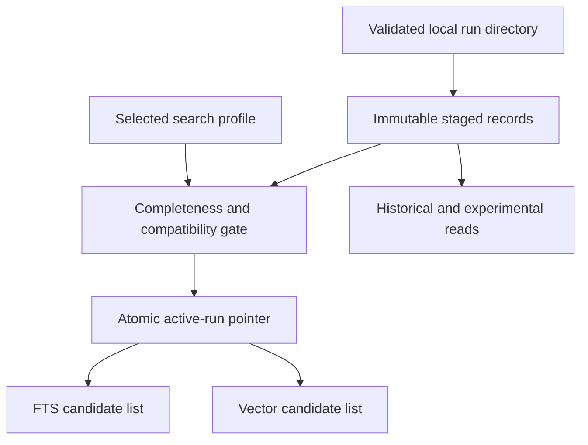

# Persist source-linked runs and search them in Supabase

## Overview

Stage 3 turns the local outputs of Stage 2 into a durable, searchable index. It stores the captured source revision and parsed artifacts, admits only a complete selected run into ordinary search, retains previous runs for comparison, and returns separate vector and Postgres full-text candidate lists with exact provenance. This plan is grounded in `FOUNDATION.md` (Current progress, Data relationships, Retrieval and answer path), `DATA.md`, and `SYSTEM.md`.

The intended first proof is a small local Supabase database populated from synthetic fixture runs. A bounded, opt-in comparison on the checked real-vault questions then selects the first raw-chunk embedding specification and tests the same path on a private corpus sample. Stage 3 is complete when both search modes return source-linked chunks from the selected active view, a failed replacement cannot change that view, and the initial embedding choice has a recorded quality/cost rationale. If no candidate meets the selection gate, the storage/search proof is complete but real-corpus Stage 3 sign-off remains pending.

The Supabase organization and project already exist, and the user reports no data in the project. No project provisioning is planned; the existing project is the hosted target after local migration and permission checks. Its schema, extensions, and grants must still be inspected before applying migrations there.

Local implementation and proof are complete. The hosted `Knowledge Agent` project (`ielkvsfcnwtaljnemxua`) has been inspected and remains unmigrated pending explicit approval of the exact migration. The selected raw-chunk model is `perplexity/pplx-embed-v1-0.6b`; exact vector search remains the baseline while approximate indexing awaits representative recall and query-plan measurements.

## Problem frame and requirements trace

Local files under `.local/ingestion-runs/<run_id>/` currently hold a snapshot, parsed document, two chunk sets, a run manifest, and optional model artifacts. Nothing can safely serve those records to a query process after ingestion, and there is no active-run or embedding-version selection. The database must preserve the source authority and make experiments possible without leaking incomplete or historical results into ordinary answers.

| ID | Requirement and source | Acceptance proof |
| --- | --- | --- |
| R1 | Preserve stable document identity, exact source revision, and source spans (`FOUNDATION.md`, `DATA.md`). | Every result resolves to one document, run, byte hash, captured text, and validated character spans. |
| R2 | Persist parsed blocks, both chunk variants, contexts, cards, summaries, manifest status, and embedding specifications without flattening their relationships (`DATA.md`, `INGESTION.md`). | Loading and reading a fixture run reconstructs its source-linked records and versions. |
| R3 | Serve one complete active run per document; retain staged, failed, experimental, and historical runs (`FOUNDATION.md`). | A failed or partial replacement leaves the prior active view searchable; an eligible replacement switches atomically. |
| R4 | Keep embedding model, dimensions, metric, input recipe, context version, and chunking version together; cut over only after a complete compatible index exists (`FOUNDATION.md`, `RETRIEVAL.md`). | Incompatible vectors cannot mix; a profile switch fails if any active document lacks complete embeddings. |
| R5 | Provide independent vector and Postgres FTS/`ts_rank` top-K searches over selected chunks, with provenance and deterministic ordering (`FOUNDATION.md`, `RETRIEVAL.md`). | Both searches return eligible hits; neither returns inactive or wrong-profile chunks. |
| R6 | Keep personal source content inaccessible through a public Data API and keep credentials out of the repository (`FOUNDATION.md`, V1 access boundary). | Database grants and connection tests deny unprivileged access; only the trusted Python process can read or load the index. |

## Scope boundaries

Stage 3 owns the database schema, local artifact loader, publication rules, independent candidate queries, and a bounded embedding-model selection trial. It also stores evidence cards so Stage 4 can expose its separate card-search tool. It does not build RRF, the production retrieval API or query-embedding service, agent loop, citation validation, comprehensive retrieval evaluation, or a UI. The selection trial embeds its own test queries; it is not the production query path. A compiled themes layer is deferred until baseline evaluation as described in `FOUNDATION.md`; the source links stored here allow future derived claims to point through cards or chunks to original spans.

The first release handles one personal corpus and one selected search profile at a time. It retains all historical runs during V1; automated deletion, multi-user access, and customer data need separate plans. Private vault files and generated model output stay outside Git.

## Context and research

### Relevant code and patterns

- `app/ingestion/source_reader.py` makes a stable document ID from root alias and relative path, a new run ID per capture, and a SHA-256 hash of the original bytes. The loader must verify `source.md` against `capture.json` and `parsed.json`.
- `app/ingestion/contracts.py` validates parsed source coverage, chunks against source slices and parent blocks, and evidence cards against exact quoted spans. Reuse those validators before database writes.
- `app/ingestion/run_manifest.py` records pending, ready, and failed model artifacts, but has no publication-completeness declaration. Stage 3 therefore needs a separate explicit publication selection.
- `app/ingestion/embeddings.py` records a full `EmbeddingSpec` and validates vector dimensions and finite values. Its batches may be incomplete, so completeness must be checked across all selected chunks.
- `app/ingestion/preview.py` writes `parsed.json`, `fixed_raw.json`, `structural_raw.json`, and `run-manifest.json`; enrichment writes versioned JSON in `artifacts/`. `eval_mapping.json` is an evaluation artifact, not search data.
- `pyproject.toml` is a small Python 3.11+ package using Pydantic 2. There is no database client, migration, or HTTP API pattern yet. `tests/ingestion/` uses synthetic fixtures and fake model responses. No `docs/solutions/` directory exists to contribute prior database learnings.

### External guidance

- [Supabase database migrations](https://supabase.com/docs/guides/deployment/database-migrations) support versioned SQL migrations tested against a local database before remote deployment. Stage 3 should not create untracked schema changes in a hosted project.
- [Supabase API security](https://supabase.com/docs/guides/api/securing-your-api) and [RLS guidance](https://supabase.com/docs/guides/database/postgres/row-level-security) support a non-exposed schema for the private corpus. The [April 2026 Data API grant change](https://supabase.com/changelog/45329-breaking-change-tables-not-exposed-to-data-and-graphql-api-automatically) also means exposure cannot be inferred from a table's existence.
- [Supabase database connections](https://supabase.com/docs/guides/database/connecting-to-postgres) distinguish direct or session connections for a persistent Python process from transaction pooling for serverless use. Plan on a server-side Postgres connection; select the connection mode for the eventual deployment environment.
- [Supabase hybrid search](https://supabase.com/docs/guides/ai/hybrid-search) demonstrates GIN-backed FTS and separately ranked vector results. [pgvector](https://github.com/pgvector/pgvector#can-i-store-vectors-with-different-dimensions-in-the-same-column) permits different dimensions in one column but requires dimension-specific expression and partial indexes. Its [indexing guidance](https://github.com/pgvector/pgvector#filtering) warns that approximate-index filters can reduce recall; exact search is the initial correctness reference.
- [Supabase vector indexes](https://supabase.com/docs/guides/ai/vector-indexes) require an operator class matching the selected distance metric and currently document dimension limits. [Postgres full-text search](https://www.postgresql.org/docs/current/textsearch-controls.html) defines the query parsing and ranking behavior that needs fixture coverage.
- [MTEB](https://leaderboard.mteb.org/) is a useful external retrieval/language screen, not a substitute for the vault's checked questions. Model cards define input formatting and dimensions; the [OpenRouter embedding catalog](https://openrouter.ai/docs/api/api-reference/embeddings/list-embeddings-models) and individual model pages provide live route and price information. Record these at trial time because they change.

## Key technical decisions

| Decision | Rationale |
| --- | --- |
| Use versioned SQL migrations in `supabase/migrations/` and a private `knowledge` schema accessed from server-side Python via Postgres. | This matches the small Python backend and keeps personal source text out of the automatically exposed Data API. A dedicated least-privilege runtime role gets only required schema privileges; migration credentials remain separate. |
| Store one immutable capture and parsed-document payload per run, with relational rows for chunk sets, chunks, cards, artifact records, and embeddings. | The parsed JSON retains every block, exclusion, and diagnostic without prematurely normalizing all parser-specific fields; the separate captured snapshot retains the exact source text. Relational rows enforce the relationships and search paths that matter now. |
| Key artifacts by run and version; let staged artifact status advance while keeping source inputs and ready payloads immutable. | Stage 2 can resume a pending or failed model batch under the same artifact ID. The loader must accept its later ready state when version inputs still match, while rejecting a changed capture, chunk, spec, or already-ready payload under the same identity. |
| Define a search profile containing the selected chunk variant/version and canonical embedding specification; retain profiles for experiments. | One query must compare vectors from a compatible model and recipe. A profile is selected at corpus level; document activation is conditional on that profile's complete chunk and embedding coverage. |
| Stage loads first, then publish in one database transaction. | The local `RunManifest` tracks artifact completion but cannot make a group of database writes atomic. The publication transaction validates all selected dependencies and changes the document's active run pointer only after they exist. |
| Search raw chunk text with a fixed, explicit FTS configuration and GIN index; begin with `simple` lexemes, `websearch_to_tsquery`, and `ts_rank`. | The mixed vault may include names, abbreviations, and non-English text. `simple` avoids English stemming assumptions; ranking quality is a later measured question. The chosen configuration must be recorded with the search profile. |
| Keep vectors in a variable-dimension column, validate dimensions against the referenced spec in the database, and make indexes spec-specific. | Multiple model versions can coexist without a premature fixed dimension; a trigger closes the cross-table integrity gap that a simple column constraint cannot express. |
| Use exact pgvector nearest-neighbor ordering as a correctness baseline, then add a profile-specific HNSW index only after the selected model's dimensions and metric are verified. | The first corpus is small and approximate filtering can silently reduce recall. Compare indexed results with exact results before relying on the index. |
| Return independent top-K lists with a shared source-linked hit shape. | Stage 4 owns RRF, deduplication policy, and agent-facing tools. Stage 3 should expose enough rank and raw score/distance information to evaluate each signal separately. |
| Select the first raw-chunk embedding model with a controlled, source-linked comparison before committing to a hosted model-specific index. | Provider popularity and generic leaderboards do not measure this vault. The checked questions, measured request cost, latency, and Supabase index feasibility are the decision evidence. |

The initial shortlist should include a compact 1,024-dimensional multilingual baseline ([`baai/bge-m3`](https://huggingface.co/BAAI/bge-m3)), a low-cost 1,024-dimensional alternative ([`perplexity/pplx-embed-v1-0.6b`](https://openrouter.ai/perplexity/pplx-embed-v1-0.6b)), and a higher-capacity option ([`qwen/qwen3-embedding-8b`](https://huggingface.co/Qwen/Qwen3-Embedding-8B)). This is a test set, not a selection. Check current OpenRouter availability, input-token prices, provider routing, and actual output dimensions before spending. Qwen's default 4,096 dimensions exceed Supabase's documented ordinary `vector` HNSW limit of 2,000; include it only if a verified reduced-dimension route or supported `halfvec` index meets the same quality and operational tests. Add an OpenAI or other model only if its measured advantage or deployment properties warrant a fourth candidate. Do not equate the embedding model with the Stage 2 extraction and summary models: the raw-chunk semantic baseline needs document and query embeddings only.

## High-level technical design

> This illustrates the intended approach and is directional guidance for review, not implementation specification. The implementing agent should treat it as context, not code to reproduce.



The publication selection names the chunk set and required artifact versions. Contextual embeddings require matching ready contexts for every selected chunk. Selected cards and summaries, when declared, must be ready and source-valid; an absent optional kind is explicitly recorded as absent rather than assumed complete. A changed profile can be selected only when every document in the active corpus has a fully compatible candidate index, with the previous profile still available for comparison.

## Output structure

The planned directories make the database boundary visible; the exact migration filenames come from the migration tool during implementation.

```text
app/storage/
  __init__.py
  records.py
  loader.py
  publication.py
  search.py
supabase/migrations/
  <versioned schema and index migrations>
tests/storage/
  test_schema.py
  test_loader.py
  test_publication.py
  test_search.py
  test_stage3_integration.py
```

## Implementation units

- [x] **Unit 1 — Define the private schema and provenance constraints**

  **Goal:** Persist immutable run inputs and source-linked derived records. **Requirements:** R1, R2, R4, R6. **Dependencies:** None.

  **Files:** Create `supabase/migrations/` migration files and `tests/storage/test_schema.py`; modify `pyproject.toml`, `.env.example`.

  **Approach:** Model documents with a unique canonical locator; runs with byte hash, snapshot text, parsed payload, parser version, and load status; chunk sets/chunks with run, variant, version, order, spans, and source roles; manifest artifact records with kind, version inputs, model, status, and usage; contexts, cards, and summaries linked to their source run/chunks; embedding specs and per-chunk vectors. Constrain child rows to the same run, not just to a globally unique-looking chunk ID. Keep captured source, parsed content, chunk sets, and ready artifacts immutable; permit validated status/attempt transitions while a run is staged. Require positive ordered offsets and uniqueness at the database level. Use a database trigger to check vector dimensions against the referenced spec, while Python validates exact quotes and full provenance. Restrict updates through database privileges to the loader's staged status transitions and guarded active-pointer changes. Place all corpus tables and functions in a non-exposed schema, revoke default public privileges, and grant only the trusted runtime role.

  **Patterns to follow:** `app/ingestion/contracts.py`, `app/ingestion/run_manifest.py`, `app/ingestion/embeddings.py`.

  **Test scenarios:**
  - Happy path: one fixture document accepts two runs and both fixed and structural chunk sets with their distinct chunk IDs.
  - Edge case: the same locator or run ID cannot be attached to a different document or source hash; a card cannot reference a chunk from another run.
  - Error path: duplicate chunk position, invalid span bounds, unknown embedding spec, or vector dimensions that disagree with its spec are rejected.
  - Integration: a fresh local database applies migrations and an unprivileged role cannot read private source text.

  **Verification:** The schema can be rebuilt locally, and its constraints preserve run provenance without relying solely on application code.

- [x] **Unit 2 — Validate and load local runs idempotently**

  **Goal:** Turn one run directory into durable staged records without publishing it. **Requirements:** R1, R2, R3, R4. **Dependencies:** Unit 1.

  **Files:** Create `app/storage/__init__.py`, `app/storage/loader.py`, `app/storage/records.py`, `tests/storage/test_loader.py`; modify `pyproject.toml` for a bounded database-driver dependency.

  **Approach:** Read the canonical capture, source, parsed-document, chunk-set, and run-manifest files, then only artifact paths named by that manifest. Resolve artifact paths inside the run directory, verify the original byte hash and decoded snapshot, parse every payload through its Pydantic contract, and re-run source-span and card validation. Match embedding batches to selected chunk IDs, spec, version, finite values, and dimensions. Insert valid available records as staged data in a transaction. A repeat load is a no-op when identical; while staged, a pending/failed artifact may advance to ready under the same version inputs and model, but a changed capture, chunk, spec, or already-ready payload fails. Pending or failed artifact records remain inspectable but cannot be represented as ready. No vault path or source body appears in routine logs.

  **Patterns to follow:** `app/ingestion/preview.py`, `app/ingestion/run_manifest.py`, `app/ingestion/embeddings.py`.

  **Test scenarios:**
  - Happy path: a synthetic run loads source, parsed blocks, both chunk sets, ready cards/contexts/summaries, and multiple embedding batches; reloading creates no duplicates.
  - Edge case: a raw-only fixture can be staged without claiming absent enrichment exists; publication refuses it under a profile that requires vectors.
  - Edge case: a staged pending embedding batch becomes ready after local enrichment resumes; reloading accepts the same artifact ID and version inputs, then publication can reconsider it.
  - Error path: a changed `source.md`, path escaping the run directory, non-finite vector, wrong vector dimension, or mismatched model spec aborts the load without partially stored rows; a pending batch loads as pending but cannot pass publication.
  - Integration: readback reconstructs original source slices and artifact/version links for both chunk variants.

  **Verification:** A staged run is durable and inspectable, yet ordinary searches still ignore it.

- [x] **Unit 3 — Publish complete runs and select a compatible profile atomically**

  **Goal:** Make exactly one eligible run per document visible to ordinary search and support safe profile changes. **Requirements:** R3, R4. **Dependencies:** Units 1–2.

  **Files:** Create `app/storage/publication.py`, `tests/storage/test_publication.py`; extend `supabase/migrations/` with profile and active-pointer constraints as needed.

  **Approach:** A publication selection explicitly names the chunk variant/version, embedding spec, and required enrichment artifact versions. Before activation, verify complete selected chunk coverage, one compatible vector per chunk, ready selected artifacts, and snapshot provenance. Use a transaction with appropriate locking to switch one document's active run; keep the old run and active pointer if validation or commit fails. Keep one active corpus profile; changing it validates coverage across every active document and switches atomically. Allow an explicit experimental profile/run scope for evaluation, never as an implicit fallback in normal search. Keep all historical runs through V1.

  **Patterns to follow:** `RunManifest` states in `app/ingestion/run_manifest.py`; the active-run invariant in `FOUNDATION.md`.

  **Test scenarios:**
  - Happy path: a complete replacement becomes active and the old run remains retrievable only by explicit historical scope.
  - Edge case: two concurrent activation attempts for one document yield one active winner and no mixed chunk/card/embedding view.
  - Error path: a missing selected batch, wrong recipe, pending card artifact, or interrupted transaction leaves the previous active run/profile untouched.
  - Integration: switching a corpus profile succeeds only after all active documents have complete compatible vectors; otherwise the old profile continues serving every document.

  **Verification:** Search eligibility changes as one consistent state transition, without exposing staged rows.

- [x] **Unit 4 — Implement independent lexical and vector candidate searches**

  **Goal:** Return stable source-linked top-K results from the selected active view. **Requirements:** R1, R4, R5, R6. **Dependencies:** Units 1–3.

  **Files:** Create `app/storage/search.py`, `tests/storage/test_search.py`; extend `supabase/migrations/` for GIN and selected-spec vector indexes.

  **Approach:** A trusted Python repository layer accepts query text for FTS and a caller-supplied vector plus declared spec for semantic search. It validates nonempty inputs, dimensions, metric, profile, and a bounded K; it never calls a model. FTS uses the profile's explicit text configuration over raw chunk text, and vector search orders by the matching pgvector distance operator. Both filter through active document/run/profile relationships before limiting, return rank plus raw rank score or distance, and include document ID, run ID, source hash, chunk ID, exact spans, and enough locator metadata for Stage 4 source inspection. Use stable chunk-ID tie breaks. The same repository can opt into a named historical/experimental scope for evaluation. Cards do not enter either chunk list by default; Stage 4 will give them a separate query path.

  **Patterns to follow:** `RETRIEVAL.md` and source-linked `Chunk`/`EvidenceCard` contracts in `app/ingestion/contracts.py`.

  **Test scenarios:**
  - Happy path: an exact term retrieves the expected fixture chunk through FTS; a nearby vector retrieves the expected chunk through semantic search, each with exact source links.
  - Edge case: empty or punctuation-only FTS queries return no hits; overlapping chunks keep distinct IDs for later RRF/deduplication; equal scores have stable order.
  - Error path: wrong dimensions, wrong spec, unsupported metric, invalid K, or an unselected profile fails explicitly rather than searching a mixed index.
  - Integration: staged, failed, and replaced runs are absent from ordinary results, while an explicit historical query can inspect them; indexed vector results are compared with exact search on representative queries and the query plan is inspected.

  **Verification:** Independent top-K lists are reproducible, permission-scoped, and usable by a later fusion layer.

- [x] **Unit 5 — Compare embedding candidates on checked vault questions**

  **Goal:** Choose the first raw-chunk embedding specification using vault-specific evidence and a bounded cost. **Requirements:** R1, R4, R5. **Dependencies:** Units 1–4 and an explicitly budgeted live-model trial.

  **Files:** Create a small comparison runner under `evals/`, `tests/storage/test_embedding_selection.py`; write private trial outputs under ignored `.local/ingestion-runs/` or another ignored `.local/` path. Do not commit source text, vectors, model outputs, or personal queries.

  **Approach:** Preflight provider availability, price, dimensions, rate limits, privacy terms, and Supabase index feasibility using current primary sources. Fix the same corpus revision, fixed/raw chunks, and checked source-span questions for every candidate; map gold spans to eligible chunk IDs and avoid giving overlapping chunks double credit. Embed each document once and each query with that model's documented query/document formatting, recording the exact input recipe, version, route, dimensions, usage, and errors as a separate spec. Query exact pgvector search before HNSW, without FTS fusion, to isolate embedding quality. Report per-question required-span coverage and Recall@5/10/20, not only one aggregate; report p50/p95 request latency, failures, estimated full-corpus indexing and query/re-index cost from measured token counts, and vector/index size. Compare with the independent FTS baseline for context. Choose the least expensive operationally feasible candidate whose retrieval results are acceptable on the checked questions; document quality/cost trade-offs and unresolved hard cases. The 37 questions are directional evidence, not a statistically conclusive benchmark. A later Stage 5 evaluation expands scope and tests fusion/answer quality.

  **Test scenarios:**
  - Happy path: a deterministic fixture comparison ranks candidates using the same gold span mapping and reports per-question and aggregate results with cost inputs.
  - Edge case: overlapping chunks or multiple required spans do not inflate a hit; differing model-specific query recipes remain separately identifiable.
  - Error path: unsupported dimensions, mismatched document/query specs, missing usage/pricing, or a failed provider route cannot silently produce a winner.
  - Live trial: with explicit credentials and spend cap, run the short list on a private sample, retain only ignored local artifacts, and record the choice or a no-choice finding.

  **Verification:** A reviewer can see why the selected profile wins on the project corpus and what it costs, or see that no candidate has yet met the gate.

- [x] **Unit 6 — Document local operation and prove the end-to-end storage path**

  **Goal:** Make the first database path repeatable and its limits visible. **Requirements:** R1–R6. **Dependencies:** Units 1–5.

  **Files:** Create `tests/storage/test_stage3_integration.py`; modify `README.md`, `DATA.md`, `RETRIEVAL.md`, `SYSTEM.md`, `FOUNDATION.md`, `.env.example`.

  **Approach:** Document local Supabase setup, separate migration/runtime credentials, ignored run directory inputs, safe load and publication controls, profile inspection, and independent search examples. Use deterministic synthetic vectors for automated integration coverage. After Unit 5 selects a model, validate the same load/search path on a small private sample without committing its content or outputs. Record the chosen model/spec and decision evidence in the appropriate current-state docs. Reconcile the current-progress row only after implementation proof; the plan itself does not mark Stage 3 complete.

  **Patterns to follow:** `README.md` preview instructions, `DATA.md` provenance map, and the one-place progress rule in `AGENTS.md`.

  **Test scenarios:**
  - Integration: migrate a fresh local database, load a fixture run, publish it, and retrieve one source-linked hit from each search mode.
  - Integration: load an incomplete replacement and verify the previous run remains searchable.
  - Error path: an unprivileged connection cannot read source records; a missing database credential fails without printing the secret.

  **Verification:** Another developer can repeat the fixture proof from the docs; current-state docs match the implemented behavior and known model-trial dependency.

## System-wide impact

- **Interaction graph:** Stage 2 remains the producer of validated local artifacts. The new loader persists them; the publication gate selects a coherent view; search reads only that view. Stage 4 consumes candidate lists and original passages without taking over storage selection.
- **Error propagation:** Invalid files or incomplete model batches fail before publication. Database failures roll back each load or activation transaction and surface a typed error to the operator; routine logs contain IDs and error classes, not source text.
- **State lifecycle:** Captured source, parsed content, chunks, embedding specs, and ready artifact payloads are immutable. Staged artifact statuses may advance through validated retries; active pointers change only through guarded transactions. Historical data stays available for comparisons. A deleted or moved original file does not erase its captured revision.
- **API boundary:** Stage 3 exposes Python repository operations for trusted server code; it does not expose personal records through REST, GraphQL, or a browser credential.
- **Integration coverage:** Fresh migration, artifact load, profile selection, concurrent activation, and both search modes need local Postgres integration tests; fake model tests alone cannot prove these paths.

## Risks and dependencies

| Risk or dependency | Treatment |
| --- | --- |
| No live embedding model or dimensions have been chosen. | Keep schema/spec IDs model-agnostic; prove behavior with deterministic vectors. Run the bounded Unit 5 comparison before selecting a real-corpus profile or creating its production HNSW index. |
| Provider price, route, dimensions, or privacy terms change before the trial. | Recheck primary model cards and live provider catalog at trial time; cap spend and keep private source/query data out of logs, Git, and shareable reports. |
| Approximate vector filtering drops eligible active rows. | Preserve exact search as an oracle, compare top-K on fixture and sampled real data, and only enable profile-specific HNSW when its recall and query plan are acceptable. |
| Database contents include private notes and books. | Use a non-exposed schema, least-privilege server connection, local migration testing, ignored runtime artifacts, and access-denial checks. Review project Data API exposure settings before any hosted deployment. |
| The existing Supabase project has no data but may have configuration or schema changes. | Inspect its schema, extensions, and grants before applying versioned migrations; use the new private schema and verify changes locally first. |
| Manifest lacks a run-level completeness declaration. | The explicit publication selection defines the required versions and counts; the gate verifies them against the actual payloads and refuses implicit fallbacks. |
| Historical runs and snapshots grow. | Keep all runs through the initial evaluation window; measure size and define a separate retention policy before any automatic deletion. |
| FTS configuration underperforms on the actual language mix. | Record the baseline configuration, preserve raw text, and evaluate lexical recall in Stage 5 before changing dictionaries or adding BM25. |

## Open questions

### Resolved during planning

- **Where does RRF belong?** Stage 4, because Stage 3 must expose both ranked lists independently for evaluation and later fusion (`FOUNDATION.md`, `RETRIEVAL.md`).
- **Can a partial local run be stored?** Yes, as staged/inspectable data; it cannot become ordinary search data until the declared selection is complete.
- **How are model changes represented?** A canonical, immutable embedding specification and separate compatible profile, with an all-document cutover gate.

### Deferred to implementation or adjacent work

- The exact shortlist, provider routes, spend cap, and acceptable quality/cost trade-off are confirmed immediately before the Unit 5 trial. Extraction, card, and summary generation models are separate Stage 2 decisions; they are not needed to select a `raw-v1` embedding profile. Contextualized embeddings would additionally require generated chunk context. Stage 3 can build and test with synthetic vectors while live access is arranged.
- Exact SQL function names, driver version, HNSW tuning, and whether the first deployment uses a direct or session-pooled connection depend on the implementation environment and query-plan measurements.
- The source opening method in a future UI and the long-term retention policy remain outside Stage 3.

## Done when

A fresh local Supabase instance can load and publish a complete synthetic run, retain and reject an incomplete replacement, switch a fully compatible profile atomically, and return separately ranked vector and FTS hits that resolve to exact captured source spans. A bounded comparison on checked vault questions selects and documents the first raw-chunk embedding spec, and the selected model's private sample follows the same load/search path. If no candidate passes, record why and leave real-corpus Stage 3 sign-off pending. The migration and permissions are reproducible, and the docs state what remains for Stage 4 retrieval/answer work.
