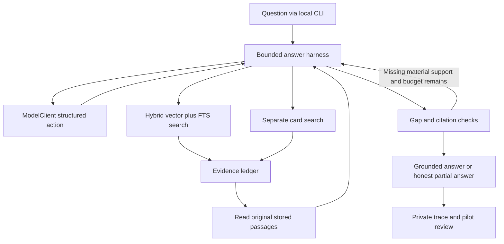

# Stage 5: grounded retrieval and answer agent

## Overview

Build the first complete local question-answer path over the selected six-file index: a stateless Python core that retrieves candidates, lets a bounded agent inspect original passages, and produces a useful, source-grounded answer with citations. A local CLI calls the same core that a later API can expose. Stage 5 includes a small, user-reviewed answer evaluation and a bounded model screen; Stage 6 expands the gold set and optimizes the configuration.

The user values contextual explanation, adaptation to the question, and coverage of distinct important ideas more than the shortest response. A quote dump, generic model-knowledge advice, invented attribution, or a citation that is merely topical does not meet the product goal. Longer answers and searches are acceptable when they add material, supported information; every run still has finite call, token, time, and spending limits.

## Problem frame and requirements trace

The selected local profile has six published runs, 83 structural/raw vectors, and 510 validated evidence cards. `app/storage/search.py` returns separate exact-vector and Postgres full-text candidate lists. There is no RRF fusion, card-search tool, source-reading operation for the agent, or answer loop. The hosted project has only a synthetic load; private source text remains local. See `FOUNDATION.md`, `SYSTEM.md`, `RETRIEVAL.md`, and `evals/README.md`.

- **R1 — Retrieval:** Combine profile-compatible vector and Postgres FTS ranks with deterministic RRF. Preserve active-run/profile isolation and expose evidence-card search as a separate, agent-selected operation.
- **R2 — Investigation:** Let the agent search with different angles, inspect stored original passages, track evidence gaps, and stop under explicit budgets. Answering must not depend on `KNOWLEDGE_SOURCE_ROOT` or a local vault path.
- **R3 — Grounded answer:** Explain ideas in source context, adapt them to the user's situation, distinguish direct source claims from the agent's suggestions, and cite the original passage supporting each material factual claim. Handle partial or absent evidence honestly.
- **R4 — Breadth:** For broad questions, seek the distinct material themes and examples the sources support, including useful differences between sources. Deduplicate overlapping chunks and repeated cards; do not optimize for the number of snippets quoted or returned.
- **R5 — Evaluation:** Use the user's eight questions as the initial candidate answer set. Before live answer comparisons, inspect source support, draft question-specific rubrics, obtain the user's review, and freeze the set. Reuse the existing 37 source-span questions for retrieval checks.
- **R6 — Model discipline:** Start with GPT-5 mini as the provisional agent model. Keep model and reasoning configuration replaceable; include one bounded, exploratory comparison with a stronger OpenAI reasoning configuration and an open-weight configuration, subject to current private-route, structured-output, and spending gates for both generation and query embeddings. No Claude model is a candidate.
- **R7 — Deployment path:** Keep the answer core stateless and suitable for a later container/API wrapper. Future cloud ingestion is a separate writer/job that publishes validated runs to the same store; Stage 5 reads published data only.

## Scope boundaries

Stage 5 delivers the local answer core and operator CLI, retrieval and citation contracts, a frozen pilot rubric, deterministic tests, local end-to-end proof, and an inspectable pilot report. It may iterate on the harness when the pilot exposes a material grounding or completeness failure; the report retains failed versions rather than replacing them silently.

### Deferred to separate tasks

- **Stage 3 hosted private-load checkpoint:** Resolve the existing Supabase security-advisor warning before loading private vault content; the hosted synthetic smoke test alone does not make hosted answering ready.
- **Stage 6:** Expand the gold set, inspect hard retrieval misses, run controlled card-search on/off and broader model/reasoning comparisons, tune ranking or budgets, and assess BM25 or reranking only if measured need warrants them.
- **Later interface/deployment work:** FastAPI or another thin transport, authentication, a dedicated read-only database login, Cloud Run/Render/Fly selection, container build, deployment, UI, and operational monitoring. The current `knowledge_runtime` role can write, so it must not be used as the credential of an externally exposed answer service. Stage 5's core does not assume a particular host.
- **Future ingestion:** Submission endpoint, source fetchers, queue/job runner, retries, and publication workflow for notes, tweets, transcripts, and videos. Their future writer role must not be coupled to the answer request lifecycle.
- **Stage 7:** Compiled themes and durable synthesis, if the baseline fails repeated cross-source questions.

Unqualified section/document summaries remain outside the answer profile. Cards can guide discovery but never serve as the final authority for a cited claim.

## Evaluation contract

The initial questions are user-authored, not generated from retrieval hits. Preserve their intent while reviewing wording and corpus support; #8 means hiring two **new people for** the user's team. Question-specific expected themes and evidence are drafted during execution and reviewed by the user before model comparison. Do not invent a canonical prose answer or require one arbitrary source when several passages can support the same point.

| ID | User question, with only the confirmed #8 correction | Primary stress |
| --- | --- | --- |
| Q1 | What are the unusual principles Bending Spoons uses to grow and work on the different products? | Broad coverage within one transcript, with operating context rather than isolated slogans. |
| Q2 | I am starting a new business project and I need help from Derek Sivers. What ideas or prompts would he suggest considering to challenge or stretch my thinking about how to build the business? | Transfer source ideas into useful prompts while keeping attribution honest. |
| Q3 | What copy advice would Tim Ferriss give me to maximize impact of my company's homepage? | Source-specific advice, narrow audience/problem framing, and transcript examples rather than generic copy advice. |
| Q4 | What steps could I take to calm myself down when I realize I feel anger? | Actionable sequence grounded in the short note. |
| Q5 | What two practical rules could help me make decisions when stuck looking for more information? | Concise selection without losing the note's reasoning. |
| Q6 | What practical tips could I use to get better at having hard conversations? | Turn the movie-logic article's situations and reasoning into usable steps. |
| Q7 | I am starting a business from scratch with no investors. Give me three constraints that would help me find customers willing to pay in my first month. | Cross-source synthesis; distinguish suggestions from any unsupported first-month guarantee. |
| Q8 | I need to hire two people for my team and don't know how to do this. If Luca Ferrari and Derek Sivers were here in this room, how would they help me do so? | Compare their perspectives without inventing their conversation or assigning a hiring opinion to a source that does not express one. |

For each question, the reviewed rubric records: the user's purpose, source revision and answerability (`full`, `partial`, or `unsupported`), essential supported facets, useful optional examples, acceptable alternative evidence, material differences or qualifications, prohibited unsupported inferences, and what a useful answer would do for the user. Source quotes and model outputs remain in ignored private reports, not in the plan or committed eval fixtures. If a source hash changes, the rubric must be rechecked before comparison.

Score at three separate levels:

1. **Grounding gate:** cited document/run/hash/span exists in the active store and was inspected; each material claim is supported by its nearby original passage. A valid reference ID alone does not pass. Record attribution and unsupported-synthesis failures per answer.
2. **Product quality:** user review marks `useful`, `partly useful`, or `unhelpful`, with reasons for essential-facet coverage, contextual explanation, application, balance across sources, and calibration. Judge distinct supported ideas, not number of chunks/cards, quote count, exact wording, or answer length.
3. **Diagnostics:** required-span Recall@5/10/20 on existing labels, evidence sufficiency and missed facets, tool/action trace, model/effort/route, input/output tokens, latency, and estimated cost. Keep these separate from the user's usefulness judgment.

For an evidence gap, an honest partial answer can pass a `partial` rubric; a confident claim beyond the sources cannot. The first pilot does not yield a statistically representative quality percentage. Stage 5 has an acceptable answer baseline only when the full path is demonstrable, its hard provenance and budget gates hold, the user judges the answers useful on the answerable pilot questions, and no known material grounding or essential-facet coverage failure remains on those questions. Iterate on the harness or retrieval until that bar is met; record unresolved failures as Stage 5 limitations rather than treating a completed report as a passing answer baseline. Stage 6 expands and tunes a baseline that has already cleared this small pilot.

## Context and research

### Existing patterns

- `app/storage/search.py` and `app/storage/records.py`: independent active-profile candidate searches and provenance-rich `SearchHit`; keep exact vector search as the correctness baseline.
- `app/storage/loader.py` and `supabase/migrations/20260923152944_private_knowledge_index.sql`: stored captured source text, validated cards, profile selection, active runs, and runtime-role access. New reads must use the same selected-run scope.
- `app/models/client.py` and `app/models/openrouter.py`: a small structured-generation/embedding interface, explicit live-request and token budgets, pinned provider routing, and ZDR endpoint preflight. Extend answer-specific configuration without changing ingestion defaults.
- `app/storage/cli.py`: local operator CLI and JSON output convention; raw source text is not printed in existing search output.
- `evals/questions_*.yaml`, `evals/README.md`, and `evals/compare_chunking.py`: revision-bound source-span labels and local private reports. Existing labels measure candidate recall, not answer usefulness.
- No `docs/brainstorms/` requirements file or relevant `docs/solutions/` learning was found; this plan uses the user decisions in this task and the current repository docs as its requirements source.

### External evidence informing the shape

- [Microsoft Research AgenticRAG (May 2026)](https://arxiv.org/html/2605.05538v1) found large gains from a bounded search/find/open loop with GPT-5 mini, at substantially higher token use than single-shot retrieval. It supports tool-driven investigation, not its large default budgets for this personal corpus.
- [Google Research Agentic RAG (June 2026)](https://research.google/blog/unlocking-dependable-responses-with-gemini-enterprise-agent-platforms-agentic-rag/) checks whether evidence covers each part of a question and searches targeted gaps. A single bounded harness can implement that decision without Google's multi-agent setup.
- [Glean Waldo (April 2026)](https://www.glean.com/blog/waldo-launch) reports latency/token gains from a custom-trained open-weight search planner and a stronger synthesis model. Its trained planner cannot be assumed to transfer to an unmodified open-weight model; use its model-role lesson as a later optimization hypothesis.
- [OpenAI evaluation guidance](https://developers.openai.com/api/docs/guides/evaluation-best-practices) favors task-specific questions and human-calibrated scoring; [agent evaluation guidance](https://developers.openai.com/api/docs/guides/agent-evals) emphasizes full traces. This plan keeps evaluation in repo-owned files/reports rather than depending on the OpenAI Evals platform, which is [being retired](https://developers.openai.com/api/docs/deprecations).
- [OpenRouter structured-output documentation](https://openrouter.ai/docs/guides/features/structured-outputs) and [ZDR endpoint documentation](https://openrouter.ai/docs/api/api-reference/endpoints/list-endpoints-zdr) require checking capabilities on the actual endpoint. ZDR limits provider retention; source text still travels to the provider, so local logs and reports must also avoid exposing it.
- [OpenRouter's Qwen3.5-122B-A10B listing](https://openrouter.ai/qwen/qwen3.5-122b-a10b-20260224) advertises structured JSON but not native `tools` on the displayed endpoint. The agent must therefore be able to use validated structured actions without assuming native tool calling.

## Key technical decisions

| Decision | Rationale |
| --- | --- |
| A plain Python answer core plus local CLI | Uses the current stack and keeps transport separate. The same core can later be called from a web service or container without a local vault dependency. |
| Structured action protocol through `ModelClient` | Existing `generate_json` is sufficient to represent `search`, `search_cards`, `read`, and `finish` decisions even when a model route lacks native tool calls. Add answer-specific reasoning configuration as an optional, backward-compatible capability; preserve ingestion behavior. |
| Hybrid RRF over independent top-K lists | Start with equal-weight `1 / (60 + rank)` contributions from up to 20 results per channel, returning at most 20 fused candidates per search. This does not equate incomparable vector distances and FTS scores. Stable chunk/run keys and overlap deduplication keep results inspectable. Cards remain a separate agent-chosen search surface. |
| Stored original passages as answer evidence | The selected run's stored source revision is authoritative. Returned cards and snippets point to it; citations resolve to original spans, not generated statements. |
| Evidence ledger and explicit gap check | Broad answers should cover distinct material facets, not stop after the first plausible hit. The loop may reformulate and read more when material gaps remain, while retaining hard limits. |
| Fixed pilot before model screen | Prevents prompt/model choices from being tuned to a moving target. A model configuration is model ID plus route, reasoning setting, prompt version, and budgets; report these together rather than claiming an isolated model effect when they differ. |

### Bounded model screen

The first end-to-end answer configuration is `openai/gpt-5-mini` at its existing minimal reasoning setting. After the pilot rubrics are reviewed and the baseline runs, preflight up to three additional configurations: GPT-5 mini at a higher supported effort, `openai/gpt-5.4` at medium effort as a stronger OpenAI reference, and `qwen/qwen3.5-122b-a10b` as an open-weight comparison using structured actions. The Glean report names GPT-5.4 medium; it does not prove it is better on this corpus. The Qwen candidate is a portability hypothesis, not a proven answer model. A missing ZDR/structured route, failed first-response action contract, or cost cap removes a candidate rather than silently substituting providers. The previous GPT-6 Luna route returned 429 in Stage 4 and is not a required candidate.

Run the GPT-5 mini baseline on all eight questions. Screen eligible challengers on Q1, Q3, Q7, and Q8 after the rubric review; if one of these proves unsupported by the current corpus, replace it before freezing the screen. Advance at most one challenger to the remaining four questions, leaving two complete configurations for side-by-side review. Keep corpus, retrieval settings, prompt version, and scoring fixed during a comparison. Set and record a Stage 5 spending ceiling before any live calls, respecting the existing Stage 4 cumulative ceiling until explicitly revised. These are exploratory results on questions also used to improve the harness: retain GPT-5 mini as provisional unless a challenger shows a clear, source-grounded gain, and do not claim a general model winner from this pilot. Stage 6 tests any apparent gain on unseen questions before settling the answer-model choice.

## High-level technical design

*This illustrates the intended approach and is directional guidance for review, not implementation specification. The implementing agent should treat it as context, not code to reproduce.*

The core receives a question and runtime dependencies. It resolves the selected search profile and query-embedding specification, then exposes bounded retrieval/read operations. Each model decision is validated before execution. The evidence ledger associates stable document/run/hash/span references with actual inspected text and records distinct facets, search angles, and remaining gaps. The final answer returns prose, cited passage references, and an explicit completeness status. The runtime verifies reference provenance and refuses fabricated/unread citations; semantic support and usefulness are checked against the user-reviewed rubric during the pilot. The ledger, budgets, and mutable model-client usage state belong to one answer invocation, never a process-wide singleton shared across future requests.

## Implementation units

- [ ] **Unit 1: Freeze the user-centered pilot and grading contract**

  **Goal:** Make the eight questions reviewable before tuning against their answers.

  **Requirements:** R3, R4, R5.

  **Dependencies:** None.

  **Files:** Create `evals/answer_questions.yaml`, `evals/answer_rubric.py`, and `tests/evals/test_answer_rubric.py`; modify `evals/README.md`.

  **Approach:** Inspect only the six checked source revisions; draft answerability, essential facets, acceptable alternate support, prohibited inferences, and source-specific versus adapted content for each question. The user reviews and freezes this before any model/prompt comparison. Keep private source quotes and resulting answers in ignored `.local/` reports, and bind the rubric to source hashes. Version any later rubric change and rerun all compared configurations.

  **Test scenarios:**
  - **Happy path:** A fully supported, a partly supported, and an unsupported question each load with the correct grading expectations.
  - **Edge case:** Multiple valid source spans satisfy one facet without forcing one exact citation or sentence.
  - **Error path:** A changed source hash, duplicate question ID, or missing answerability decision prevents a comparison run.

  **Verification:** The user has reviewed all eight rubrics and their answerability labels; no model result was used to retroactively define success.

- [ ] **Unit 2: Add hybrid and card retrieval with original-source reading**

  **Goal:** Supply the agent with bounded, profile-scoped discovery and trustworthy passage reads.

  **Requirements:** R1, R2, R4.

  **Dependencies:** Unit 1 can proceed in parallel; selected local profile and existing storage schema are prerequisites.

  **Files:** Modify `app/storage/search.py` and `app/storage/records.py`; create `app/storage/retrieval.py`; create `tests/storage/test_retrieval.py`; extend `tests/storage/test_stage3_integration.py` where a database boundary must be proved.

  **Approach:** Resolve the active profile's embedding specification. Before sending a question or reformulated search text for embedding, verify the selected embedding model's current ZDR endpoint, denied data collection, pinned provider, and price ceiling; fail closed if the route is unavailable. Embed query text as `search_query` where specified, run independent vector and FTS lists, fuse by the stated RRF rule with stable ties, and deduplicate the same chunk/source span. Add a separate Postgres FTS search over source-linked card statement, situation, action, result, and principle fields with an explicit cap; follow each card to its validated original span. Read bounded windows from the selected run's stored source text. Keep ordinary queries limited to active published runs; retain explicit historical selection only for evaluation. Measure card query plans before introducing a new SQL index or migration.

  **Test scenarios:**
  - **Happy path:** Vector and FTS hits with different raw score scales produce the expected stable fused rank; a card hit opens its original supporting passage.
  - **Edge case:** Overlap returns one source span, one retrieval channel is empty, and multiple cards repeat the same fact; the agent receives distinct bounded evidence.
  - **Error path:** Unknown profile, mismatched embedding spec, stale run, invalid span, or missing source revision fails without returning unrelated private data.
  - **Privacy:** An unqualified or changed query-embedding endpoint stops before the question leaves the process; it cannot silently fall back to another provider.
  - **Integration:** A selected active run is searchable/readable through the runtime login; an unselected or historical run does not leak into ordinary results.

  **Verification:** Existing 37 labels can be scored for vector, FTS, and fused Recall@5/10/20, with per-question misses visible; card search remains separate from RRF.

- [ ] **Unit 3: Extend the model action boundary without changing ingestion defaults**

  **Goal:** Support configurable, strictly parsed answer-agent actions through the existing model adapter.

  **Requirements:** R2, R6.

  **Dependencies:** Existing `ModelClient` and OpenRouter adapter.

  **Files:** Modify `app/models/client.py` and `app/models/openrouter.py`; create `app/agent/actions.py`; create `tests/agent/test_actions.py`; extend `tests/models/test_client.py`.

  **Approach:** Define a small versioned action/final-answer schema and optional reasoning configuration for answer calls. Keep ingestion's current `generate_json` behavior and defaults intact. Treat provider route, structured-output capability, output truncation, malformed JSON, request/time/token budgets, and ZDR eligibility as explicit failures; do not route private source text to an unqualified fallback. Record model ID, effort, provider tag, prompt version, and usage in private traces.

  **Test scenarios:**
  - **Happy path:** Each allowed action and a cited final answer parse into validated records; an answer-specific effort changes only answer requests.
  - **Edge case:** An open-weight endpoint with strict JSON but no native `tools` can still drive the structured action protocol.
  - **Error path:** Unknown action, bad reference, truncated response, unsupported reasoning setting, or exhausted request budget cannot execute an unvalidated tool call.
  - **Regression:** Existing ingestion callers retain their current model behavior when the new option is omitted.

  **Verification:** Fake clients can exercise the whole action contract without a live provider, and live use remains opt-in and route-gated.

- [ ] **Unit 4: Build the bounded answer loop and citation contract**

  **Goal:** Investigate until material evidence is covered or the budget ends, then return a useful grounded answer or an honest limitation.

  **Requirements:** R2, R3, R4.

  **Dependencies:** Units 2 and 3.

  **Files:** Create `app/agent/harness.py`, `app/agent/records.py`, and `prompts/answer_agent_v1.md`; create `tests/agent/test_harness.py` and `tests/agent/test_citations.py`.

  **Approach:** Track search angles, inspected original spans, source attribution, distinct supported facets, and open gaps. Allow bounded reformulation and targeted reading; require a deliberate sufficiency decision before finishing. Treat retrieved text and cards as untrusted evidence, never as instructions to the agent. Prompt for an explanation and practical application, not source-text reproduction. Separate source statements from recommendations inferred for the user's situation. The final answer attaches citations to nearby claims; runtime checks selected-run identity, exact spans, and that every cited passage was read. Human pilot review remains the authority on whether a cited span actually supports a claim.

  **Test scenarios:**
  - **Happy path:** A broad question finds several distinct themes and returns contextual synthesis; a focused question uses source-specific examples; a cross-source question attributes each perspective separately.
  - **Edge case:** A card discovers a relevant idea but the original passage does not support the card's interpretation; the answer excludes that claim or qualifies it. A source has only partial support for a requested first-month outcome; the answer states the limit.
  - **Error path:** The model invents a citation, cites an unread passage, conflates two speakers or stories, or runs out of budget; the harness rejects or revises the claim and reports a partial result rather than fabricating support.
  - **Untrusted input:** A retrieved passage that contains instructions to ignore the question or reveal private data remains quoted source content and cannot alter tool limits, source scope, or answer policy.
  - **Boundary:** A no-evidence question yields an explicit insufficiency answer; no local vault file is opened during question answering.

  **Verification:** Deterministic fake-model traces prove termination, provenance, and partial-answer behavior; the eight-question pilot then measures semantic support and usefulness with human review.

- [ ] **Unit 5: Expose the local CLI and preserve deployment boundaries**

  **Goal:** Make the answer core usable now without tying it to a terminal, vault path, or future host.

  **Requirements:** R2, R7.

  **Dependencies:** Unit 4.

  **Files:** Create `app/agent/cli.py` and `tests/agent/test_cli.py`; modify `README.md` and `RETRIEVAL.md` after the implementation works.

  **Approach:** Provide a local question command with human-readable answer, bounded cited excerpts, and optional machine-readable output. Runtime dependencies come from configuration and the selected private database login; model calls remain explicitly enabled and budgeted. Create per-answer model budgets, client usage state, and evidence ledger; a later API may share immutable configuration but not these mutable objects. Use a read-only answer transaction and keep the core compatible with a future dedicated read-only login. Keep ordinary traces to IDs, actions, usage, and timing; store any excerpts and full answers needed for private review only in explicitly requested, ignored `.local/` reports without credentials. The answer operation reads published data only, leaving ingestion and future submission/jobs in a separate component. No FastAPI service, Docker image, or cloud deployment is required for this unit.

  **Test scenarios:**
  - **Happy path:** A local question returns an answer with source locators and inspected excerpts that resolve to the selected run.
  - **Error path:** Missing database/model configuration, no selected profile, provider failure, and interrupted run produce actionable errors without printing secrets or private passages.
  - **Integration:** The CLI runs against a disposable published fixture while `KNOWLEDGE_SOURCE_ROOT` is absent and the answer transaction is read-only.
  - **Isolation:** Consecutive answers start with fresh budgets and ledgers; neither answer can cite evidence read only by the other.

  **Verification:** The same core can be invoked from the CLI and a future transport without changing retrieval or agent policy.

- [ ] **Unit 6: Run the frozen pilot and bounded comparison**

  **Goal:** Produce an honest first answer-quality result and identify Stage 6 priorities.

  **Requirements:** R3, R4, R5, R6.

  **Dependencies:** Units 1–5 and an agreed live-spend ceiling.

  **Files:** Create `evals/answer_trial.py` and `tests/evals/test_answer_trial.py`; modify `evals/README.md`; update `FOUNDATION.md` and `SYSTEM.md` only after implementation and observed results, using the repository's `$finish-task` workflow.

  **Approach:** Run the frozen pilot on the same six source revisions and selected profile. Capture versioned actions, retrieval ranks, source reads, citations, gap decisions, model usage, latency, and cost in distinct ignored `.local/` directories. Check deterministic provenance automatically and have the user review support and usefulness against the frozen rubrics. Investigate failures by layer before changing one lever at a time; fix harness or retrieval defects before model comparison, while allowing a challenger to address a failure shown to come from the baseline model. Screen only route-eligible configurations on the fixed subset, advance at most one challenger to the remaining questions, and stop at the agreed budget; preserve failed attempts and report any untested candidate as such.

  **Test scenarios:**
  - **Happy path:** A report separates retrieval coverage, grounding failures, user usefulness, completeness, and cost for each question and configuration.
  - **Edge case:** Partial/unsupported questions are graded against calibrated behavior rather than forced full answers; a changed source revision invalidates the run.
  - **Error path:** Missing route, malformed model response, spending ceiling, or interrupted trial stops safely and leaves a resumable, unambiguous report without counting an incomplete attempt as a pass.
  - **Comparison:** Two configurations face the same frozen questions, source revisions, retrieval settings, and rubric; changes in model/effort/route remain visible in the result.

  **Verification:** The report states what passed, failed, was not run, and why; the user can inspect representative answers and traces privately before accepting a provisional Stage 5 baseline. Any apparent model advantage is labeled exploratory until Stage 6 checks unseen questions.

## System-wide impact

The answer path connects the runtime database login, query embeddings, vector/FTS/card search, stored source reads, OpenRouter structured generation, a local CLI, and private evaluation reports. A database or provider error ends the relevant request clearly; it must not produce an uncited fallback answer. Published-run replacement between search and read must be detected by run/hash identity, preventing citations from mixing revisions. The CLI and future API should call one stateless core; neither becomes the owner of retrieval or agent decisions.

No ingestion artifact is mutated by answering. Stage 5 does not change the selected structural/raw-plus-cards profile or activate unqualified summaries. If a card-search index later requires SQL, treat it as a separate migration with active-profile scoping, authorization, and query-plan checks; merging that migration to `main` would deploy through the existing Supabase integration.

## Risks and dependencies

| Risk | Treatment |
| --- | --- |
| A broad answer stops after the first plausible hit or repeats quotes. | Evidence ledger, gap check, source-specific rubric facets, and human review of completeness and contextual application. |
| Citation IDs are valid but claims are not supported. | Restrict citations to inspected original spans; require nearby claim support in the pilot review; retain trace and failure examples. |
| A card or model summary invents a factual relationship. | Treat cards as discovery hints; re-open original source and omit unsupported interpretations. Unqualified summaries are excluded. |
| Multiple active revisions or overlapping chunks contaminate an answer. | Bind references to run/hash/profile, deduplicate overlaps, and fail closed on replacement or mismatch. |
| Model route, effort, or structured-output support differs from catalog claims. | Preflight the current exact ZDR endpoint, pin eligible providers, test first-response schema reliability, and avoid silent fallback. |
| Source text attempts to redirect the agent. | Treat retrieved text and card fields as untrusted data, keep tool and budget rules in application-controlled instructions, and test an injected-source fixture. |
| An externally exposed answer service reuses the current writable runtime login. | Keep Stage 5 local, use read-only answer transactions, and require a separately provisioned read-only database login before any API deployment. |
| Broad investigation runs indefinitely or becomes expensive. | Finite configurable search/read/model/token/time budgets and a separately agreed live-spend ceiling; report quality alongside cost rather than optimizing away useful evidence. |
| The six-file pilot overstates production readiness. | Label corpus support per question, retain hard failures, avoid population-level percentages, and defer hosted private load, full eval expansion, and deployment. |

## Open questions

### Resolved during planning

- **Who defines useful answers?** The user supplies genuine questions and reviews rubrics and outputs; the system does not grade exact prose or source-count quotas.
- **Does Stage 5 include evaluation?** Yes: the eight-question pilot and retrieval checks are part of proving the harness. Stage 6 expands and tunes.
- **What does #8 mean?** Hiring two new people for the user's team.
- **Does Stage 5 choose a deployment host or build cloud ingestion?** No; it preserves the stateless read boundary so either can be added later.
- **Are Claude models candidates?** No.

### Deferred to implementation or later stage

- **Exact per-question facets and support classification:** Requires reviewing private source revisions with the user; freeze before comparisons.
- **Exact call limits and Stage 5 spending ceiling:** Choose after a no-live dry run and current endpoint price/capability preflight, before live requests. Retain the Stage 4 ceiling unless the user revises it.
- **Answer model and reasoning effort:** Stage 5 may provisionally switch after a clear, grounded pilot gain; Stage 6 tests that gain on unseen questions before treating it as a settled choice. Public case studies do not decide it.
- **Dedicated card text index, reranker, or separate planner model:** Add only after measured failures or query-plan pressure justify them.

## Sources and references

- Project map and requirements: `AGENTS.md`, `SYSTEM.md`, `FOUNDATION.md`, `RETRIEVAL.md`, `DATA.md`.
- Prior implementation and trial: `docs/plans/2026-09-24-001-feat-live-enrichment-ingestion-plan.md`, `docs/plans/2026-09-23-001-feat-supabase-storage-search-plan.md`.
- Retrieval and model code: `app/storage/search.py`, `app/storage/records.py`, `app/models/client.py`, `app/models/openrouter.py`.
- External studies and provider contracts: linked in **Context and research** above.
