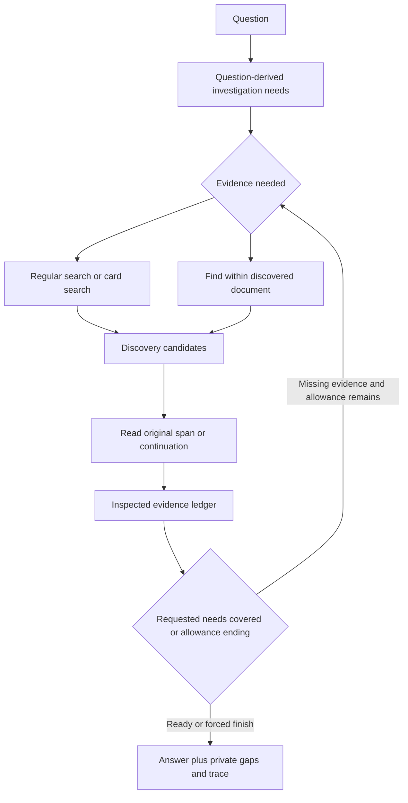
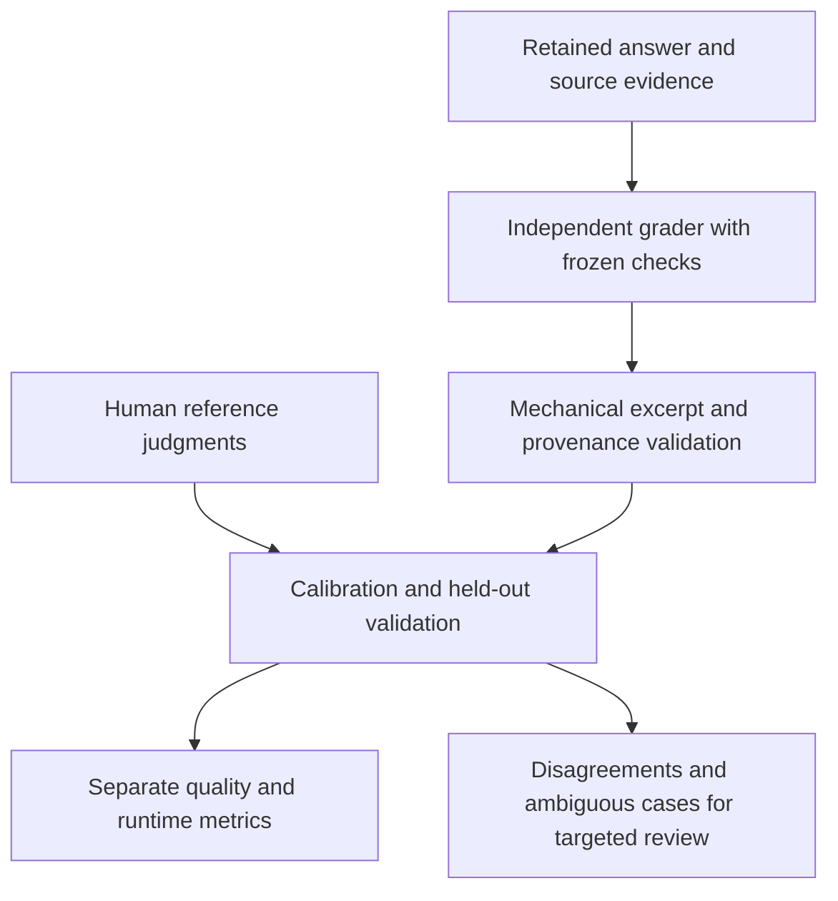

# Retrieval Answer Quality Repairs - Plan

## Goal Capsule

- **Objective:** Answers cover the user's requested ideas with concrete source examples, supported citations, and useful explanations, including questions spanning long transcripts or multiple sources.
- **Means:** Repair answer instructions and investigation tools first, then prepare and calibrate automatic grading (KTD1).
- **Authority:** This conversation defines the revised behavior; `FOUNDATION.md` owns project progress; `docs/plans/2026-09-27-001-feat-retrieval-answer-agent-plan.md` supplies the existing local architecture and Stage 5 constraints.
- **Execution profile:** Local Python core and CLI over the existing six-file profile. Continue the current feature branch and preserve existing work.
- **Stop conditions:** No accepted quality baseline while a known material grounding or required-coverage failure remains; stop live work before exceeding the approved spending ceilings.
- **Tail ownership:** Implementation reconciles `FOUNDATION.md` and `RETRIEVAL.md`, preserves private receipts, and reports unresolved failures separately from completed code.

---

## Product Contract

### Summary

Repair the observed prompt, tool-selection, card-query, and document-exploration failures before building the automated grader.
Use the existing pilot and submitted review to check the repairs, then formalize revised expectations and validate grading on retained answers.

### Problem Frame

Answers omit valuable themes and examples, invent scenarios, and sometimes append limitations outside the user's request.
The prompt-v6 pilot returned 22 of 24 attempted answers, but deterministic citation provenance did not establish semantic support or completeness.
Card search was invoked twice and returned no hits both times; nine returned answers were forced to finalize as budgets approached exhaustion.
These observations justify repairs now without another model ranking exercise.

### Requirements

**Answer behavior**

- R1. Cover the distinct material parts of the question, with breadth proportional to its scope; a request for three tips does not require an exhaustive framework.
- R2. Include concrete examples from inspected original sources when relevant examples exist; invented scenarios do not satisfy this requirement, and missing examples must not be fabricated.
- R3. Adapted advice remains permitted when explicitly identified at the point of use and distinguished from the source author's statements.
- R4. Explain ideas coherently with examples integrated into their explanation; mention a limitation in the visible answer only when it materially affects the question asked.

**Investigation**

- R5. Explain each action's distinct purpose, required parameters, result semantics, and when to choose it; unsupported parameters cannot silently pretend to perform another action.
- R6. Use card search to discover relevant principles and source examples when useful, with query reformulation after empty results; a card call is not required when inspected originals already suffice.
- R7. Track unresolved needs from the question and newly discovered relevant material during investigation; direct additional search or reading toward them before a voluntary finish.
- R8. Explore a discovered long document beyond its initial previews and first passage window, while preserving active-profile scope, exact source revisions, inspected-evidence citation authority, and finite budgets.

**Evaluation and operations**

- R9. Preserve prompt-v6 reports, rubric-v3 identity, and the user's submitted ratings; revised criteria must be versioned and cannot overwrite historical judgments.
- R10. After the repairs, prepare individually assessable criteria with acceptable evidence alternatives and separate coverage, examples, grounding, qualifications, relevant gaps, and usefulness.
- R11. Build an evidence-backed automatic grader whose references are mechanically validated; invalid, ambiguous, and unreviewed results remain distinct from passes.
- R12. Calibrate the grader against human judgments and evaluate frozen grader behavior on held-out cases before using it to select configurations.
- R13. Keep source text, answers, reviews, and grader receipts under ignored `.local/`; maintain read-only source access and the existing pinned ZDR provider controls.
- R14. Charge all live answer and grader calls to the existing ledger: $8 Stage 5 and $10 cumulative, including the $0.25 unknown-usage hold; reserve conservative costs before calling.

### Scope Boundaries

The work repairs the existing local answer core and adds grading after those repairs.
It does not change ingestion, embedding selection, the six-file profile, or hosted publication.

#### Deferred to Follow-Up Work

Separate trained search planners, multi-agent orchestration, semantic card embeddings, new ranking architectures, expanded vault loads, and production deployment require measured need after this repair cycle.

### Acceptance Examples

- AE1. For a broad operating-principles question, the agent investigates distinct themes and original examples rather than ending after one simplification passage. Covers R1, R2, R7, R8.
- AE2. For three tips, the answer contains three supported tips and does not apologize for failing to find an unrequested step-by-step framework. Covers R1, R4.
- AE3. An empty card query produces reformulation guidance; a useful card remains a lead until its original evidence is read. Covers R5, R6, R8.
- AE4. A multi-source question includes the required contributions with correct attribution, or explains the specific requested part that remains unsupported. Covers R1, R3, R7.
- AE5. A grade of covered includes an exact answer excerpt and relevant source support; an unreviewed check cannot increase a pass rate. Covers R10, R11.

---

## Planning Contract

### Key Technical Decisions

- KTD1. **Repair before formal grading.** Execute U3 and U4 before U1 and U2, keeping the unit labels from the discussion. (session-settled: user-directed — chosen over grader-first sequencing: the current failures are already established and unacceptable.) Repairs use concrete failure checks and representative answer inspection; they do not wait for a grading platform. Governs R1-R12.
- KTD2. **Retain one model-controlled investigation loop.** Start with question-derived needs, then revise them when inspected material reveals other relevant themes or source examples. Keep tool guidance within the existing stateless core; do not introduce a second sufficiency model yet. Before voluntary finish, record which surfaced needs were resolved or deliberately excluded as outside the question; unresolved material needs receive one targeted correction opportunity when budget permits. Forced termination preserves truthful structured gaps instead of creating an endless repair loop. Governs R5, R7, R8.
- KTD3. **Make lexical card search usable first.** Preserve the initial all-term query, then use a bounded OR fallback only after zero hits, following `app/storage/search.py`. Report query mode and zero-hit feedback, retain publication filters before limiting, and expose useful card fields as discovery context. No semantic-search migration is required. Governs R5, R6, R13.
- KTD4. **Add document-scoped find and continuation reads.** A new `find` action searches original indexed spans in the document of an existing reference. Extend `read` with a validated offset within a selected span and report truncation/continuation metadata. A find result registers a source-linked candidate, not citation authority. Reads cannot cross excluded gaps or reach unpublished source revisions. Governs R5, R8, R13.
- KTD5. **Version action semantics and preserve legacy runs.** U3 rejects misleading non-null fields, such as a read's unused query, in the current action schema. U4 introduces action schema v2 for investigation requirements, new find parameters, and read offsets. Return actionable feedback in both stages and treat archived v1 reports as immutable historical inputs. Governs R5, R9.
- KTD6. **Separate product answer from investigation metadata.** Keep detailed gaps, actions, and evidence coverage in private structured reports. The prompt produces the useful answer directly and includes only limitations needed under R4. A broad question receives an explicit bounded configuration with enough synthesis allowance; record every changed call/read/time/output limit and the actual finalization trigger. Choose numeric allowances during U4 after local characterization and cost preflight, without removing hard limits. Governs R1, R4, R7, R14.
- KTD7. **Freeze new criteria after repair implementation, before comparisons using them.** Retain rubric v3 in a versioned file and its historical ratings. Prepare v4 through a compatible loader rather than relabeling old ratings as v4 truth; source examples become the requirement in R2. Question-derived investigation needs are available to the runtime, but evaluation answer keys never are. Governs R7, R9, R10.
- KTD8. **Grade each semantic dimension with evidence, then aggregate in code.** The grader receives the frozen question/checks, generated answer, inspected evidence, and separately labeled gold evidence alternatives. Answers and source passages are untrusted data, separate from grader instructions and criteria. Citation support is judged against inspected passages; coverage and diagnostics can also use gold alternatives. The grader must not confuse facts available in the corpus with passages the agent actually read. Governs R10-R12.

### High-Level Technical Design

### Risks and Dependencies

- Lexical OR fallback can introduce noise. Bound result counts, preserve exact query mode in traces, and test useful matches before concluding cards add value.
- Self-reported need coverage can be wrong. U4 prevents premature termination on declared unresolved needs; it does not claim semantic completeness enforcement. U2 supplies independent assessment later.
- Wider document access can bypass provenance restrictions. Find and continuation must use selected published spans and the same read-only transaction as current retrieval.
- More investigation and longer output consume time and money. U4 recalculates adapter completion limits and conservative caps for every configuration; R14 remains authoritative.
- Existing broad human grounding ratings lack claim-level annotations. They are calibration input, not a complete grounding gold set. Annotate targeted difficult cases and report unresolved disagreements.
- The remaining accounted allowance is approximately $2.759185 Stage 5 and $3.324307 cumulative. Expensive full-matrix reruns cannot be assumed to fit; local work proceeds independently of live capacity.

### Deferred Execution Decisions

The executor selects the smallest useful broad-question allowance and confirms query fallback effectiveness against stored cards.
Grader prompt wording and thresholds are resolved against calibration evidence in U2 and frozen before the held-out evaluation.
An unaffordable live batch is reported with its concrete reservation estimate; no live work proceeds beyond R14.

---

## Implementation Units

**Preservation preflight before U3:** Export the submitted interactive review payload verbatim to an ignored `.local/` receipt while it is still retrievable. Record its question, configuration, and answer identities, entry count, and checksum. If the original payload cannot be recovered, mark those human labels unavailable and do not reconstruct them from later summaries. This preservation step does not delay the U3/U4 repairs for rubric or grader design.

### U3. Repair answer instructions and tool semantics

**Goal:** Remove the known invitation to invent examples and make retrieval actions understandable and usable.

**Requirements:** R1-R6, R9, R13; KTD1, KTD3, KTD5.

**Dependencies:** Existing prompt-v6 and pilot receipts.

**Files:** `prompts/answer_agent_v7.md`, `app/agent/actions.py`, `app/agent/harness.py`, `app/storage/retrieval.py`, `app/storage/records.py`, `tests/agent/test_actions.py`, `tests/agent/test_harness.py`, `tests/storage/test_retrieval.py`, `tests/storage/test_stage3_integration.py`.

**Approach:**

1. Version the revised prompt with explicit source-example, scope, and fluent-explanation guidance under R1-R4.
2. Describe action selection, lexical query format, references, ignored-field errors, and original-reading obligations in the model-visible action contract.
3. Apply KTD3 to card search and expose concise situation/action/result/principle context when present, without treating generated fields as evidence.

**Patterns:** Existing chunk FTS fallback, publication filters, strict action validation, and source-linked card records.

**Test scenarios:**

- A long card query with zero all-term hits returns relevant OR hits, records the fallback, and excludes unpublished artifacts. Covers AE3.
- A genuine empty result supplies useful reformulation guidance without fabricated hits.
- A read containing an unused query is rejected with guidance to select an actual span or use the existing search action.
- Card previews cannot be cited before original evidence is read.
- Invalid action fields and source-content instructions cannot alter allowed tools or budgets.

**Verification:** Focused tests pass and local stored-card probes show useful original-linked results for the previously empty query concepts. Prompt inspection confirms R1-R4 without requiring fragile tests of prose literals. This unit does not wait for rubric-v4 work.

### U4. Repair investigation depth and document exploration

**Goal:** Let the agent locate and read the missing material within discovered sources, then finish at the scope requested.

**Requirements:** R1-R8, R13, R14; KTD1, KTD2, KTD4-KTD6.

**Dependencies:** U3.

**Files:** `app/agent/actions.py`, `app/agent/harness.py`, `app/agent/records.py`, `app/agent/cli.py`, `app/storage/retrieval.py`, `app/storage/records.py`, `prompts/answer_agent_v8.md`, `tests/agent/test_harness.py`, `tests/agent/test_citations.py`, `tests/agent/test_cli.py`, `tests/agent/test_cli_integration.py`, `tests/storage/test_retrieval.py`, `tests/storage/test_stage3_integration.py`.

**Approach:**

1. Represent material needs derived from the user's question in strict actions; update them when inspected material exposes other relevant themes or source examples. Retain evidence references, unresolved state, and explicit out-of-scope decisions across turns.
2. Add document-scoped find and span continuation under KTD4; display enough location and truncation context to choose the next read.
3. Implement KTD2's bounded finish correction and record why the host forces finalization.
4. Expose separate finite find limits and a versioned broad-question budget configuration; align model calls, transport request caps, output allowance, time reserve, and cost reservation.

**Execution note:** Establish boundary and integration coverage before expanding source access. Use the already identified failures for representative verification; do not run another unchanged model screen.

**Test scenarios:**

- A broad question's second theme is found in the same transcript after an initial simplification passage, read, and included. Covers AE1.
- A continuation reveals evidence beyond the first 2,400 characters with exact offsets and citation identity; end-of-span, duplicate, and out-of-range reads behave explicitly.
- Find filters the document and active publication before limiting; an unknown reference, stale revision, or attempt to cross excluded gaps is rejected.
- A voluntary finish with a material unresolved need receives one targeted correction; a forced finish cannot loop or claim all needs were verified.
- A broad question cannot finish merely because its initial need list is resolved when inspected passages have surfaced other relevant themes or source examples; an unrelated theme is explicitly excluded.
- A three-tip request does not create a need for an unrelated framework. Covers AE2.
- Two requested authors are investigated separately; unsupported contributions remain specifically identified. Covers AE4.
- Provider errors, time exhaustion, and CLI calls preserve isolation, inspected evidence, and finite costs.

**Verification:** Synthetic storage-to-harness integration proves new exploration and citation behavior. A small affordable live repair check covers Q1, Q2, and Q8, plus Q4 if allowance permits: broad themes, source examples, relevant gaps, and attribution are inspected against existing expectations. Material remaining failures are recorded and repaired before calling the system acceptable. U1 is not a prerequisite for these checks.

### U1. Prepare the revised rubric and human reference data

**Goal:** Express the repaired behavior as clear checks without changing the historical pilot's meaning.

**Requirements:** R9, R10, R13; KTD1, KTD7.

**Dependencies:** U4 implementation and representative repair checks.

**Files:** `evals/answer_questions_v3.yaml`, `evals/answer_questions_v4.yaml`, `evals/answer_rubric.py`, `evals/answer_trial.py`, `evals/README.md`, `tests/evals/test_answer_rubric.py`, `tests/evals/test_answer_trial.py`; private submitted-review receipt under `.local/`.

**Approach:**

1. Import the raw receipt saved in the preservation preflight and link each entry to its exact question/configuration/answer receipt; distinguish user judgments from later corrections. If the original payload proved unavailable, keep its labels unreviewed.
2. Split bundled facts into stable individually assessable check IDs with source-revision-bound evidence alternatives, required versus conditional applicability, and concrete qualification/gap rules.
3. Record old-to-new check mapping and criteria changes; a mapping does not invent missing human labels.
4. Resolve source-scope ambiguities such as Q3's in-person testing expectation through a targeted review, then freeze v4 before its comparisons.

**Test scenarios:**

- Version-3 reports load with their original fingerprint and cannot be silently scored as v4.
- Blank user fields remain unreviewed, and missing excerpts are not manufactured.
- Alternate wording and source evidence can satisfy a check; a product name alone cannot satisfy an explanatory-example check.
- Changed source hashes or unapproved substantive criteria prevent a frozen comparison.
- Raw human feedback, including contradictory grounding judgments, remains intact alongside a separately attributed adjudication.

**Verification:** A private review import covers the submitted entries without loss. The versioned rubric and its evidence map are inspectable, historical receipts remain valid, and new comparisons require the revised freeze.

### U2. Build and calibrate automatic grading

**Goal:** Produce useful automatic quality judgments while limiting human review to disagreements and samples.

**Requirements:** R10-R14; KTD1, KTD7, KTD8.

**Dependencies:** U1.

**Files:** `evals/answer_grader.py`, `evals/answer_trial.py`, `evals/answer_rubric.py`, `prompts/answer_grader_v1.md`, `tests/evals/test_answer_grader.py`, `tests/evals/test_answer_trial.py`, `evals/README.md`.

**Approach:**

1. Build a strict evidence-backed grader over immutable answer receipts, using existing ModelClient and route/cost controls. Keep grader instructions and frozen criteria separate from untrusted answer and source fields.
2. Validate exact excerpts, source revisions, inspected citation IDs, check completeness, and applicability before calculating separate metrics.
3. Diagnose required evidence as retrieved, read, or included where mapped spans permit it; distinguish host retrieval from candidates actually exposed to the model.
4. Use question-grouped calibration and held-out validation cases, supplemented with clearly labeled fault-injected controls for missing examples, invented details, and irrelevant gaps. Hide model identity, user grades, and expected outcomes from the grader.
5. Freeze grader prompt, model/route, rubric, and evidence bundle before validation; review false passes and disagreements rather than optimizing to aggregate agreement alone.

**Test scenarios:**

- A supported fact passes with valid excerpts; an invented claim with a topically related citation fails. Covers AE5.
- A source example passes while an invented scenario fails the example criterion; labeled adapted advice is assessed separately.
- Gold source evidence outside the inspected ledger cannot rescue a grounding failure.
- Empty, invalid, truncated, or injected grader output remains ungraded and resumable without duplicate completed calls.
- Embedded instructions in an answer or source passage cannot change grading criteria or force a pass; suspicious judgments remain ungraded for review.
- Runtime failure, partial annotation, and non-applicable checks use explicit denominators; comparisons use matching questions and reviewed criteria.
- A three-tip answer with an irrelevant framework gap fails gap relevance; a real missing requested contribution is an appropriate limitation.
- Held-out answers cannot leak into grader development or share a question group with calibration.

**Verification:** Report per-dimension agreement, false passes, misses, and unresolved judgments on the held-out set. Acceptance requires every identified critical grounding/example false pass to be resolved and no unreviewed or invalid output treated as a pass. Record sample sizes; do not infer a general model winner or a representative reliability rate from eight questions. Set any numeric agreement target from calibration evidence before validation, not after seeing held-out outcomes.

---

## Verification Contract

U3 and U4 use existing failure examples, meaningful boundary tests, stored-source integration, and a small representative answer check. Grader development does not block those repairs (KTD1).

Relevant focused suites are `tests/agent`, `tests/storage/test_retrieval.py`, `tests/storage/test_stage3_integration.py`, `tests/models`, and `tests/evals` using the repository's unittest discovery convention.
Integration requires a disposable database fixture; skipped database checks must be reported as skipped.
No tests or live calls are part of writing this plan.

Before any live batch, re-read the ledger and reserve conservative answer or grader spend under R14.
Each receipt records prompt/schema/rubric identities, source hashes, model/route/effort, limits, usage knowledge, finalization reasons, and provenance checks.
Repaired answers retain old expectations as diagnostics; the new source-example policy is labeled explicitly until v4 is frozen.

After U2, compare repaired configurations only on common questions with frozen criteria and grader identity. Run card on/off comparisons only when the corrected card tool demonstrably returns useful leads. Citation provenance, semantic grounding, coverage, usefulness, runtime success, latency, and spend remain separate.

## Definition of Done

- U3: explicit action guidance, revised answer instructions, and useful bounded card retrieval are verified.
- U4: targeted investigation and document continuation resolve representative known failures without breaking provenance or budgets.
- U1: submitted judgments and historical identities are preserved; revised checks and source alternatives are frozen after targeted clarification.
- U2: the grader is evidence-validated and calibrated, with held-out disagreement reporting and explicit unresolved cases.
- The Stage 5 quality gate from the original plan remains authoritative; code completion or automatic scores alone do not accept a baseline.
- Current progress and the relevant retrieval document are reconciled; obsolete experimental code is removed while historical private receipts remain retained.

## Sources and Research

- Local architecture and constraints: `docs/plans/2026-09-27-001-feat-retrieval-answer-agent-plan.md`, `FOUNDATION.md`, `RETRIEVAL.md`, and the owning code/test paths named above.
- Private diagnostic evidence: `.local/stage5-pilot-v6/selection.json`, `.local/stage5-pilot-v6/summary.json`, attempt receipts, and the submitted interactive review.
- [Anthropic tool guidance, September 2025](https://www.anthropic.com/engineering/writing-tools-for-agents) informs explicit action descriptions and meaningful result context in KTD3/KTD5.
- [Google sufficient-context retrieval, June 2026](https://research.google/blog/unlocking-dependable-responses-with-gemini-enterprise-agent-platforms-agentic-rag/) informs targeted needs checks in KTD2 without requiring its multi-agent architecture.
- [Microsoft AgenticRAG, May 2026](https://arxiv.org/html/2605.05538v1) informs document-scoped discovery and continuation in KTD4; its larger windows and reported gains are not adopted as local performance claims.
- [Glean Waldo, April 2026](https://www.glean.com/blog/waldo-launch) motivates keeping trained-planner optimization deferred until local behavior is established.
- [PostgreSQL query semantics](https://www.postgresql.org/docs/current/textsearch-controls.html) explain all-term query failure and KTD3's bounded fallback.
- [Anthropic evaluation guidance, January 2026](https://www.anthropic.com/engineering/demystifying-evals-for-ai-agents) informs evidence-backed grading and human calibration in KTD8.
