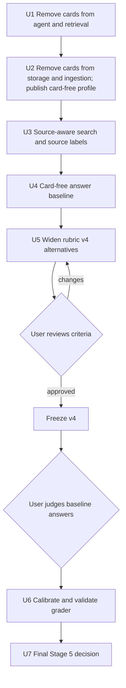

# Remove Evidence Cards and Finish the Answer Gate - Plan

## Goal Capsule

- **Objective:** Remove evidence cards from the system, then finish the Stage 5 answer gate on chunk retrieval alone: a reviewed card-free answer baseline, a frozen scoring rubric, a grader whose agreement with the user is measured, and a recorded pass or fail.
- **Authority:** This plan is the only execution plan for this work. It replaces `docs/plans/2026-10-01-1213-complete-answer-quality-plan.md`, which is closed. `FOUNDATION.md` owns project progress. Captured source revisions own factual truth.
- **Execution profile:** Six checked local source files, structural/raw chunks, 83 Perplexity vectors, hybrid search, the answer harness with prompt `answer_agent_v11`, and GPT-5 mini at medium reasoning on its pinned private route.
- **Stop conditions:** Stop and ask the user when a step needs a hosted schema change, when a source hash no longer matches, when rubric criteria need a product judgment, when an answer cites a passage the agent did not read, or when the card-free baseline covers fewer essential points on Q1, Q3, or Q8 than the recorded with-card runs in `.local/stage5-u9-decision.json`.
- **Tail ownership:** Private source text, answers, receipts, and review data stay under ignored `.local/`. Reconcile `FOUNDATION.md`, `SYSTEM.md`, `INGESTION.md`, `RETRIEVAL.md`, `DATA.md`, `README.md`, `AGENTS.md`, and `evals/README.md` as each unit lands.

---

## Product Contract

### Summary

Delete everything that creates, stores, searches, shows, or evaluates evidence cards. Make search find a source by its title, people, and tags. Then prove answer quality without cards: rerun the eight pilot questions, finalize the scoring rules with the user, validate the automatic grader against the user's judgments, and record the final Stage 5 decision.

### Problem Frame

The answer agent works. It runs a first search with the question, reads whole chunks, and cites the exact passages it read. The user judged its answers very good; those answers were produced with cards shown.

Evidence cards do not earn their place. A card is a one-sentence restatement of a passage that is already in an embedded chunk. In a repeated test, cards changed nothing on five narrow questions and raised cost per question by about 70%. On the three broad questions the agent read more chunks with cards and covered somewhat more essential points; the gap was largest on Q8, which also failed to complete twice without cards. Two attempts to enrich cards (the rejected `v8` and `v9` candidates, not the selected `v5` cards) produced factual errors in about 5% of cards. Published research found little support for sentence-level or LLM-written index layers when chunk retrieval is already strong.

Search cannot find a source by name. It matches only chunk text, and a book's highlights do not contain their author's name. For the question about Luca Ferrari and Derek Sivers, the first search returned 20 chunks from one interview and none from the Sivers book. The agent then spent its turns searching again, and the harness refused each repeat while still counting it.

Three things remain open from the closed plan: the scoring rubric (v4) is a draft, the grader has never been checked against human judgment, and the Stage 5 gate has no recorded decision.

### Current State

| Area | State |
| --- | --- |
| Answer harness | Prompt `answer_agent_v11`, action schema v2. Host search before the first model turn, one candidate per chunk, whole-chunk reads with span-level citations, repeated-query rejection, finish check against unread chunks of sources already used. |
| Cards in the running system | 510 `evidence_cards_v5` cards are in the published local profile and shown beside candidate chunks. Card code spans ingestion, storage, retrieval, the agent, and evaluation. |
| Answers | With cards, all eight pilot questions complete. Without cards, Q8 ran out of calls in 2 of 4 attempts. In both, no search returned the Sivers book until late, so turns went to repeated searches and then to refused finishes. All eight questions are answerable; Q8 is partially answerable because one author's source does not cover hiring. |
| Source metadata | Ingestion already reads `title`, `author`, `tags`, and every other header key from each file and stores them with the run. Search does not use them. The agent sees a file path, not a title or author. |
| Known answer gaps | Q1 omits centralized talent decisions and the no-variable-pay practice. Q3 omits testing wording in person. Q1 and Q8 sometimes end with an offer of further help or a gaps paragraph. |
| Rubric | v3 is frozen, with 21 preserved human judgments tied to earlier answers. v4 is a draft: 91 checks, 59 of them bound to source passages, 70 passage alternatives in total. |
| Grader | `evals/answer_grader.py` validates excerpts, citations, and inspected text. It has no human calibration and no held-out validation. |
| Integration tests | The seven tests that need a disposable database have never been run. |
| Spend | Stage 4: $1.664654 of $3.50. Stage 5: $7.664189. Cumulative: $9.328843. The ledger is `.local/stage5-budget.json`. Its reservation ceilings were raised on 2026-10-02 from $8 and $10 to $9 for Stage 5 and $11 cumulative. Each run reserves $1.00 before it starts, so the Stage 5 ceiling must be raised again before U4. |

### Requirements

**Card removal**

- R1. Ingestion generates no evidence cards and has no card check pass.
- R2. Storage loads no cards and no profile requires them. Retrieval has no card search and no card lookup. A source read is allowed only inside a chunk's own spans.
- R3. The answer agent has no card action, shows no card facts, and has no card switch.
- R4. Card prompts, card evaluation code, and card tests are deleted. No module imports a card type.
- R5. Existing captured runs whose manifests list card artifacts still load and publish. Their card artifacts are ignored.
- R6. The six-file local profile is published without a card requirement and its search and read proof passes.
- R7. The hosted schema does not change. The hosted `knowledge.cards` table stays in place, empty and unused.

**Source-aware search**

- R20. Search matches a query against each file's source label: its title, its people (`author` and `guest`), and its tags. Matching ignores case.
- R21. When a query names a source, the best chunks of that source for the query are guaranteed a place in the results. This applies to the host's first search and to every search the model runs.
- R22. Source labels are read from the metadata already stored with each run. Chunk text and embeddings do not change, and the hosted schema does not change.
- R23. Each candidate shown to the agent carries its source's title and people instead of a file path.
- R24. Ingestion reads a `guest` header field for interviews, and reports files that have no title or no author.
- R25. The six pilot source files are not edited during this plan. Editing a file changes its hash and invalidates the retrieval labels and rubric passages bound to it.

**Answer baseline**

- R8. The eight pilot questions are run on chunk retrieval alone, five runs per question, with prompt, model, limits, source revisions, and spend recorded. Report the mean and the worst of five.
- R9. Q8 completes in every run. The fix is source-aware search (R20, R21). No new rule that refuses a model action is added. If Q8 still fails after that change, work stops and the traces go to the user.
- R10. Every cited passage is one the agent read. This check stays enforced in code.
- R11. An answer does not end with an offer of further help or a question to the user. This is handled in prompt wording only.
- R26. A finish marked complete that also lists a gap is recorded as partial, not refused. The repeated-query refusal is removed if it no longer fires in the baseline runs.

**Rubric**

- R12. Rubric v3 and the 21 submitted human judgments stay unchanged. No historical judgment is relabeled as v4.
- R13. Each source-bound v4 check lists every passage in the six sources that supports it, verified against the checked source hashes.
- R14. Three points are not required: Q1's centralized talent decisions, Q1's no-variable-pay practice, and Q3's testing of wording in person. They stay in the rubric as optional points and never count against an answer.
- R15. The user reviews the remaining v4 criteria before v4 is frozen.

**Grader and gate**

- R16. The user judges one baseline answer per question against the frozen v4 checks: the first completed run of each question, fixed before the review. Blank or ambiguous entries stay unreviewed.
- R17. The grader is calibrated on some questions and checked on others. No question appears in both sets. Invalid, truncated, or unreviewed grades never count as passes. The grader counts as validated only if it gives zero false passes on grounding and example checks across the held-out questions; any other result is recorded as measured, not validated. Grader output supports the Stage 5 decision and never decides it.
- R18. Stage 5 passes only when the local answer path and its provenance checks work, the user judges the pilot answers useful, no known material grounding failure remains, and each question's judged answer covers at least 70% of that question's required points by the user's judgment against frozen v4.
- R19. Every live model call is recorded in the spend ledger with its measured cost.

### Scope Boundaries

- No hosted schema migration and no hosted data load.
- No replacement for cards. Nothing new sits beside chunk retrieval in this plan.
- Chunk context and summary behavior, chunks, embeddings, and source snapshots are unchanged. U2 edits shared files only to remove card code.
- Historical answer prompts `prompts/answer_agent_v1.md` through `v11.md` stay as the record that earlier receipts point to.
- Adding `guest` to the two pilot interviews waits until this plan is finished (R25). Their titles already contain the guests' names, so they are found by title.
- Topic tags and connections between sources by theme are not part of source-aware search.
- Private card artifacts and receipts under `.local/` are kept. Card rows already in the local database are left in place, unused.

#### Deferred to Follow-Up Work

These are recorded in `FOUNDATION.md` under "What should complement chunk retrieval (later work)":

- Memory across turns in a conversation.
- Connections across sources.
- Questions about the whole vault, such as recurring themes and "find all".
- A larger evaluation set that matches real use: more files, whole books, follow-up chains.

### Acceptance Examples

- AE1. A captured run whose manifest lists a ready card artifact is loaded and published; no card row is written and no error is raised. Covers R5.
- AE2. A model action named `search_cards` is rejected as an unknown action and no search runs. Covers R3.
- AE3. Q8 is run five times in a row without cards and returns a cited answer drawing on both authors each time. Covers R9.
- AE7. The first search for a question naming Luca Ferrari and Derek Sivers returns chunks from both sources before the model takes a turn. Covers R20, R21.
- AE4. An answer makes a required point and cites a passage different from the one first listed for that check; the check counts as evidenced because the cited passage is among its alternatives. Covers R13.
- AE5. A grade marked covered has a valid answer excerpt and a cited passage the agent read; a passage the agent did not read cannot support it. Covers R17.
- AE6. A v3 judgment keeps its original answer identity and fingerprint after v4 is frozen. Covers R12.

---

## Planning Contract

### Key Technical Decisions

- KTD1. **Remove evidence cards entirely.** Delete generation, loading, search, agent display, evaluation code, prompts, and tests. (session-settled: user-directed — chosen over redesigning cards as fewer self-contained sentences: a card restates text already in an embedded chunk, the measured gain was modest, and the cost was about 70% higher.)
- KTD2. **Leave the hosted `knowledge.cards` table in place.** No migration is written. (session-settled: user-directed — chosen over dropping it with a new migration: a production schema change for no functional gain.)
- KTD3. **Close the old plan and execute from this one.** The old file already carries a closed notice and a pointer here. (session-settled: user-directed — chosen over continuing to patch the old plan: its unit order, starting point, and references were stale.)
- KTD4. **Park the retrieval complement.** Memory across turns, cross-source connections, and vault-wide questions wait for a later plan. (session-settled: user-directed — chosen over building an outline tool or a theme layer now: this plan must be finished first.)
- KTD5. **Spend is tracked, not capped.** Record measured cost for every live call. Raise a reservation ceiling in the ledger when a reservation would not fit, and record the raise. (session-settled: user-directed — chosen over holding to the earlier $8 and $10 ceilings: the user stated budget is not a constraint.)
- KTD6. **Ignore card artifacts in old run manifests; do not rewrite the manifests.** The loader skips records of kind `cards`. Rewriting six captured runs would change immutable run identity for no benefit.
- KTD7. **New action schema version 3 and prompt `answer_agent_v12`.** Version 3 is version 2 without `search_cards`. A versioned contract is replaced, not edited, so earlier receipts keep meaning what they recorded. Need tracking, the open-needs finish correction, and unresolved-need gaps, which the harness applies to version 2 today, apply to version 3.
- KTD8. **Publish a new card-free profile from the runs already loaded.** Profiles are immutable once created, and the current one requires card artifacts. Use the storage command line (`python -m app.storage.cli` with `create-profile`, `publish`, `select-profile`), not `app.ingestion.live_run`, which needs live routes and a billable embedding call. The new profile reuses the same chunks and vectors, so these steps make no model calls and no run is reloaded.
- KTD9. **Fix Q8 at its cause: search cannot find a source by name.** The receipts `.local/stage5-u9-without-cards/Q8/attempt-1.json` and `attempt-2.json` show the host search returning 20 chunks from one interview and the query "Derek Sivers hiring" returning none from the Sivers book. Refused actions then used the remaining turns. Add source-aware search; add no refusal rules.
- KTD14. **Source labels come from the file header, with an explicit `guest` field for interviews.** (session-settled: user-directed — chosen over deriving the guest from speaker labels in the transcript: one of the two pilot transcripts has no speaker labels, so deriving would fail silently.) The user maintains `title`, `author`, `guest`, and `tags` in the notes.
- KTD15. **Show the source's title and people on each candidate.** (session-settled: user-directed — chosen over the file path shown today: the agent must be able to tell whose material a chunk is.)
- KTD16. **Match labels at query time; do not copy them into chunks.** Labels are stored once per file and looked up through the chunk's run. Writing them into chunk text before embedding was tested earlier as contextual embedding and did not improve recall, and it would force re-embedding whenever a header changes. If label lookup becomes slow at many thousands of files, an index is a later schema change.
- KTD17. **Source matching lives inside the search step.** It is not a new agent action and not a prompt instruction, so it runs every time, for the host's first search and for model searches alike.
- KTD10. **The user's v4 judgments on the baseline answers are the grader's reference data.** The 21 older judgments belong to v3 and to earlier answers, so they cannot calibrate v4. This puts the user's review before grader calibration.
- KTD12. **Three points are optional.** Q1's centralized talent decisions and no-variable-pay practice and Q3's in-person wording test do not count as required. (session-settled: user-directed — chosen over keeping them required: the product is a conversation with follow-ups, so one answer need not be exhaustive.) The decision was made before the card-free baseline was run.
- KTD13. **The gate requires 70% of required points, not all of them.** (session-settled: user-directed — chosen over requiring every required point, which the user judged too harsh, and over requiring none.) The plan applies it per question, on the answer the user judges; the per-question reading is this plan's interpretation of the user's figure.
- KTD11. **Score coverage against labels, not model-judged pairwise comparisons.** Published re-evaluations found pairwise model judging biased by position and length (`docs/research/2026-10-02-retrieval-complement-research.md`, case 5).

### High-Level Technical Design

The two diamonds are the points where work waits for the user.

### Assumptions

- The local Supabase container that holds the published six-file profile is available, and empty throwaway databases can be created on it for the integration tests.
- Five runs per question are enough to see run-to-run variation for the baseline, following the research note's advice that three is too few.
- The eight pilot questions split five for grader calibration and three held out. U6 picks the split before any grading.

### Risks and Dependencies

- Removing cards may lower coverage on broad questions (Q1, Q3, Q8), as the card-value test showed. U4 measures this against the recorded with-card runs, and a clear loss is a stop condition.
- The integration tests have never run. They may expose failures unrelated to cards, and `set role knowledge_runtime` may need a login with that role membership. Record unrelated failures and ask the user before widening U2.
- Source matching could pull in a file that the query names only in passing, or match common words in a long title. U3's tests cover both, and U4 reruns all eight questions after the change.
- Header fields are typed by hand. A name spelled two ways is two people. The missing-field report in U3 covers absent fields, not inconsistent spelling.
- Card code is imported across ingestion, storage, and evaluation. Removal order matters: the agent and retrieval first, then storage, then ingestion, so each step leaves a passing suite.
- Grader validation on three held-out questions is a small sample. Report counts, not percentages, and do not generalize beyond the pilot.

### Open Questions

- Deferred to implementation: whether `cards` stays an allowed value of a profile's required artifact kinds so the old profile row still validates, and whether a fresh load writes an artifact row for a skipped card record.

---

## Implementation Units

### U1. Remove cards from the agent and retrieval

**Goal:** The agent and the retrieval layer have no card concept.

**Requirements:** R2, R3, R10; KTD1, KTD7.

**Dependencies:** None.

**Files:** `app/agent/harness.py`, `app/agent/actions.py`, `app/agent/cli.py`, `app/agent/records.py`, `app/storage/retrieval.py`, `app/storage/records.py`, `prompts/answer_agent_v12.md`, `evals/answer_trial.py`, `evals/retrieval_trial.py`, `tests/agent/test_harness.py`, `tests/agent/test_actions.py`, `tests/agent/test_cli.py`, `tests/agent/test_cli_integration.py`, `tests/storage/test_retrieval.py`, `tests/storage/test_stage3_integration.py`, `tests/evals/test_retrieval_trial.py`, `tests/evals/test_answer_trial.py`, `RETRIEVAL.md`.

**Approach:** In the harness, delete the card action branch, card facts on candidates, the card-chunk conversion, the card-search budget, and the `use_cards` switch. Candidates keep `id`, `path`, `rank`, and `preview`. Add action schema version 3 without `search_cards`, require it for new runs, remove `search_cards` from the accepted action names for every version, and move the harness's version-2 need-tracking checks to version 3. Write `answer_agent_v12` from v11 with the card wording removed. In retrieval, delete card search, the chunk-cards lookup, the `CardHit` record, and the card allowance in `read_passage`. Remove the `--no-cards` flag, the `cards` receipt field, the `cards` config key in the trial runner, and the card probes in the retrieval trial. In `tests/storage/test_stage3_integration.py`, remove the `search_cards` import and the card-search test now; that module is imported by the agent integration test, so leaving it breaks both suites.

**Patterns to follow:** The existing versioned prompt and schema handling in `app/agent/harness.py` and `app/agent/actions.py`.

**Test scenarios:**

- Covers AE2. A `search_cards` action is rejected as invalid and the retriever is not called.
- A version-2 action is rejected for a new run; a version-3 search, find, read, and finish sequence completes with a cited answer.
- A version-3 finish with an open need gets the one correction rejection, and a need resolved with an unread passage is rejected.
- Candidates sent to the model contain no `facts` key.
- `read_passage` rejects a range outside the chunk's source spans, including a range that an old card span would have allowed.
- A whole-chunk read still registers every span and continuation with span-level citation IDs.
- The finish check against unread chunks of sources already used still fires and still accepts a repeat finish without new reading.

**Verification:** The agent, storage, and eval suites pass, with and without a disposable database. No file under `app/agent/` or `app/storage/retrieval.py` mentions cards.

### U2. Remove cards from storage and ingestion, and publish a card-free profile

**Goal:** No code creates or loads cards, and the local profile no longer requires them.

**Requirements:** R1, R2, R4, R5, R6, R7; KTD1, KTD2, KTD6, KTD8.

**Dependencies:** U1.

**Files:** `app/ingestion/enrichment.py`, `app/ingestion/contracts.py`, `app/ingestion/live_run.py`, `app/storage/loader.py`, `app/storage/local_viewer.py`, `evals/compare_generation.py`, `evals/answer_rubric.py`, `tests/evals/test_answer_rubric.py`, `tests/ingestion/test_enrichment.py`, `tests/ingestion/test_live_run.py`, `tests/ingestion/test_contracts.py`, `tests/storage/test_stage3_integration.py`. Delete: `evals/card_field_audit.py`, `evals/card_value.py`, `evals/card_field_guidelines_v1.md`, `tests/evals/test_card_field_audit.py`, `tests/evals/test_card_value.py`, `prompts/evidence_cards_v1.md` through `prompts/evidence_cards_v9.md`, `prompts/evidence_card_check_v1.md`. Docs: `SYSTEM.md`, `INGESTION.md`, `DATA.md`, `README.md`, `evals/README.md`.

**Approach:** Delete card extraction, the check pass, the card schema, and the `EvidenceCard` contract. Keep chunk context generation. In the live run, drop the cards model, the card step, the card cost estimate, and the card requirement on the profile. In the loader, skip manifest records of kind `cards` and stop inserting card rows. Remove the card page from the local viewer. In `evals/compare_generation.py`, keep the summary comparison and remove the card paths. Before deleting `evals/card_value.py`, move its `evidence_hits` function and test into `evals/answer_rubric.py` and `tests/evals/test_answer_rubric.py`; it has no card dependency and U5 needs it. Publish a new card-free profile with the storage command line as KTD8 describes and select it. Run the seven disposable-database tests; each suite invocation needs a freshly created empty database, because both suites apply the full migration, and the test database must never be the one holding the published profile.

**Execution note:** Creating, publishing, and selecting the profile must make no model calls. The search proof afterwards makes one billable query-embedding request; record it in the ledger.

**Test scenarios:**

- Covers AE1. Loading a run whose manifest has a ready card artifact succeeds and writes no card rows.
- A profile with no required artifact kinds publishes and becomes selectable; a run with no card artifact publishes under it.
- The live-run estimate and command line no longer take a cards model or card prompt version.
- Chunk context generation and summary generation behave as before.
- The integration fixture loads, publishes, searches by vector and full text, and resolves returned spans to captured bytes, with no card fixture.

**Verification:** All suites pass, including the seven tests that need a disposable database. A repository search for card types, card prompts, and card tables finds matches only in plans, the research note, the migration file, historical answer prompts, the loader's skip of `cards` manifest records with its test fixture, and the later-work section of `FOUNDATION.md`. The new profile is selected and a live retrieval trial reports the same recall as before: 41/44/47 of 51 at K=5/10/20 for vector search.

### U3. Make search source-aware and label candidates by source

**Goal:** A query that names a person, a title, or a tag finds that source, and the agent sees whose material each chunk is.

**Requirements:** R20, R21, R22, R23, R24, R25; KTD9, KTD14, KTD15, KTD16, KTD17.

**Dependencies:** U2.

**Files:** `app/storage/search.py`, `app/storage/retrieval.py`, `app/storage/records.py`, `app/agent/harness.py`, `app/ingestion/contracts.py`, `app/ingestion/markdown_parser.py`, `app/ingestion/transcript_parser.py`, `app/ingestion/preview.py`, `tests/storage/test_retrieval.py`, `tests/storage/test_stage3_integration.py`, `tests/agent/test_harness.py`, `tests/ingestion/test_markdown_parser.py`, `tests/ingestion/test_transcript_parser.py`, `README.md`, `INGESTION.md`, `RETRIEVAL.md`, `DATA.md`.

**Approach:** Build each file's source label from the metadata stored with its run: title (file name when absent), people from `author` and `guest`, and tags. A query names a source when two or more consecutive query words appear together in a label, ignoring phrases made only of common words, or when a single query word equals a person's surname or a tag. For each named source, at most three, run the existing vector and full-text search restricted to that file and guarantee its best five chunks a place in the fused results. Carry the title and people on each search hit and show them on the agent's candidates in place of the path. In ingestion, read `guest` into the document metadata and print the files that lack a title or an author.

**Patterns to follow:** `find_in_document` in `app/storage/retrieval.py` for searching within one published document revision; `fuse_hits` for merging ranked lists.

**Test scenarios:**

- A query containing "Derek Sivers" returns chunks from the file whose author is Derek Sivers, although no chunk text contains that name.
- A query containing a guest's name returns chunks from the interview whose `guest` field names that person.
- A query containing a file's full title returns chunks from that file; a query sharing only common words with a long title, such as "how to", does not trigger a source match.
- A query naming two sources returns chunks from both; a query naming no source returns the same results as before.
- A name matches regardless of letter case.
- A file with no title uses its file name; a file with no author is listed in the ingestion report and still ingests.
- A candidate shown to the agent carries the title and people and no file path.
- Covers AE7. The host's first search for Q8's question returns at least one chunk from the Bending Spoons interview and one from the Sivers book.

**Verification:** The suites pass, including the integration tests. The live retrieval trial still reports vector recall 41/44/47 of 51. The first search for Q8 returns chunks from both named sources. No migration file is added.

### U4. Establish the card-free answer baseline

**Goal:** A reviewed set of answers produced without cards, with Q8 stable.

**Requirements:** R8, R9, R10, R11, R19, R26; KTD5, KTD9.

**Dependencies:** U3.

**Files:** `app/agent/harness.py`, `prompts/answer_agent_v12.md`, `tests/agent/test_harness.py`, `evals/answer_trial.py` only if the runner needs a repeat-run option, `tests/evals/test_answer_trial.py`, `RETRIEVAL.md`; private receipts under `.local/`.

**Approach:** Raise the Stage 5 reservation ceiling in the ledger and record the raise. Tighten the closing-sentence rule in `answer_agent_v12`. Record a complete finish that lists a gap as partial instead of refusing it. Run Q8 five times first. If any run fails, stop and take the traces to the user; add no refusal rule. Then run the other seven questions five times each; the trial runner records one attempt per question per directory, so use one directory per round or add a repeat option. For each run record chunks read, model calls, refused actions, completion, and measured cost. Remove the repeated-query refusal if it fired in none of the 40 runs. Review each question's answers against rubric v3's essential points, compare Q1, Q3, and Q8 with the recorded with-card runs, and note what is missing.

**Test scenarios:**

- A finish marked complete that lists a gap is accepted and recorded as partial, with the gap kept.
- A finish citing a passage the agent did not read is still refused.
- The count of refused actions per run appears in the run's receipt.

**Verification:** Covers AE3. Every question completes 5 of 5 runs. A private report lists, per question, the runs, chunks read, cost, the mean and worst-of-five coverage of v3's essential points, the comparison with the with-card runs for Q1, Q3, and Q8, and the known gaps for Q1 and Q3.

### U5. Widen rubric v4, review it with the user, and freeze it

**Goal:** Frozen scoring rules that accept every passage supporting a point.

**Requirements:** R12, R13, R14, R15; KTD10.

**Dependencies:** U4.

**Files:** `evals/answer_questions_v4.yaml`, `evals/answer_rubric.py`, `tests/evals/test_answer_rubric.py`, `evals/README.md`; private review material under `.local/`.

**Approach:** For each of the 59 source-bound checks, search the six captured sources for every passage that supports the criterion and add each as an evidence alternative with exact offsets. Verify every alternative against the checked source hashes. Use the passages cited in U4's answers as leads: where an answer made a point and cited a passage the rubric does not list, check whether that passage supports the point. Mark the three points in R14 as optional. Present the remaining criteria to the user. Apply the user's changes, set every question to approved, and freeze v4.

**Test scenarios:**

- Covers AE4. A check with several alternatives counts as evidenced when any one of them overlaps a cited passage of the same source revision, using the `evidence_hits` function moved in U2.
- An alternative whose offsets fall outside its source, or whose source hash has changed, fails validation.
- Covers AE6. The v3 fingerprint is unchanged after v4 is frozen, and a v3 report cannot be scored as v4.
- An answer that omits all three optional points in R14 loses nothing on required-point coverage.
- A rubric marked frozen with any question still pending is rejected.

**Verification:** v4 is frozen with every question approved by the user. Every source-bound check has at least one verified alternative, and the count of alternatives per check is reported. The three optional points in R14 are marked optional in the rubric.

### U6. Calibrate and validate the grader

**Goal:** An automatic grader whose agreement with the user is measured.

**Requirements:** R16, R17, R19; KTD10, KTD11.

**Dependencies:** U5, and the user's judgments of the U4 baseline answers against frozen v4.

**Files:** `evals/answer_grader.py`, `evals/answer_trial.py`, `prompts/answer_grader_v1.md`, `tests/evals/test_answer_grader.py`, `tests/evals/test_answer_trial.py`, `evals/README.md`; private judgments and reports under `.local/`.

**Approach:** Extend `review_template` and `summarize_review` in `evals/answer_trial.py`, which accept only rubric version 3 today, to version 4. Generate a minimal local review page under `.local/` from that template so the user can judge one baseline answer per question against the frozen checks; store the submitted judgments with the answer identity and a checksum. Add a command-line entry for the grader, which has none. Fix the calibration and held-out split before grading. Run the grader on the calibration questions and on fault-injected copies: an invented example, a citation that is on topic but does not support the claim, and a required point removed. Adjust the grader prompt on calibration data only. Freeze the grader prompt, model, route, and rubric identity, then run it once on the held-out questions and compare with the user's judgments.

**Test scenarios:**

- Covers AE5. A covered grade needs a valid answer excerpt and an inspected passage; a listed alternative the agent did not read does not count as grounding.
- Truncated, malformed, or injected grader output stays ungraded and is not counted as a pass.
- A held-out question that appears in the calibration set makes the validation invalid.
- A fault-injected answer with an invented example is graded as failing the example check.
- A changed rubric fingerprint or grader prompt hash after the freeze invalidates the held-out result.

**Verification:** A report gives, per dimension, the number of checks where the grader and the user agree, false passes, misses, and unreviewed items, for calibration and held-out questions separately. It states whether the grader is validated or only measured under R17. Every critical false pass on grounding or examples is resolved or listed as a known limit.

### U7. Record the final Stage 5 decision

**Goal:** A recorded pass or fail for Stage 5, with docs matching the system.

**Requirements:** R18, R19.

**Dependencies:** U6.

**Files:** `FOUNDATION.md`, `SYSTEM.md`, `RETRIEVAL.md`, `INGESTION.md`, `DATA.md`, `AGENTS.md`, `evals/README.md`; private decision report under `.local/`.

**Approach:** Collect the user's usefulness judgment for each pilot question. From the user's v4 judgments, compute for each question the share of required points its judged answer covers. Apply the rule in R18. Record what passed, what failed, and what was not run, with spend totals. Update the progress table and the detail docs to the final state, including the removal of cards from every diagram and description.

**Test expectation:** none -- this unit records a decision and updates documentation.

**Verification:** The decision report names each question's usefulness judgment, its required-point coverage against the 70% bar, any remaining grounding failure, and the totals from the spend ledger. `FOUNDATION.md` shows Stage 5's state and next proof. No doc describes cards as part of the running system.

---

## Verification Contract

| Gate | Command or check | Applies to |
| --- | --- | --- |
| Unit suites | `python -m unittest discover -s tests/<area> -p 'test_*.py'` for `agent`, `storage`, `evals`, `models`, `ingestion` | Every unit |
| Integration tests | The storage and agent suites with `KNOWLEDGE_TEST_DATABASE_URL` set to a freshly created empty database for each suite invocation, never the profile database | U1, U2 |
| Card-free search proof | `python -m evals.retrieval_trial --live --provider-tag perplexity/int8 --max-usd 0.01 --report <new .local file>` against the selected profile; vector recall 41/44/47 of 51 | U2 |
| Source-aware search | The live retrieval trial, plus the first search for Q8 returning both named sources | U3 |
| Live answers | `python -m evals.answer_trial run <config> <new .local dir> --live` with GPT-5 mini medium, broad profile | U4 |
| Rubric integrity | `tests/evals/test_answer_rubric.py`, plus offset and hash verification of every alternative | U5 |
| Grader validation | Held-out agreement report from U6 | U6 |
| Spend | Every live call present in `.local/stage5-budget.json` with measured cost | U2, U3, U4, U6 |

Live calls need `OPENROUTER_API_KEY` and `KNOWLEDGE_DATABASE_URL`. Reports must be new files under `.local/`.

---

## Definition of Done

- U1 and U2: no code path creates, loads, searches, or shows cards; all suites pass, including the disposable-database tests; the card-free profile is selected; the hosted schema is unchanged.
- U3: a query naming a person, title, or tag returns that source's chunks; candidates show title and people; no schema change.
- U4: the eight questions have card-free receipts; each completes 5 of 5; the review against v3's essential points and the comparison with the with-card runs are recorded.
- U5: rubric v4 is frozen with the user's approval and every source-bound check lists its verified alternatives.
- U6: the grader's agreement with the user is reported on held-out questions, labelled validated or measured, with critical false passes resolved or listed.
- U7: the Stage 5 decision is recorded and the docs describe the system as it is.
- No rule that refuses a model action was added during this plan.
- Experimental code from abandoned attempts is removed from the diff. Private receipts stay under `.local/`.

---

## Sources and Research

- `docs/plans/2026-10-01-1213-complete-answer-quality-plan.md` is the closed predecessor. Its execution outcomes table records the earlier answer checks, the rejected card candidates, and the card-value test.
- `docs/research/2026-10-02-retrieval-complement-research.md` records the published evidence on sentence-level indexes, graph layers, long-context reading, and biased pairwise judging.
- `.local/stage5-u9-decision.json` holds the card-value test result. `.local/stage5-u9-without-cards/` holds the card-free receipts, including the two failed Q8 attempts.
- `app/agent/harness.py`, `app/storage/retrieval.py`, `app/storage/loader.py`, `app/ingestion/enrichment.py`, and `app/ingestion/live_run.py` are where card code lives today.
- `evals/answer_rubric.py` already supports several evidence alternatives per check; `evals/answer_grader.py` holds the grader core.
